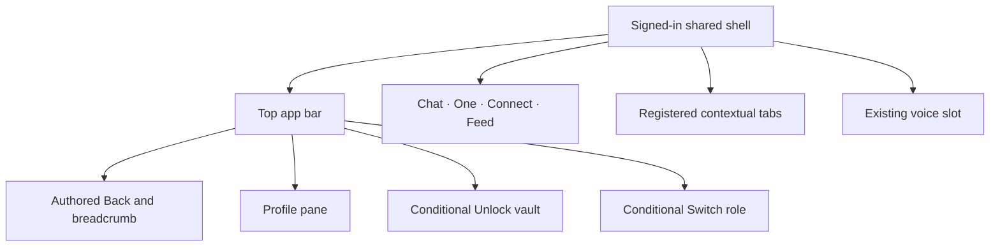

# Shared Navigation UI Contract

Status: current product and UI reference, checked against source revision
`fd22c14a9` on 20 October 2026. Owner: frontend architecture. Classification:
`canonical`, package-local. This is the shared shell entry/CTA inventory for
Profile, Feed, and their neighboring routes. See [Typography](./typography.md)
for the font role of each control.

## Visual Map

## Controls, destinations, and guards

| Surface / CTA | Current effect |
| --- | --- |
| Chat | Canonical `/` route. |
| One | `/one`. |
| Connect | `/one/connect`. |
| Feed | `/one/feed`. Attention dot when pending requests or unread Feed activity is positive. |
| Open Profile | Rightmost signed-in top-bar action. Opens Profile pane over current route, retaining opener for focus restoration. Signed-in photo/generic fallback; 32px image within 44px control. |
| Back | Resolves overlay, active feature layer, then authored route parent. Shell, iOS edge gesture and Android Back share the same hierarchy. |
| Breadcrumb parent | Clickable authored ancestor; final current label is noninteractive. |
| Unlock vault | Offered when signed in, a vault exists, and it is locked. Opens existing unlock owner; no new credential flow. |
| Switch role | Only persona-switch routes; Investor / Advisor or Set up Advisor. Busy switching disables menu choices. |
| Onboarding Account actions | Replaces the ordinary Profile cluster. Sign out, or Delete account → Cancel/Delete account confirmation. |
| Voice slot | Existing shared voice owner, narrower than tab segments in the bottom surface. Its session/permission decisions retain the voice runtime contract. |
| App-wide Search | Disabled/archived; no current app-wide Search segment or palette launcher. Page-local search/filter controls remain with each feature. |

Sources: [bottom action resolver](../../lib/navigation/app-bottom-nav.ts),
[bottom renderer](../../components/navbar.tsx),
[top app bar](../../components/app-ui/top-app-bar.tsx),
[pane entry](../../lib/navigation/profile-pane.ts),
[route layout](../../lib/navigation/app-route-layout.contract.json), and
[voice runtime](../../../docs/reference/one/one-voice-runtime-architecture.md).

The four bottom items keep their order. A specialist does not append Finance
or RIA to that bar. Auth, route shell, onboarding, and explicit hide flags
control visibility. Native admission additionally considers unlocked vault,
negotiated appearance and session suppression. Modal/pane/privacy states
must isolate underlying DOM and native controls alike.

## Contextual tabs

Tabs use the central registry and owning route/query, not a second route-local
navigation authority. The registered rail belongs below the module heading
where that workspace owns it; the shell must not draw another copy.

| Workspace | Labels | State owner |
| --- | --- | --- |
| Connect | Connections / Circles | `tab`; [Connect contract](./connect.md). |
| Location | Now / People / Links | Existing `view` and Location route owner. |
| Finance | Market / Portfolio / Analysis | `/one/kai?tab=…` and generated Finance builders. |
| Consent Center | Requests / Active / History / Connections | Existing consent route-tab registry. |
| RIA | Profile / Clients / Picks | RIA route registry. |
| Public knowledge | Research / Blog / Developers | Public route registry. |
| Calendar / Wallet local sets | Owning controlled pager labels | Reuse the shared renderer; derive actual values from each workspace. |

Selecting a tab requests its authored route/state. Cells use equal-width
segments, responsive labels and truncation; this renderer does not own a
horizontal overflow scroller. Local pagers retain their owning state. Sources:
[top-tab registry](../../lib/navigation/top-shell-tabs.ts),
[tab renderer](../../components/app-ui/top-shell-tabs.tsx), and
[RIA tabs](../../lib/navigation/ria-route-tabs.ts).

## Interaction, native presentation, and verification

Use the shared shell action surface for icon/pill controls and preserve
focus, ripple and busy behavior. Its current icon/pill recipe is 36px high;
the Profile avatar is 44px and some control wrappers provide a larger target.
Do not infer a universal 44px target from the shared recipe. The preferred
touch-control contract remains 44px; source geometry must be checked for
each actual control. Route changes inherit the one
shared route transition. A nested editor registers its own Back cleanup;
raw browser history is not the application Back contract. Sources:
[shell controls](../../components/app-ui/shell-action-surface.tsx),
[Back layers](../../lib/navigation/back-layers.ts), and
[app-surface design system](../../../docs/reference/quality/app-surface-design-system.md).

An acknowledged supported iOS native bottom bar uses standard UIKit tabs
with the same four destinations. Unsupported wrappers, web and Android
retain DOM presentation. Native controls are not evidence that every native
candidate scene is admitted; negotiated capability and presentation policy
remain authoritative. UIKit labels use OS typography, whereas WebView text
uses the product family. See
[native navigation](../../lib/capacitor/native-navigation.ts) and
[native adoption](../ios-native-surface-adoption.md).

Nearest existing checks include
[bottom-nav behavior](../../__tests__/components/navbar-bottom-nav.test.tsx),
[pane navigation](../../__tests__/navigation/profile-pane.test.ts), and
[top](../../e2e/app-shell-top-clearance.layout.spec.ts) /
[bottom clearance](../../e2e/app-shell-bottom-clearance.layout.spec.ts) fixtures.
These are source/fixture evidence, not device permission or Dynamic Type
acceptance. This documentation change performs no navigation/runtime mutation.
