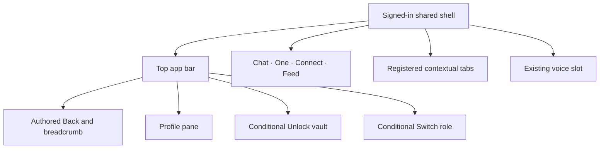

# Shared Navigation UI Contract

Status: current product and UI reference, checked against source revision
`3ff2620b48567177dce5c667e77a70203e4a8c35` on 20 October 2026. Owner: frontend architecture. Classification:
`canonical`, package-local. This is the shared shell entry/CTA inventory for
Profile, Feed, and their neighboring routes. See [Typography](./typography.md)
for the font role of each control.

## Visual Map

## Controls, destinations, and guards

| Surface / CTA | Current effect |
| --- | --- |
| Chat | Canonical `/` route. |
| One | `/one`. |
| Connect | `/one/connect`. |
| Feed | `/one/feed`. Attention dot when pending requests or unread Feed activity is positive. |
| Open Profile | Rightmost signed-in top-bar action. Opens Profile pane over current route, retaining opener for focus restoration. Signed-in photo/generic fallback; 32px image within 44px control. |
| Back | Resolves overlay, active feature layer, then authored route parent. Shell, iOS edge gesture and Android Back share the same hierarchy. |
| Breadcrumb parent | Clickable authored ancestor; final current label is noninteractive. |
| Unlock vault | Offered when signed in, a vault exists, and it is locked. Opens existing unlock owner; no new credential flow. |
| Switch role | Only persona-switch routes; Investor / Advisor or Set up Advisor. Busy switching disables menu choices. |
| Onboarding Account actions | Replaces the ordinary Profile cluster. Sign out, or Delete account → Cancel/Delete account confirmation. |
| Voice slot | Existing shared voice owner, narrower than tab segments in the bottom surface. Its session/permission decisions retain the voice runtime contract. |
| App-wide Search | Disabled/archived; no current app-wide Search segment or palette launcher. Page-local search/filter controls remain with each feature. |

Sources: [bottom action resolver](../../lib/navigation/app-bottom-nav.ts),
[bottom renderer](../../components/navbar.tsx),
[top app bar](../../components/app-ui/top-app-bar.tsx),
[pane entry](../../lib/navigation/profile-pane.ts),
[route layout](../../lib/navigation/app-route-layout.contract.json), and
[voice runtime](../../../docs/reference/one/one-voice-runtime-architecture.md).

The four bottom items keep their order. A specialist does not append Finance
or RIA to that bar. Auth, route shell, onboarding, and explicit hide flags
control visibility. Native admission additionally considers unlocked vault,
negotiated appearance and session suppression. Modal/pane/privacy states
must isolate underlying DOM and native controls alike.

## Contextual tabs

Tabs use the central registry and owning route/query, not a second route-local
navigation authority. The registered rail belongs below the module heading
where that workspace owns it; the shell must not draw another copy.

| Workspace | Labels | State owner |
| --- | --- | --- |
| Connect | Connections / Circles | `tab`; [Connect contract](./connect.md). |
| Location | Now / People / Links | Existing `view` and Location route owner. |
| Finance | Market / Portfolio / Analysis | `/one/kai?tab=…` and generated Finance builders. |
| Consent Center | Requests / Active / History / Connections | Existing consent route-tab registry. |
| RIA | Profile / Clients / Picks | RIA route registry. |
| Public knowledge | Research / Blog / Developers | Public route registry. |
| Calendar / Wallet local sets | Owning controlled pager labels | Reuse the shared renderer; derive actual values from each workspace. |

Selecting a tab requests its authored route/state. Cells use equal-width
segments, responsive labels and truncation; this renderer does not own a
horizontal overflow scroller. Local pagers retain their owning state. Sources:
[top-tab registry](../../lib/navigation/top-shell-tabs.ts),
[tab renderer](../../components/app-ui/top-shell-tabs.tsx), and
[RIA tabs](../../lib/navigation/ria-route-tabs.ts).

## Per-control source, wire and branch contract

A route request is not a consent/relationship/payment operation. Destination
components can perform their own work after navigation; idle prefetch can
fetch route assets before tapping. Current controls are owned by the linked
Navbar/top bar, [Back dispatcher](../../lib/navigation/top-shell-back.ts),
[persona context](../../lib/persona/persona-context.tsx),
[RIA service](../../lib/services/ria-service.ts),
[vault service](../../lib/services/vault-service.ts) and auth owner.

| Control/guard | Read/projection | Every action/negative boundary |
| --- | --- | --- |
| Chat / One / Connect / Feed | Always displayed keys chat/dashboard/connect/feed; current route+accepted intent select active | Resolve ordinary keys with scope `one`, contextual navigation `scroll:false` to `/`, `/one`, `/one/connect`, `/one/feed`; native same handler. No domain mutation. Same selected key suppresses selection haptic; still runs portfolio guards and dispatches canonical route, potentially clearing nested query. Prefetch can use current scope even though click resolves ordinary scope. |
| Portfolio saving | `busyOperations.portfolio_save` | Blocks tab navigation; `Saving to vault. Please wait until encryption completes.` No nav/API. |
| Portfolio unsaved review | `portfolio_review_active && portfolio_review_dirty` | Browser confirm `You have unsaved portfolio changes. Leaving now will discard them.` Negative stays; affirmative navigates, not a save. Browser owns button captions; do not invent Yes/No labels. |
| Feed dot | Positive pending-consent count **OR** positive unread count | Dot, not summed count. Tapping tab does not mark read; Feed owns acknowledgement. |
| Profile avatar | Effective current-owner cached identity photo, fallback Firebase photo | Local pane-open event source tap with opener/focus restoration; no save API. |
| Unlock vault | Signed in, known hasVault true, locked; unknown hides CTA | Existing unlock Dialog; Cancel stays locked. `Unlock vault` / `Unlock your vault to use secure memory and background activity.` |
| Role pill | Interactive center title only `/one/kai` family; active role | Local dropdown open/close no call. Eligible alternate role POST below; setup routes only. No role confirmation dialog. |
| Back | Overlay→deepest/newest matching feature→authored route parent | Escape through overlay; refused dismissal still consumes Back. Feature cancel/reset callbacks next; no raw history fallback. |
| Breadcrumb parent | Authored label/href; final item inert | Direct ancestor route/full transition/scrollfalse, distinct from Back unwind. No mutation. |
| Contextual tab | Central registry active/labels/hrefs | Disabled/current no-op; controlled pager local onValueChange, routed default replace or owning push. Finance resets scroll/bottom chrome. |
| Account actions | Onboarding chrome replaces ordinary Profile cluster | Menu open/close/outside/Escape no operation. Sign out/delete separate below. |

### Persona, attention and vault read models

`F` denotes current Firebase bearer. IAM web proxy forwards path/query/auth/
JSON through [IAM catchall](../../app/api/iam/[...path]/route.ts) to
[backend IAM](../../../consent-protocol/api/routes/iam.py) and RIAIAMService.
Persona GET hot30s/stale10min/timeout30s; force bypasses hot hit. Cached values
are current-owner hints, not permission authority.

| Read/action | Exact wire and fields | UI/persistence/recovery |
| --- | --- | --- |
| Role bootstrap | F GET `/api/iam/persona[?force=1]`→`user_id,personas,last_active_persona,active_persona,primary_nav_persona,ria_setup_available,ria_switch_available,investor_marketplace_opt_in,iam_schema_ready,mode` | Active=active_persona else last_active_persona else investor. IAM-not-ready disables capability; otherwise switch availability decides switch/setup. GET can ensure actor/vault rows and reconcile runtime persona; not blanket zero-write. Error retains cache, otherwise investor compatibility. No shell Retry. |
| Switch | F POST `/api/iam/persona/switch`, `{persona:"investor" or "ria"}`→full persona state | Invalidates dependent caches, writes returned session state; mutation sequence rejects older refresh. Investor route remembered lastKaiPath/finance root; Advisor remembered non-onboarding lastRiaPath/riaEntryRoute. Failure current role/spinner released, `Couldn't switch roles right now. Please retry.` |
| Setup Advisor | No switch POST | Routes RIA setup; labels `Investor`, `Advisor`, `Set up Advisor`, `Switching to Investor`, `Switching to Advisor`. Optional onboarding-status GET belongs to RIA owner. |
| Vault presence | Memory→session→bootstrap; cold F GET `/api/vault/check?userId=<uid>`→`{hasVault}` | [Web proxy](../../app/api/vault/check/route.ts) POSTs `/db/vault/check`, `{userId}`; backend owner match/read-only ensure_entryfalse. Cache60s/dedupe, retry timeout/5xx once. Native HushhVault.hasVault→exists. Error unknown; cached presence is not unlocked authority. |
| Pending dot | F GET `/api/consent/center/summary?mode=consents`; actor=ria only `/ria`+active RIA | `user_id,actor,mode,counts:{pending,active,previous}`; dot counts.pending. Hot30s/stale5min/timeout20s; mutation refresh bypasses stale hot state. Current-owner retained summary/error null initially. Eligibility-combined summary, not raw event count. |
| Unread dot | F GET `/api/one/feed/unread-count`, no query/body→`{unread_count}` | SHORT cache/invalidation epoch; failures retain last count. Starts null; successful missing field currently normalizes0. Shared Feed events/recounts can retire older fetches. Hook does not POST `/feed/read`. |

Attention owners: [pending hook](../../lib/consent/use-consent-pending-summary-count.ts),
[summary service](../../lib/services/consent-center-service.ts),
[summary proxy](../../app/api/consent/center/summary/route.ts),
[unread hook](../../lib/feed/use-feed-unread-count.ts),
[Feed service](../../lib/services/feed-service.ts). Root-chat deferred/foreground
chat guards avoid competing reads. Bootstrap can provision state; an eligible
badge read is not itself approval of information access.

### Onboarding account actions: preparation versus erasure

| Action/branch | Exact behavior/copy |
| --- | --- |
| Sign out | Existing auth owner tears down native/Firebase sessions then `/`; no confirm. Failure `Couldn't sign out. Please retry.` |
| Delete account preparation | `resolveDeleteAccountAuth`: existing token reused; existing vault without token unlocks; no-vault branch may issue token. This is not erasure. |
| Token preparation | F POST `/api/consent/vault-owner-token`, `{userId,renewalOfToken}`→`token,expiresAt,scope,renewalValidated?`; native existing HushhConsent bridge. Token issuance doesn't delete. |
| Unlock | `Unlock Vault to Delete Account` / `Unlock your Vault to confirm account deletion. This permanent action removes your saved Vault information.` Success retries preparation after300ms; Cancel no delete. |
| Confirmation | `Delete account?` / `Deletes your account, vault, memory, chats, and connections. This can’t be undone.` |
| Cancel | No verified erasure. Cancel/Delete buttons disabled busy, but root onOpenChange is not busy-guarded; universal dismissal blocking would be a false claim. |
| Delete account / Deleting... | Re-resolve authority→shared [verified deletion](../../lib/flows/delete-account.ts); exact erasure/deprovision/recovery in [Profile](./profile.md). |
| Feedback | `Failed to delete account. Please try again.`; `Deleting your account...`; `Account deleted.`; outcome-specific errors from shared owner. |

### Spatial axes, anchoring and layers

Coordinates are container-relative source rules. A centered control uses
`x=center of its authored slot−width/2`; content-dependent Y is not a fixed
screen coordinate. Portal collision may move a menu from preferred placement.

| Surface | Dimensions/anchor/scroll/layer |
| --- | --- |
| Role pill/menu |36high center-title anchor; dropdown aligncenter,min200/default offset4/collision handling; transient portal10100. |
| Onboarding menu |36×36/glyph20; end-aligned dropdown,radius14/p4; item radius10;10100. Opening doesn't call auth. |
| Top chrome |fixed top0/insetX0,z50; Unlock-visible z505. Old backdrop499 comment is not current layer authority. |
| Avatar |44target/image32; distinct from shared36high icon/pill recipe. |
| Breadcrumb |gap4; ancestor max144; chevron14; final inert. |
| Bottom |fixed z120 unlocked/505 locked; bottom `max(effectiveSafeBottom,10)+chromeLift`; shared width/slot AppBottomShell.4segments minimum44; labels10/13. |
| Contextual rail |36high,p2,equal flex cells/px12; local buttonsz10 above indicator. >3labels11→12≥360→14≥400→15≥640. No horizontal overflow scroller. |
| Native |Admitted native bar uses inert negotiated-height DOM spacer/same guards. Active blocking voice layer disables underlying native interaction. OS frames/typography are not web CSS. |
| Token ladder |Chrome118,feature700/701,Sheet711/712,boot790,Dialog800/801,takeover9000,system9999,transient10099/10100; explicit chrome tiers above still apply. |

## Interaction, native presentation, and verification

Use the shared shell action surface for icon/pill controls and preserve
focus, ripple and busy behavior. Its current icon/pill recipe is 36px high;
the Profile avatar is 44px and some control wrappers provide a larger target.
Do not infer a universal 44px target from the shared recipe. The preferred
touch-control contract remains 44px; source geometry must be checked for
each actual control. Route changes inherit the one
shared route transition. A nested editor registers its own Back cleanup;
raw browser history is not the application Back contract. Sources:
[shell controls](../../components/app-ui/shell-action-surface.tsx),
[Back layers](../../lib/navigation/back-layers.ts), and
[app-surface design system](../../../docs/reference/quality/app-surface-design-system.md).

An acknowledged supported iOS native bottom bar uses standard UIKit tabs
with the same four destinations. Unsupported wrappers, web and Android
retain DOM presentation. Native controls are not evidence that every native
candidate scene is admitted; negotiated capability and presentation policy
remain authoritative. UIKit labels use OS typography, whereas WebView text
uses the product family. See
[native navigation](../../lib/capacitor/native-navigation.ts) and
[native adoption](../ios-native-surface-adoption.md).

Nearest existing checks include
[bottom-nav behavior](../../__tests__/components/navbar-bottom-nav.test.tsx),
[pane navigation](../../__tests__/navigation/profile-pane.test.ts), and
[top](../../e2e/app-shell-top-clearance.layout.spec.ts) /
[bottom clearance](../../e2e/app-shell-bottom-clearance.layout.spec.ts) fixtures.
These are source/fixture evidence, not device permission or Dynamic Type
acceptance. This documentation change performs no navigation/runtime mutation.
