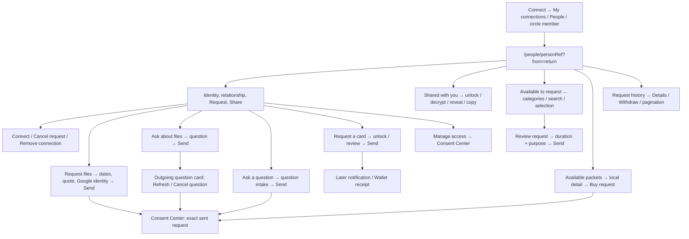

# Person Profile UI Contract

Status: current source-backed contract, updated for Profile v16 on 21 October
2026, based on `f64c890498dd4aa9bd1fe8bb3ac35c6445948f47`.
Owner: frontend design system and the existing consent/wallet feature owners.
Classification: `canonical`, package-local. This is **another person's profile**
opened from Connect or Messages, not the signed-in person's [Profile settings](./profile.md).

This contract covers the complete mounted profile, its local dialogs/sheets,
every immediate CTA, responsive geometry, typography, request submission,
success/recovery states, and explicit downstream handoffs. It describes
current behavior, including gaps; it does not propose a redesign.

## Visual Map



## Route, admission, and page order

Sources: [route](../../app/people/[personRef]/page.tsx),
[page](../../components/connections/person-profile-page.tsx),
[route builder](../../lib/navigation/routes.ts),
[Back owner](../../lib/navigation/back-navigation-graph.ts), and
[profile service](../../lib/services/person-profile-service.ts).

| Entry or state | Current contract |
| --- | --- |
| URL | `/people/<publicPersonRef>?from=<normalized internal return>`; a public person reference is required. The route initially mounts with no prefetched profile. |
| From Connect | A permitted identity row opens this shared route. The trailing connection/message controls belong to Connect, not this page. |
| From Messages | The conversation name/photo and received-message avatars open the loaded peer's existing profile directly through a Next client link. The conversation options menu retains Contact info and message search. Contact info reads the existing authorized viewer profile only for a current writable conversation and projects email/verified phone only for its connected relationship. Owner, selection, dialog close and connection-graph revisions retire old results; it does not perform a public identity or Firebase lookup. Links require the current owner/selection's admitted public person reference and have 44px minimum targets. `from=/one/messages` gives shell Back a Messages breadcrumb and returns through the existing owner-scoped conversation restoration; identifiers and route tokens are not added to the return URL. |
| Native iOS | Resolves the actual person reference from the pathname instead of the static-export placeholder. Other platforms use the route prop. This remains a web/WebView component. |
| Public identity | Memory-cached public identity paints immediately; a no-store read revalidates display name, photo, and optional verified role. Contact details and grants are not public profile fields. |
| Loading/unavailable | Centered minimum `50vh` loading region: “Loading profile…” then “This profile is unavailable.” on failure; **Try again** retries the public read. |
| Signed out | Identity, Share, “Connect through Hussh,” and **Sign in** → `/login`. This sign-in CTA adds no return query. |
| Signed in | Firebase ID-token viewer/history reads; vault unlock is independently required for encrypted information and particular request flows. |
| Viewer read fails | Public identity, Share, drafts, receipts and previously loaded catalog/history display remain with **Try again**. Protected shared values wait for current authority. An independent relationship read establishes action eligibility without waiting for the complete catalog/history; failed eligibility is not retained as current authority. |
| `?request=1` | Scrolls to Available to request after viewer state is ready. |
| `?section=shared` | Scrolls to Shared with you; opens existing vault unlock if locked. |
| Back | Shell Back uses normalized `from`. An entry without a trusted origin has no authored parent. Do not replace this with arbitrary browser history. |

Document order: **hero → Available packets (when enabled) → Shared with you →
Available to request → Request history → Review request**. The signed-out
sign-in prompt occupies the protected-content boundary. Top navigation,
Talk to One, and bottom tabs are shared shell chrome; their owners are in the
[navigation contract](./navigation.md). They are not part of the hero height.

## Viewport, zoom, and responsive sizing

All numbers below are **CSS pixels**, at the default 16px root size, with a
full-width route area. Browser zoom, device-pixel ratio, OS scaling, scrollbar
width, and an app containing pane can change the raster result. A screenshot
at 50% zoom cannot establish exact `innerWidth`, `innerHeight`, DPR, or safe
areas. At that zoom, a wider CSS viewport can activate desktop breakpoints.
An 824 CSS-pixel section may appear approximately 412 capture pixels wide
only when the capture scale otherwise equals one pixel per unzoomed CSS pixel.

### Width formula and breakpoints

The page retains `AppPageShell width="agent" fitContent`: **880px outer cap**
and the shared gutters. The artifact navbar and extra page padding are not
adopted. Hero and lower sections fill the shell's inner width.

```text
shell S        = min(available route width, 880)
section C      = S - 2 × shell gutter
hero inner I   = C - 2px border - 2 × hero body padding
task column    = (I - (columns - 1) × gap) / columns
```

| CSS viewport | Gutter | Body padding | Tasks | Gap | Primary actions |
| --- | --- | --- | --- | --- | --- |
| Below 640px | 16 | 16 | 2 columns | 8 | Equal columns; Share alone fills row |
| 640–767 | 20 | 16 | 2 columns | 8 | Equal columns; Share alone fills row |
| 768–1023 | 20 | 24 | 2 columns | 9 | Intrinsic widths below identity |
| 1024–1279 | 24 | 24 | 4 columns | 9 | Inline beside identity |
| From 1280px | 28 | 24 | 4 columns | 9 | Inline beside identity |

The task grid has no separate 560px cap. Missing gated controls compact its
normal grid placement. No fixed empty slots or extra desktop panel is added.
The catalog's existing below 640px trailing-content behavior and each request
form's own presentation breakpoints remain unchanged.

Sources: [AppPageShell](../../components/app-ui/app-page-shell.tsx),
[profile CSS](../../components/connections/person-profile-page.module.css),
[global gutters/tokens](../../app/globals.css), and
[settings rows](../../components/app-ui/settings-ui.tsx).

### Heights, spacing, corners, and touch targets

| Element | Current geometry, phone / from 768px unless specified |
| --- | --- |
| Whole page | Content height; inner bottom padding 24 / 32 plus existing shell reservation. |
| Page sections | Gap 22 / 26; section heading-to-content gap 10 / 12. |
| Hero | Radius 20 / 24, border 1, opaque shared surface; content-driven height. |
| Cover | Height 94 / 120; top corners 19 / 23; separate phone/wide SVG canvases preserve shapes. |
| Hero body | Padding `0 16px 6px` / `0 24px 10px`. |
| Avatar | 64 / 76 square, border 4 / 5, overlaps cover 24 / 30. Canonical verified badge/photo/referrer/fallback retained; initials 22 / 24px, weight 600. |
| Identity | Left aligned; name/actions margin top 10 / 13, bottom 16 / 22. Below 1024px actions follow identity with a 14px gap. |
| Request / Share / profile options | 44px targets; primary gap 8. Share border 1; shared primary button grammar. |
| Task cards | Minimum 60, border 1, radius 14; icon 17 inside 28×30 / 30×32 well. Gap 8 / 9; trailing chevron 12 hidden on phone. Inner label may wrap. |
| Footer | Wrapping row with border above, margin-top 14, padding-top 4, minimum 44px controls; Manage access is quiet/intrinsic. |
| Empty shared/history rows | Minimum 62 / 68, radius 16, horizontal icon/text; padding 13 / `16px 18px`; glyph 18 in padded well. |
| Nested category row | Existing shared compact row, minimum 48, padding `8px 16px`, category icon 24 and chevron 16. |
| Search/filter | Existing shared 44px capsule; icon 16, text inset 36. Filter retains its shared owner/minimum. |
| History | Radius 17, padding 16, content-driven rows with 16px vertical padding. On phones, text occupies its own row above wrapping actions. Details scroll after 160px. Details/Withdraw use compact 44px controls. |
| Review request | Intrinsic width, right aligned, 44px target; normal document flow after History. Disabled opacity 1 retained. |
| Catalog scroll margin | `var(--top-shell-height, 80px) + 24px`; not a fixed hero or viewport height. |

Task labels explicitly allow wrapping inside the shared button; ordinary
primary labels retain the shared no-wrap grammar. Search uses inherited input
role variables: 16px on phone and 14px from 768px. No second typography registry
or replacement catalog/search component is introduced.

### Top and bottom shell clearance

This is a standard route with no fixed top tabs. Before scroll collapse/native
host constraints, first content starts at approximately **safeTop + 92px**
below 1280px or **safeTop + 100px** from 1280: effective top inset + 4px route
row gap + 56/64px bar + 32px body gap. Local offset defaults to zero.

Bottom clearance is runtime measured by the shared bottom shell's
ResizeObserver; the scroll root reserves `--bottom-chrome-stack-height`.
Do not assign the bottom nav/Talk to One screenshot one universal fixed
height. This profile adds its own shell bottom 24px and inner bottom 24px on
phone / 32px from 768px.
Sources: [content offset](../../components/app-ui/signed-in-shell-content-offset.ts),
[bottom shell](../../components/app-ui/app-bottom-shell.tsx),
[shell provider](../../app/providers.tsx), and [global rules](../../app/globals.css).

## Spatial map: X, Y, anchoring, and layer order

This is a layout contract, not a screenshot coordinate dump. Origin is the
viewport's upper-left; positive X goes right and positive Y goes down. Normal
page content moves with scroll. Portal menus/dialogs use their primitive's
viewport/collision positioning; Z values below are CSS stacking tiers, not
physical depth or a promise about native OS windows.

For a full-width route, `L=(W−S)/2`, section left `Xc=L+g`, section width
`C`, and hero content left `Xc+1+p`. Following sections use normal flow plus the
authored gap; labels and server-returned rows may grow.

```text
┌──────────── full-bleed decorative cover ─────────────┐
│ avatar overlaps                     status  options │
│ name / role / contacts         Request / Share (*)  │
│ Request files | Ask about files | Ask a question |   │
│ Request a card                                      │
│ ───── Manage access / packets / relationship ──────  │
└─────────────────────────────────────────────────────┘
  Available packets, when eligible
  Shared with you
  Available to request: shared search/filter/nested rows
  Request history
                                    Review request
```

Diagram is semantic, not to scale. (*) Below 1024px the primary actions follow
identity; tasks become two columns. The **Relationship actions** named group
contains primary actions, task controls and footer, excluding profile options.

| Element / control | X / Y / alignment rule | Z / overflow / open result |
| --- | --- | --- |
| Hero/sections | Left `Xc`, width `C`; normal flow | Cover alone clips artwork; canonical avatar badge remains visible. |
| Avatar/name/role/contacts | Left hero content edge; metadata wraps | Status/options align right in the avatar row; no absolute text positioning. |
| Three-dot trigger | In identity status row,44×44 | Connected-only, no network on open. Opens DropdownMenu Portal. |
| Three-dot menu | `align="end"`, default bottom side, side offset4; nominal right edge follows trigger right edge | Radix collision can shift/flip it. Min width128, padding4, border1, `max-height` available space, internal Y scroll; `--z-transient=10100`. |
| Remove menu item | Inside portal padding, item padding6px vertical/8px horizontal, flex gap8 | Single destructive action; selecting calls removal immediately. Escape/outside closes menu with no removal. No Yes/No confirmation exists here. |
| Request / Share | Beside identity from 1024px, below it otherwise; equal phone columns | Request scrolls; Share clipboard call. Guest Share fills its row. |
| Feature action cards | Full hero inner width; four columns from 1024px, two below; mounted order files, Drive question, scope question, card request | Horizontal icon well, wrapping label and trailing chevron; no action authority change. |
| Available packets shortcut | Wrapping hero footer when enabled | Scrolls to independent following packet catalog; no route or create call. |
| Manage access | Quiet intrinsic footer control; leading icon, label, chevron | Route navigation; no person filter automatically sent. |
| Relationship action | Intrinsic-width control in wrapping footer | Connect/Cancel performs exact relationship mutation; pending incoming has no action here. |
| Catalog search | Flex1 left; search icon left12 and vertically centered; input text left36 | Input changes local query only. Search width shrinks around filter button and gap12. |
| Filter button/menu | Search row right; 44px requested width; menu end-aligned4px from trigger | Same transient Portal/collision owner; choosing filter changes local domain/path only. |
| Category row | Icon24 on leading track; title middle; count/checkbox/chevron trailing | Whole row enters branch; trailing checkbox stops propagation. Below 640px leaf trailing control stacks. |
| History row | Text and actions share a wrapping row from 768px; phone text occupies its own row above the controls, gap 12 | Actions wrap without squeezing the title; details take full row width and scroll after 160px. |
| Centered request dialogs | Viewport-centered, `left:50%`, `top:50%`, translated half own width/height | Content801. Information review/files/scope explicitly modal→scrim800. Ask about files/cards omit modal (defaultfalse)→**no Radix scrim**. Feature sizes below; keyboard/native reservation may reposition. |
| File form below 640px | Left0, bottom keyboard inset, full viewport width | Still Dialog overlay/content800/801; bottom presentation is CSS, not a Sheet component. |
| Packet sheet below768 | Full viewport width, bottom keyboard inset, height capped by task rules | Sheet overlay711/content712. Body scrolls independently; handle-only drag dismissal. |
| Packet desktop detail | Centered viewport, max520 | Dialog overlay800/content801; task-close target44×44, winning task CSS top12/right`task-pad−6` (18 at desktop24px pad). |

Sources: [profile CSS](../../components/connections/person-profile-page.module.css),
[page composition](../../components/connections/person-profile-page.tsx),
[DropdownMenu](../../components/ui/dropdown-menu.tsx),
[native collision padding](../../lib/capacitor/native-presentation-regions.ts),
[Dialog](../../components/ui/dialog.tsx), [Sheet](../../components/ui/sheet.tsx),
and [global layer tokens](../../app/globals.css). Native surfaces are separate
host layers; a CSS z-index cannot certify their visual ordering without the
active presentation contract. Open/close, scroll, checkbox and filter state
are not server writes unless the operation table explicitly identifies one.

## Font schema: what is used where

Use the existing [typography contract](./typography.md) and semantic roles
when changing this UI. Product text uses self-hosted **Plus Jakarta Sans**;
the available normal/italic faces are 400/600/700. Intermediate CSS weights
such as 650 do not mean a separate font file exists. Emoji use platform fallback.

| Placement / meaning | Effective size / line height / weight |
| --- | --- |
| Person name `<h1>` | Phone 24/32/600; from 768px 28/36/600; tracking −.035em. |
| Section `<h2>` | Phone 17/25/600; from 768px 20/28/600; tracking −.025em. |
| Primary/compact profile actions | 13/20/600; shared no-wrap grammar. |
| Task labels | 12/18/600; 13px at 768–1023; explicit inner wrapping. |
| Manage access | 12/18/600. |
| Relationship status | 10/17/600 phone; 11/17/600 from 768px. |
| Verified role | 13/20/400. |
| Email / phone | 11/17/400 phone; 12/18/400 from 768px. |
| Catalog / history row label | 13/20; existing emphasized role retains 600. |
| Helper text | 12/18/400; empty row 13/20 from 768px. |
| Catalog search value | 16/22 phone; 14/22 from 768px. |

**Cascade matters:** local inherited Foundation and semantic role variables
reach the global important heading/button rules. The production cascade,
optimized stylesheet and self-hosted font are measured by the layout fixture.
Do not infer final typography from a raw module stylesheet alone. Portalled
request forms retain their existing typography and component owners.
Sources: [global typography](../../app/globals.css),
[Button variants](../../lib/ui/button-variants.ts),
[semantic wrappers](../../components/app-ui/typography.tsx), and
[profile module](../../components/connections/person-profile-page.module.css).

## Hero: every visible action and guard

| Control | Availability | Result / mutation / recovery |
| --- | --- | --- |
| Avatar/name/role | Public identity loaded | Display only. Photo fallback uses initials. |
| Email / phone | Connected, with valid server-returned value; phone must pass E.164-style validation | `mailto:` / `tel:` OS handler. No contact editor here. |
| **Request** | Authenticated viewer loaded | Scrolls Available to request. Does not open a dialog or send. |
| **Share**, accessible “Share profile” | Public profile loaded | Calls clipboard write for the complete current URL, including queries, then immediately toasts “Profile link copied.” No Web Share chooser or clipboard failure recovery is implemented. |
| **Request files** | Connected + authenticated + unlocked vault + connector overview `drive_document_sharing` enabled | Opens the existing file-request form; details below. |
| **Ask about files** | Same file-sharing gate | Opens Drive question form; details below. |
| **Ask a question** | Active connection; trigger remains visible while intake is checking, disabled, or failed | Opens question intake, not a scope checkbox picker. Availability is explained inside. The component remains mounted during authority refresh; Send loses authority when no longer connected. |
| **Request a card** | Connected | Locked vault opens wallet unlock. Unlocked state opens explicit request review. |
| **Available packets** | Connected + unlocked vault + overview package flag | Scrolls to the packet catalog below the hero. Overview failure hides it. |
| **Manage access** | Authenticated viewer loaded | Navigates to `/one/consent`, without person filtering or return query. |
| **Connect** | Relationship `none` | POST connection request with fresh Firebase ID token and no requested/offered information scopes. Busy disables it; acknowledgement changes state. Error allows retry. |
| **Cancel request** | `pending_outgoing` | POST withdrawal of the outgoing connection request. Same acknowledgement/error behavior. |
| **Profile options → Remove connection** | Connected | DELETE connection immediately after menu selection. Busy disables item; no UI confirmation dialog. Success clears contact values and invalidates graph state. Existing information grants retain their separate consent lifecycle. |
| **Sign in** | Guest | `/login`. |
| **Try again** | Viewer read failure | Re-reads current viewer state; no mutation. |

Relationship labels are **Connected / Request pending / Not connected**.
`pending_incoming` shows the pending label but has no Accept/Respond/Deny CTA
on this page. There is no general-purpose Message button here; Connect owns
the direct-message icon. Removal through the separate voice handler requires
confirmation; the UI menu currently does not.

## Shared with you

The profile maps current viewer grants into the existing
[SharedWithYouCard](../../components/agent/consent/shared-with-you-card.tsx), profile
variant. This is a consent/export surface, not public profile metadata.
The core passes labels, sensitivity, purpose, and request/bundle identifiers,
not decrypted field values. It does not require the relationship still be
connected in order to mount an otherwise valid grant.

| State / control | Behavior |
| --- | --- |
| No grants | Lock illustration and “Nothing shared yet.” |
| Header | Person/avatar, status “Locked on this device” / “Opening on this device…” / “Couldn't open on this device” / “Decrypted on this device.” Identity here is display-only, not another profile link. Shared/access-until dates when available. |
| Locked | Generic three-row masked outline in this caller; no values/copy. **Unlock to view** opens existing vault unlock with the same title. Disabled without an account. |
| Loading | Inline skeletons and busy state; opens automatically after eligible unlock. No extra Open CTA or detail dialog. |
| Ready | Inline readable field/value rows. Initial state is **visible**, including sensitive values. Decryption is client-side; values remain memory-only. |
| Sensitive item / field **Hide / Show** | Whole-sensitive item hides all values; otherwise hides sensitive fields only. Hidden values show bullets/Hidden and lose Copy. Sensitivity disclosure says excluded from the private agent's model. |
| **Copy FIELD** | Each visible field's icon action; success “Copied,” failure “Couldn't copy.” No bulk copy/download/edit. |
| Empty readable result | “Nothing readable was shared”; no Show/Hide/Copy. |
| Partial failure **Try again** | Successful items remain; retries failed items. |
| Complete failure **Try again** | Alert replaces opened list. After 20 seconds unsettled items become retryable; a valid late response can still resolve. |
| Unopenable item | Masked outline, “Can't be opened on this device”; no item retry. |
| Revoked/expired | Access-ended notice; removes values, purpose, sensitivity pill and reveal/copy. No request-again/reconnect CTA. |

Lock, sign-out, person/session replacement, hidden tab/native background or
shielding clears opened values. Live access watching and expiry timers remove
ended values; opens bind current person, bundle, request and export scope.
Sources: [card view](../../components/agent/consent/shared-with-you-card-view.tsx),
[secure open](../../lib/consent/open-granted-person-information.ts), and
[access-ended notice](../../components/agent/consent/access-ended-notice.tsx).

Use the card's actual secure presentation when changing this section; copying
its values into a new ordinary card creates a second information surface.

## Available to request: catalog and selection

Sources: [nested list](../../components/consent/consent-scope-nested-list.tsx),
[list item adapter](../../lib/consent/consent-scope-items.ts), and
[selection normalization](../../lib/consent/request-scope-selection.ts).

| UI / CTA | Current contract |
| --- | --- |
| Category row / chevron | Enters that category locally. Root label is “All”; deeper views show ancestor orientation and current heading. Counts come from loaded scopes. |
| Parent-labelled **Back** | Pops one local tree level. It is not a route change. Page/tree do not register a `useBackLayer`; shell/system Back is not proven to unwind this local path. |
| **Search categories** | Appears only with more than six loaded scope items. Case-insensitive local matching across loaded items, flattened with breadcrumb context. It does not search unloaded server pages. |
| **Filter categories** | Same search threshold; radio **All categories** or a loaded domain. Changes filter and resets local path while retaining query and selection. |
| Individual row / checkbox | Toggles opaque scope reference. Already granted scopes are disabled. Selection alone performs no request. |
| **Select all in CATEGORY** | Appears inside a category, not on root category rows. Selects loaded eligible descendants; deeper branch bulk choices are also available. |
| Wildcard selection | Authored broad scopes cover descendants in their server-supplied domain/hierarchy. Final request removes covered duplicate children; deselecting a child removes the covering wildcard. |
| Nothing published | “This person has nothing available to ask for.” |
| Search no match | “Nothing matches that.” |
| Stale local branch | “This is no longer here. Go back and open it again.” |
| More pages | Shows loaded/total count and “Search checks loaded information.” |
| **Load more information** | Reads the next viewer catalog page with page/revision, one flight at a time. **Loading more…** while busy; **Try loading more again** after failure; prior items remain. |
| Catalog revision changes | Replaces outdated catalog, clears selection/review. Late results from another person/viewer/generation are ignored. |
| **Review request (N)** | Below Request history; rendered only with some scopes and disabled with no eligible choices. Requires unlocked, ready vault; otherwise toasts guidance without automatically opening unlock. |

### Information bundle review

Component: [InformationRequestReviewFields](../../components/consent/information-request-review-fields.tsx),
hook: [usePersonInformationRequest](../../lib/consent/use-person-information-request.ts).
This differs from the **Ask a question** entry, whose existing dialog title is
**Request scope**.

| Field / CTA | Validation and outcome |
| --- | --- |
| Title | “Request information from NAME”; human labels, sensitivity pills, and broad/wildcard warning. No selection editor inside review. |
| **Access duration** | 1 / 3 / 7 / 30 days; default **7 days**. |
| **Purpose** | Required, 8–500 trimmed characters; textarea maxLength 500. |
| Scope set | 1–50 eligible scope references; deduplicated and sorted before create. |
| **Cancel** / X / dismissal | Closes review without clearing choices, purpose, or duration. Current page does not block dismissal while sending; closing does not abort the request. |
| **Send request / Sending…** | Disabled while sending, unavailable vault connector, invalid purpose, no scopes, or >50 scopes. Fields disabled during send. |
| Commit | Ensures requester encryption connector, then submits one information-request bundle with vault-owner authority and idempotency key. Opening/reviewing never submits. |
| Success | Invalidates consent cache and announces change at acknowledged write; closes review, clears choices/purpose, resets history pagination and refreshes viewer/history. Duration is retained. |
| Failed/unconfirmed | Keeps draft and same unchanged-draft retry identity in mount memory. 45-second abort reports inability to confirm; retry checks the same request. A failed subsequent refresh does not turn an acknowledged create into a failed write. |
| Owner/account/vault change | Aborts obsolete generation, retires retry state and transient errors. Authority refresh clears stale selection/review. |

## Request files: complete immediate form

Owners: [DocumentRequestButton](../../components/consent/document-request-button.tsx),
[RequestFilesButton / useFileRequest](../../components/consent/document-file-request.tsx),
[mobile dates](../../components/consent/mobile-document-date-range.tsx), and
[quote](../../components/consent/document-request-quote.tsx).

This asks the other person for **existing Google Drive originals**. There is
no file picker, drag/drop, device upload, or “upload file request” control in
the profile/requester form. Drive linking/upload/owner review elsewhere remain
separate feature owners.

| Field / state / CTA | Current behavior |
| --- | --- |
| **What do you need?** | Required, initially blank textarea; maxLength 2,000. Example is a description of requested files, not file contents. |
| **Start date / End date** | Both required, valid real dates, End ≥ Start. Empty/reversed range has guidance; dates alone do not send. |
| Phone calendar | Start/End opens an inline calendar. Choosing Start moves editing to End and clears an earlier End. Choosing End closes calendar. Month/year selectors and previous/next month; 42 day cells; invalid earlier End choices disabled. |
| Desktop dates | Native date inputs. |
| Package feature **Requesting as** | Myself (`person`, default) / Verified RIA (`ria`). Entire field omitted when package feature is off. |
| Package **Reason** | Optional for Myself, required for RIA; maxLength 500. Omitted in plain request payload. |
| Package **Access period** | 7 / 30 / 90 days; default **30 days**. Omitted from plain request payload. |
| Recipient preview | Server checks linked Google identity; displays receiving email or “Add a Google account to receive the files.” Failure hides preview; actual Send still rechecks. No requester Drive connection is created by this identity link. |
| Price preview | Loads on open: “Checking price…”. Error “Couldn’t check the price.” + **Retry**; quote object required before Send. |
| Quote text | Can show “No payment needed,” an estimated amount, or owner-set-price guidance. Payment/payout readiness messages can explicitly allow sending the request. No price editor or Pay button here. |
| **Send request / Sending…** | Valid terms + current quote required. Deliberate send verifies linked Google identity and submits using current vault session. |
| **Add Google account** | Required identity missing changes the next explicit action into Google linking. Identity/native availability errors remain recoverable in the form. |
| **Cancel** | Can dismiss during identity verification and discard its late result; does not promise to close the external Google window. Cannot dismiss during the create POST. Unsent ordinary field drafts remain in mount memory. |
| X / outside / Escape | Initial form hides X; close requests are blocked during POST. Success allows X. |
| Success | “Request sent.”; package variant may also show a waiting packet summary. Clears form and restores role/duration defaults. |
| **View request** | `/one/consent?tab=pending&requestView=sent&requestId=document_share_request%3A<uuid>`. |
| **Request more files** | Returns to blank/default form. |
| Failure / uncertain send | Retains draft; unchanged retries reuse memory-only operation ID. Terms/quote changes create a new retry identity. Errors cover dates, inactive connection, feature availability, changed request/price, Google/native identity and inability to confirm send. |

### Quote and payment boundary

There is **no separate quote-request CTA** on this profile. The file form
reads a server price preview and sends its expected quote version. A changed
price clears/refreshes the stale preview and requires review/retry.

The initial preview is an **estimate**, not a guarantee that Send freezes the
price. The existing [price sheet](../../components/consent/document-request-price-sheet.tsx)
allows owner choice until an order exists; the
[payment view](../../lib/consent/document-request-payment-view.ts) distinguishes
estimated/current/final prices. This form creates a request, not checkout.
Owner review, price/order/payment and file delivery continue in Consent Center
and the [Feed contract](./feed.md).

Record “You pay only if files are found” as current preview copy, not a universal
backend invariant: the existing owner-Allow/autoshare payment lane can open
checkout once an order exists before a frozen file selection. See
[payment store](../../../consent-protocol/hushh_mcp/services/drive_request_payment_store.py).

## Ask about files: Drive question

Owner: [DocumentRequestButton](../../components/consent/document-request-button.tsx)
and directly mounted [DriveQueryRequestCard](../../components/consent/drive-query-request-card.tsx).

| Field / CTA / state | Current behavior |
| --- | --- |
| Title / explanation | “Ask about their Drive.” Owner decides; no Drive read before Allow. Later file sharing grants Viewer access through the linked Google account. |
| **Your question** | Required nonblank; textarea maxLength 2,000 plus service UTF-8 byte limit 2,048. Oversize guidance: “Shorten your question.” No dates, quote, price, Google linking or upload fields. |
| **Send / Sending…** | Creates a pending Drive question; opening does not search/read the owner's Drive. Session/token/operation guards and unchanged-retry ID protect late/duplicate results. |
| **Cancel**, X, outside/Escape | Close allowed when idle; refused during POST. Failure retains question. |
| Success | Clears entry and mounts the outgoing question card; **View question / Ask another question** appear. |
| **View question** | Pending/sent Consent Center URL with `requestId=drive_query_request:<uuid>` (URL-encoded). |
| **Ask another question** | Clears success/error and returns entry form. |
| Outgoing card | Shows quoted question, counterpart and current waiting/running/answered/declined/cancelled/expired state; refetches authoritative snapshot. |
| **Cancel question** | Requester may cancel pending/running question before expiry. This is a separate mutation from closing the dialog. |
| **Refresh** | Pending/running or read failure; manual refresh resets polling budget. Automatic polling is 5 seconds, up to 36 polls per status period. |
| Answer | Answer text, optional incomplete-answer note and titles. No requester raw Drive links or owner file picker from answer metadata. If owner later shares files, existing DocumentShareReview handles that linked share, below. |
| Locked card | Existing unlock notice; protected content requires current vault authority. |

Incoming-owner **Allow/Deny**, choosing files, and final **Share N files**
belong to the owner-role downstream review, not the requester form. Do not
add them to the normal outgoing profile flow or copy Chat-only draft branches.

### Conditional linked file delivery

When the outgoing question acquires a linked share, it directly mounts
[DocumentShareReview](../../components/consent/document-share-review.tsx) and
its [requester panel](../../components/consent/document-request-requester-panel.tsx).
This is an existing nested delivery surface, not a second request form:

| Conditional CTA | Contract |
| --- | --- |
| **Refresh status** | Re-reads authoritative share status; respects active work/session guards. |
| **Open original** | Only delivered eligible file links; external Google Drive tab, with recipient Google account hint, no-referrer and opener isolation. |
| **Previous / Next 25** | Pages delivered files when the returned delivery has more pages. |
| File-page **Try again** | Retries failed page read. |
| **Request review** | Only when returned recovery state allows owner review; explicit requester mutation and refreshed status. |
| **Cancel request** | Free request only while pending/preparing/review-ready; explicit cancel, not just close. |
| **Withdraw request** | Only while the returned payment state permits it; uses an armed confirmation. |
| **Pay [amount]** | Only if the returned payment view authorizes checkout. Existing payment service handles checkout; no assumption that every Drive question becomes paid. |

Payment state/countdown/recovery uses the existing
[requester payment section](../../components/consent/requester-payment-section.tsx)
and [Feed contract](./feed.md). No paid/free behavior is inferred from query text.

## Ask a question: existing question intake

Owner: [RequestScopeButton](../../components/consent/request-scope-button.tsx),
[AnswerRequestService](../../lib/services/answer-request-service.ts).
The profile entry is **Ask a question**; its dialog title remains **Request scope**.
Selecting known catalog fields
is the separate information bundle review above.

| State / field / CTA | Current behavior |
| --- | --- |
| Gate | Firebase-authenticated availability check plus active connection. This component has no vault/Drive/trusted-circle prerequisite. Payment pause must not hide enabled intake. |
| Checking | Availability notice; X may close. |
| Disabled intake | Explains nothing sent; **Close**. |
| Blocked/read error | Explains failure and nothing sent; **Try again / Close**. |
| Ready | “Request scope,” “To NAME”; required **Question**, 8–2,000 trimmed characters; textarea maxLength 2,000. |
| Helper | Owner approves question, exact information used, and price before payment. No scope picker, dates, price field, consent checkbox or upload here. |
| **Send request / Sending…** | Explicit pending question create with Firebase identity authority. Invalid/busy/disconnected disables Send; after 5 seconds shows “Still sending—please wait…”. |
| **Cancel** / dismissal | Disabled/refused during send. Ready unsent form hides X. Idle cancel closes and clears question/error/created confirmation. |
| Failure | Alert, question retained, same retry UUID for unchanged terms; **Check request status** recovers an uncertain submission through participant state. |
| Success | “Request sent”; explains the owner's next review/price step. **View request / Ask another question**. No answer/payment sheet is mounted here. |
| **View request** | Pending/sent Consent Center URL with `requestId=answer_request:<uuid>`. |
| **Ask another question** | Returns entry state. |
| Authority changes | Retains typed question/accepted confirmation, disables further submission. Closing returns focus to profile Share trigger. |

## Request a card

Owner: [RequestCardsButton](../../components/wallet/request-cards-button.tsx)
and [wallet service](../../lib/services/wallet-card-access-service.ts).

| State / CTA | Current behavior |
| --- | --- |
| Locked/no owner token | Existing **Unlock your wallet** / “Unlock to request a card” vault dialog. Unlock closes this gate; does not send. Tap Request a card again. |
| Review | “Request a card”; asks the other person to choose a card. No requester card picker, type, price, duration or card field inputs. |
| **Send request / Sending…** | Bootstraps only requester recipient encryption key, then creates a card-access request (`personRef` + request ID). Does not read a card; encrypted card sharing follows owner selection/consent later. |
| **Cancel** / X / outside/Escape | Idle closes; busy disables both buttons and rejects dismissal. |
| Success | Closes review; trigger becomes disabled **Card request sent**. No automatic Wallet/receipt navigation. |
| Existing pending request | Explains a card request is already waiting. |
| Uncertain result | “Could not confirm your request. Retry to check the same request.” Reuses same operation identity. |
| Visibility/person/account/vault changes | Close transient review and ignore obsolete asynchronous results. |

Later Wallet receipt `/one/wallet?card_request=<uuid>` is a downstream handoff.
In [owner receipt review](../../components/wallet/wallet-card-request-review.tsx),
no card is initially selected; eligible Agent One Profile and saved wallet
cards use radio selection. Default duration 15 minutes, options 15 minutes /
1 hour / 2 hours; explicit **Share card**. Pending requester can **Withdraw
request**; owner can **Decline**. These are not controls inside profile Send.

## Available packets

Owners: [catalog](../../components/consent/drive-packet-catalog.tsx),
[buyer](../../components/consent/packets/buyer-packets.tsx),
[packet detail](../../components/consent/packets/packet-page.tsx).

| Surface / CTA | Current behavior |
| --- | --- |
| Catalog admission | Connected profile + unlocked vault + package feature. Account/session-scoped independent pagination. |
| Loading / empty / failure | “Loading packets…” / “No packets yet” / “Couldn’t load packets” + **Retry**. |
| **Load more** | Reads another page; deduplicates results. |
| Packet row | Title, document count/summary; requestable rows first. Price only when requestable without existing access. May show unavailable, waiting for owner, or already-held files. |
| Open detail | Local adaptive sheet/dialog, not a new route. List stays mounted; closing restores list/focus. Back/dismiss is an interaction, not an authored visible “Back” text button in PacketPage. The X has an accessible close label. |
| Detail | “What’s included” count/summary and optional incomplete-inventory note; “Price” explains payment after approval. No file titles, contents, uploader, picker or price editor. |
| **Buy for $X / Sending…** | Creates a packet request only; does not charge or open checkout. |
| **Add Google account** | Missing identity changes next deliberate action to linking. |
| Success **View request** | “Request sent”; opens exact Consent Center document request. |
| Existing access **View files** | “You already have these files. Nothing was charged”; opens exact Consent Center document request. |
| Unavailable | Detail remains open without Buy/price. |
| Failure / retry | Shared file/identity errors plus changed/unavailable packet. Changed revision refreshes catalog and retry identity. Same revision retry identity survives close/reopen. |
| Close while busy | Detail does not block closing; guards suppress late unmounted results. Closing is not evidence that the server create was cancelled. |

## Request history

| State / CTA | Current behavior |
| --- | --- |
| Page read | Authenticated independent cursor read, **8 bundles per page**. Fallback groups recent viewer activity by bundle/request ID, also eight per page. |
| Row | Human item labels or count, purpose, date; no encrypted values exposed. |
| Status | Waiting / Shared / Declined / Stopped / Expired / Withdrawn; unknown “Check status”; mixed “N of M shared.” |
| **Details / Loading…** | Fetches exact bundle with vault-owner token; verifies person and bundle ID; caches in person/viewer memory. Failure toasts and allows retry. Missing token currently returns without opening unlock or showing a dedicated error. |
| Details shown | Inline scrolling text, maximum height 160; individual labels/statuses, duration and withdrawn state. Button disappears; no collapse control or details dialog. |
| **Withdraw pending / Withdrawing…** | Only known pending items. Missing vault authority toasts unlock guidance. Explicit server cancel; acknowledgement invalidates consent/detail cache and refreshes profile/history. Failure toasts and allows same CTA retry. |
| **Previous / Next** | Cursor navigation; previous disabled first page; next disabled without another page. Fallback uses local recent groups. |
| Empty | “No requests yet.” |
| History read failure | “Older requests could not be loaded. Showing recent activity only.” No dedicated history Retry button. Remount/viewer refresh can reload. |

## Dialog and bottom-sheet component contract

There are **five immediate request dialog flows**, plus **one adaptive packet
detail flow** and the reused vault-unlock gate. These are feature compositions,
not seven independent shared primitives. The shared bases are **Dialog** and
**Sheet**, with task/adaptive wrappers.

These flows do not all use one universal bottom sheet. Their existing owners
compose shared primitives; changing only `sheet.tsx` will not change every
profile request dialog.

| Mounted flow | Component chain / primitive |
| --- | --- |
| Catalog information review | PersonProfilePage → shared **Dialog / DialogContent**, custom scrolling middle/footer. |
| Request files | DocumentRequestButton → RequestFilesButton → **DialogContent**, CSS bottom presentation on phone, centered on desktop. |
| Ask about files | DocumentRequestButton → **DialogContent**. |
| Request scope | RequestScopeButton → **DialogContent**. |
| Request cards | RequestCardsButton → **DialogContent**; locked state uses existing VaultUnlockDialog. |
| Packet detail | PacketPage → **AdaptiveDetailSurface**, phone Sheet, desktop Dialog, compact Settings rows. |
| Shared grant | Existing secure card and vault unlock; not an extra ordinary dialog for each field. |
| History Details | Inline expansion, not Sheet/Dialog. |

Full implementations: [Dialog](../../components/ui/dialog.tsx),
[Sheet](../../components/ui/sheet.tsx),
[AdaptiveDetailSurface](../../components/app-ui/settings-ui.tsx),
[VaultUnlockDialog](../../components/vault/vault-unlock-dialog.tsx).
Both shared primitives wrap Radix Dialog and integrate existing native overlay
isolation. Their root default is `modal=false`; callers can opt in. Preserve
the caller's busy/dismiss/focus policy when consolidating presentation.

### Dimensions

`W`/`H` below are CSS viewport dimensions; `T` is effective top safe area,
`Benv` is `env(safe-area-inset-bottom,0px)`, `Beff` is the app's effective
bottom safe area, and `K` is keyboard inset. Values are maxima, not fixed heights.
Generic centered dialogs have radius 20, border 1, default padding 24, gap 16,
scrolling overflow and 16px viewport side clearance below their desktop cap.

| Flow | Phone / narrow width | Desktop width | Height / scrolling / padding |
| --- | --- | --- | --- |
| Information review | `min(W−32, 480)` | Same 480 cap | max `min(512, H−32−T−Benv)`; padding 16, gap 12; outer overflow hidden, middle scrolls, footer stays outside scroller. |
| Request files | Below 640: full W, bottom anchored above K; top radius 20, bottom radius 0 | From 640: max 448 | Phone max `H−K−T−8`; padding top16/side4/bottom`16+Beff`; desktop max `85dvh`, padding24. |
| Ask about files | W−32 | From 640: max 512 | Max `85dvh`; padding24; form content scrolls. |
| Request scope | W−32 | From 640: max 448 | Max `85dvh`; padding24. |
| Request cards | W−32 | From 640: max 448 | Standard max `H−32−T−Benv`; padding24. |
| Packet detail | Below768: full W bottom Sheet | At768: centered Dialog, width `min(W−32,520)` | Phone max `85dvh−K`; desktop max `H−32−K−T−Beff`; radius24; zero outer padding, separate header/body. |

Keyboard-open/native-reserved-chrome global rules can further constrain
position and height. A 393px phone therefore gives centered forms up to
361px width; Request files uses the full 393px bottom presentation. At a
1440px desktop the centered caps above apply. Do not subtract the profile's
880px shell from portalled dialogs; they use viewport coordinates.

Packet detail has its own **768px** presentation breakpoint, not the
file-request form's 640px breakpoint. Its body scrolls inside the task frame;
region side padding16/24, header top20/bottom18/gap6 (top4 when the phone drag
handle is present). Phone close target44×44; drag dismissal is handle-only.
The primitive handle occupies44px with a40×4 grip below 640px, hidden at640–767.
Short-height/keyboard conditions can switch to whole-frame scrolling. Packet
groups radius17/border1; rows min58/padding9px12px/gap10; ≤380 uses10px side
padding/gap7. Sources: [task surfaces](../../lib/morphy-ux/ui/task-surfaces.tsx),
[task CSS](../../lib/morphy-ux/ui/task-surfaces.module.css), and
[account/packet styling](../../components/profile/profile-your-account.module.css).

### Dialog fonts and fields

Portals do **not** inherit the person-page `.page` tokens or `.app-page-shell`
descendant rules. Reuse the semantic controls rather than copying a page font
size into each dialog.

| Dialog element | Source-derived type / geometry |
| --- | --- |
| Generic DialogTitle, including information review | `clamp(20px,18.88px + .3vw,22px)` / 1.2 /600; tracking −.012em. |
| Generic DialogDescription | 14px /20px /400. |
| Input | 17px /22px /400 from `ui-text-input-value`, which overrides the generic mobile16px rule. |
| Textarea without semantic role | 16px below768;14px from 768px; min-height64, padding8px12px; grows with field content; shared large radius token. |
| Standard / prominent buttons | Label17px/22px/650; height44 /50. Legacy default height50. |
| Request-files title | Explicit surface tokens15px/20px/600. |
| Request-files body / helper | Semantic body13px/1.25, helper11px/1.35; declared ≤360 overrides12.5px/10px. Form label13px/1.25. Inputs keep their separate control roles. |
| Packet detail title / description | 20px/28px/600;13px/18px/400. Task buttons13px/20px/600. |
| Packet detail row title / description | 13px/1.22/400;12px/1.3/400. |

Sources: [Dialog slots](../../components/ui/dialog.tsx),
[Textarea](../../components/ui/textarea.tsx),
[file-flow type tokens](../../lib/consent/document-request-flow.ts),
[global important rules](../../app/globals.css), and the packet owners above.

## Exact English copy and CTA inventory

This section records **verbatim feature copy**, rather than the behavior
summaries above. `{name}`, `{email}`, `{count}`, `{date}`, `{price}` and other
braced names denote runtime substitutions, not literal text printed to the
person. A slash between quoted strings means alternative states/options.
Punctuation and case are preserved. CTA rows distinguish visible labels from
icon-only controls' accessible names.

Scope: the profile, catalog, shared-information card, five request dialogs,
outgoing Drive-question card, and buyer packet detail at the source revision
above. User-authored questions/purposes, person names, field values, packet
titles/descriptions, localized dates, safe server errors and browser/provider
messages are dynamic content, not a finite set of authored English sentences.
Generic credential steps inside the reused vault flow and downstream
owner/Consent Center pages keep their existing source owners; the profile's
unlock title/description and request handoff labels are recorded here.

### Profile, catalog, history, and feedback

Source: [person page](../../components/connections/person-profile-page.tsx)
and [nested list](../../components/consent/consent-scope-nested-list.tsx).

| Placement / state | Exact English copy |
| --- | --- |
| Public loading / unavailable | `Loading profile…` / `This profile is unavailable.` |
| Relationship | `Connected` / `Request pending` / `Not connected` |
| Hero actions | `Request`; `Share`; `Available packets`; `Manage access`; `Connect`; `Cancel request` |
| Overflow action | `Remove connection` |
| Guest title | `Connect through Hussh` |
| Guest explanation | `Sign in to see requestable information and consented access.` |
| Guest CTA | `Sign in` |
| Shared title / empty | `Shared with you` / `Nothing shared yet` |
| Catalog title | `Available to request` |
| Search placeholder | `Search categories` |
| Root / filter option | `All` / `All categories` |
| Category orientation | `{ancestorLabels}` joined with ` › `; `{currentCategoryTitle}`; parent control `{parentLabel}` |
| Category selection | `Select all in {currentCategoryTitle}` |
| Category counts | `{childCount}` / `{selectedCount}/{childCount}` |
| No match | `Nothing matches that.` |
| Missing branch title / help | `This is no longer here` / `Go back and open it again.` |
| Catalog empty | `This person has nothing available to ask for.` |
| Pagination disclosure | `{loadedCount} of {totalCount} loaded. Search checks loaded information.` |
| Catalog paging CTA | `Load more information` / `Loading more…` / `Try loading more again` |
| History title | `Request history` |
| History read failure | `Older requests could not be loaded. Showing recent activity only.` |
| History empty | `No requests yet` |
| History fallback label/title | `Shared information`; `{count} item` / `{count} items` |
| History status | `Waiting`; `Shared`; `Declined`; `Stopped`; `Expired`; `Withdrawn`; `Check status` |
| Mixed history status | `{grantedCount} of {itemCount} shared` |
| History actions | `Details` / `Loading…`; `Withdraw pending` / `Withdrawing…` |
| Loaded history details | `{itemLabel} ({lowercaseStatus})`, joined with `, `; optional ` · {duration}` and ` · withdrawn` |
| History pagination | `Previous`; `Next`; `Page {page}` / `{page} of {pageCount}` |
| Bottom CTA | `Review request` / `Review request ({count})` |
| Viewer read error | `We couldn’t load your connection with {displayName} right now.` |
| Viewer retry | `Try again` |
| Share toast | `Profile link copied` |
| Relationship success toasts | `Connection request sent` / `Connection request cancelled` / `Connection removed` |
| Relationship failure fallback | `Connection could not be updated. Try again.` |
| Review guard, nothing selected | `Choose at least one item before reviewing the request.` |
| Review guard, locked | `Unlock your vault before requesting information.` |
| Review guard, not ready | `Your vault is still getting ready. Try again in a moment.` |
| Information-send success toast | `Request sent for review` |
| Details mismatch / failure fallback | `Request details did not match this person.` / `Request details are unavailable right now.` |
| Withdrawal locked / success / failure fallback | `Unlock your vault to cancel this request.` / `Information request cancelled` / `The request could not be cancelled. Try again.` |
| Query-triggered unlock title | `Unlock your vault` |
| Query-triggered unlock explanation | `Unlock your private agent to reveal information shared with you.` |
| Icon/checkbox accessible names | `Share profile`; `Profile options`; `Filter categories`; `Everything in {category}` |

Core relationship/details/withdrawal errors can show `{safe server error}`
through the existing [error formatter](../../lib/one-location/error-message.ts).
Its transient gateway fallback is `One is still catching up. Please refresh
once, then check this page before retrying.` The service can also report
`Person profile is unavailable.`, `The selected person could not be verified.`,
and `Available information changed. Please check again.` Catalog paging uses
the retry label above rather than printing its service error.

### Information-request review dialog

Sources: [review fields](../../components/consent/information-request-review-fields.tsx),
[page dialog](../../components/connections/person-profile-page.tsx),
[send hook](../../lib/consent/use-person-information-request.ts).

| Placement / state | Exact English copy |
| --- | --- |
| Title | `Request information from {displayName}` |
| Description | `They will see exactly what you asked for, why, and for how long.` |
| Selection section | `What you are asking for` |
| Missing selected label / sensitivity | `Selected information` / `Standard` |
| Broad-scope help | `This includes all available information in this area, not just one detail.` |
| Too many fields | `Choose up to 50 fields for one request.` |
| Duration label | `Access duration` |
| Duration options | `1 day`; `3 days`; `7 days`; `30 days` |
| Purpose label | `Purpose` |
| Purpose placeholder | `Explain why you need these and how you will use them.` |
| Purpose helper | `Add at least 8 characters so the recipient can make an informed decision.` |
| Footer CTAs | `Cancel`; `Send request` / `Sending…` |
| Locked error | `Unlock your vault before requesting information.` |
| Invalid submission | `Choose up to 50 fields, explain why you need them, and select an access duration.` |
| Unconfirmed / timeout | `We could not confirm the request yet. Retry to check the same request.` |
| Other send failure | `The request could not be confirmed. Your choices are kept; please try again.` |
| X accessible label | `Close` |

### Request files dialog, calendar, and quote

Sources: [file form](../../components/consent/document-file-request.tsx),
[phone calendar](../../components/consent/mobile-document-date-range.tsx),
[price preview](../../components/consent/document-request-quote.tsx).

| Placement / state | Exact English copy |
| --- | --- |
| Trigger / title | `Request files` |
| Recipient | `To {name}` |
| Purpose label | `What do you need?` |
| Purpose placeholder | `Six months of bank statements` |
| Package actor label / options | `Requesting as` / `Myself` / `Verified RIA` |
| Package reason labels | `Reason (optional)` / `Reason` |
| Reason placeholder | `Why do you need these documents?` |
| Date legend | `Period (required)` |
| Date labels | `Start date` / `End date` |
| Empty phone date | `Choose date` |
| Phone calendar weekday headings | `Sun`; `Mon`; `Tue`; `Wed`; `Thu`; `Fri`; `Sat` |
| Calendar arrows | `‹` / `›`; accessible `Previous month` / `Next month` |
| Calendar selectors, accessible | `Month` / `Year`; English month names and dynamic years/day numbers |
| Package access label / options | `Access period` / `7 days` / `30 days` / `90 days` |
| Missing dates | `Choose a start and end date.` |
| Invalid completed range | `The end date must be on or after the start date.` |
| Verified receiving account | `Files will be shared with {email}` |
| Missing receiving account | `Add a Google account to receive the files.` |
| Primary CTA | `Send request` / `Sending…` / `Add Google account` |
| Secondary CTA | `Cancel` |
| Success | `Request sent.` |
| Package success summary | `{purpose}`; `Waiting for {name} · {formatted date range}` |
| Success CTAs | `View request` / `Request more files` |
| Quote loading | `Checking price…` |
| Quote locked | `Unlock your vault to check this price.` |
| Quote failed / retry | `Couldn't check the price.` / `Retry` |
| Free quote | `No payment needed.` |
| Paid estimate | `About {price}. You pay only if files are found.` |
| Owner-priced quote | `{Setter} sets the price. You see it before you pay.` |
| Payout setup notice | `We'll ask the owner to set up payouts.` |
| Payments unavailable | `Payments are unavailable. You can still send your request.` |
| Dialog accessible description / success X | `Request files from {name}.` / `Close` |

`{Setter}` capitalizes the supplied name's first character; internal fallback
is `The owner`. Calendar date controls announce `Start date: {date or Choose
date}` / `End date: {date or Choose date}`; calendar group `Choose start date`
/ `Choose end date`; screen-reader instructions `Choose a start date.` /
`Choose an end date on or after the start date.` Day accessible labels use
the full English weekday/month/day/year.

Shared [file-request errors](../../components/consent/file-request-errors.ts)
also serve packet requests, subject to packet-specific overrides below:

| Condition / code | Exact English copy |
| --- | --- |
| Google account required | `Add a Google account once to receive original files.` |
| Web linking required | `Open One on the web to add your Google account once.` |
| Account linked elsewhere | `That Google account belongs to another One account. Choose another.` |
| Verification cancelled | `Google verification was cancelled. No new request was sent.` |
| Verification busy | `Finish the verification already open, then retry.` |
| Verification timed out | `Google verification timed out. Close any open verification window, then retry.` |
| Account mismatch | `Use the Google account linked to your One account.` |
| Native verification unavailable | `Update the app to verify your Google account, then retry.` |
| Popup blocked | `Allow the Google verification popup, then retry.` |
| Sharing unavailable | `File requests aren't available for this connection yet.` |
| Connection required | `You need an active connection with this person.` |
| Request changed | `This request was already sent with different details. Start a new request.` |
| File quote changed | `The owner changed the price. Review the updated quote before sending.` |
| Dates required | `Choose a start and end date.` |
| Other/unconfirmed file send | `Couldn't confirm it was sent. Send again. It won't be sent twice.` |

### Ask about files dialog and outgoing question card

Sources: [question form](../../components/consent/document-request-button.tsx)
and [outgoing card](../../components/consent/drive-query-request-card.tsx).

| Placement / state | Exact English copy |
| --- | --- |
| Trigger | `Ask about files` |
| Title | `Ask about their Drive` |
| Description | `They see your question and decide. Nothing in their Drive is read unless they allow it. If they share files, you get Viewer access through the Google account linked to your One sign-in.` |
| Label | `Your question` |
| Placeholder | `e.g. Find my bank statement from March` |
| Oversized question | `Shorten your question.` |
| CTAs | `Send` / `Sending…`; `Cancel` |
| Success CTAs | `View question` / `Ask another question` |
| Form unavailable | `Drive questions aren't available for this connection yet.` |
| Connection required | `You need an active connection with this person.` |
| Changed question | `This question was already sent with different words. Start a new question.` |
| Invalid question | `Check your question and try again.` |
| Other/unconfirmed send | `Couldn't confirm it was sent. Send again. It won't be sent twice.` |
| Locked outgoing card | `Unlock your vault to see this question.` |
| Outgoing card title | `Drive question` / `Your question for {name}` / `Your question` |
| Card loading / cancelling | `Loading…` / `Cancelling…` |
| Card status | `Cancelled`; `Allowed — finding the answer`; `Answered`; `Declined`; `Expired` |
| Pending card | `Waiting for {name} to allow` / `Waiting for them to allow` |
| Question / answer | `“{question}”`; `{answer text}` |
| Incomplete answer | `This answer may be incomplete.` |
| Source-title introduction | `From these files:`; followed by `{file title}` |
| Card CTAs | `Refresh` / `Cancel question` |
| Card unavailable | `This question isn't available.` |
| Card sharing unavailable | `Drive questions aren't available right now.` |
| Card read failure | `Couldn't load this question. Try again.` |
| Cancel recovery: expired | `This question expired.` |
| Cancel recovery: changed | `This question changed. Check it and try again.` |
| Cancel recovery: connection ended | `You're no longer connected with this person.` |
| Shared cancel-recovery errors | `Reconnect Google Drive, then allow again.` / `Drive didn't answer. Try again.` / `Something went wrong. Try again.` |
| X accessible label | `Close` |

The two owner-oriented recovery sentences above are current shared error
mapping, even in this outgoing cancellation branch. Do not silently rewrite
them in the contract as if production copy had already changed.

### Request scope dialog

Sources: [scope question](../../components/consent/request-scope-button.tsx)
and [service](../../lib/services/answer-request-service.ts).

| Placement / state | Exact English copy |
| --- | --- |
| Profile trigger | `Ask a question` |
| Persistent dialog title | `Request scope` |
| Subtitle | `To {name}` |
| Checking | `Checking whether this can be sent…` |
| Disabled intake | `Requests are not switched on here yet, so this question cannot be sent. Nothing has been sent to {name}.` |
| Disabled CTA | `Close` |
| Blocked availability | `{gateMessage} Nothing has been sent to {name}.` |
| Blocked CTAs | `Try again` / `Close` |
| Ready label | `Question` |
| Placeholder | `E.g. What is your age?` |
| Helper | `They approve the question, the exact information it uses, and the price before you pay.` |
| Ready CTAs | `Send request` / `Cancel` |
| Busy CTA / delayed help | `Sending…` / `Still sending—please wait…` |
| Success | `Request sent. {name} reviews the question and the exact information it would use, then sets a price.` |
| Success CTAs | `View request` / `Ask another question` |
| Missing sign-in guard | `Sign in to send this request.` |
| Availability fallback | `Could not check whether this can be sent.` |
| Non-Error submit fallback | `This request could not be sent.` |
| Service create403 | `You need an active connection with this person.` |
| Service create422 | `Check the request details.` |
| Other create HTTP error | `This request could not be sent. Try again.` |
| Invalid success response | `Invalid response` |
| Accessible description / X | `Ask {name} a question.` / `Close` |

Caught `Error.message` is displayed by this component, so `{gateMessage}` and
network/parser messages can vary. Service precondition messages without a
period also exist: `Sign in to send this request` / `Check the request details`;
the component ordinarily intercepts these conditions first.

### Request cards dialog and wallet-unlock gate

Source: [card-request button](../../components/wallet/request-cards-button.tsx).

| Placement / state | Exact English copy |
| --- | --- |
| Profile trigger | `Request a card` |
| Review title | `Request a card` |
| Description | `Ask {name} to choose a card to share with you.` |
| Footer CTAs | `Send request` / `Cancel` |
| Busy primary | `Sending…` |
| Pending request error | `A card request is already waiting for this person.` |
| Other/unconfirmed send | `Could not confirm your request. Retry to check the same request.` |
| Successful disabled trigger | `Card request sent` |
| Unlock title | `Unlock your wallet` |
| Unlock description | `Unlock to request a card.` |
| X accessible label | `Close` |

Success closes review and changes the trigger; no separate success paragraph
is authored. Generic credential copy remains owned by
[VaultUnlockDialog](../../components/vault/vault-unlock-dialog.tsx) and its
shared VaultFlow, not a second profile implementation.

### Available packets list and buyer detail

Sources: [catalog](../../components/consent/drive-packet-catalog.tsx),
[buyer detail](../../components/consent/packets/buyer-packets.tsx), and
[packet copy](../../components/consent/packets/packet-copy.ts).

| Placement / state | Exact English copy |
| --- | --- |
| Catalog heading | `Available packets` |
| Loading / empty | `Loading packets…` / `No packets yet` |
| Read failure / action | `Couldn’t load packets.` / `Retry` |
| Pagination, including busy | `Load more` |
| Row/detail title | `{packet.title}` |
| Requestable subtitle | `{count} document` / `{count} documents`, optionally ` · {coverageSummary}` |
| Held subtitle | `You have these files` |
| Requested subtitle | `Requested · Waiting for {name}` |
| Unavailable subtitle | `Not available right now` |
| Included section | `What’s included` |
| Included row | `{count} document` / `{count} documents`; `{coverageSummary}` when eligible |
| Partial inventory | `It may not include every matching file.` |
| Price heading / row / value | `Price` / `Price` / `{price}` |
| Price helper | `You pay after {name} approves.` |
| Primary action | `Buy for {price}` / `Sending…` / `Add Google account` |
| Success / CTA | `Request sent.` / `View request` |
| Existing access result / CTA | `You already have these files. Nothing was charged.` / `View files` |
| Changed packet/listing/price | `This packet changed. Check the new details.` |
| Unavailable error | `This packet isn’t available right now.` |
| Other/unconfirmed send | `Couldn’t confirm your request. Try again. It won’t be sent twice.` |
| X accessible label | Phone `Close`; desktop `Close detail panel` |

Other buyer errors reuse the file-request error table. Packet-specific changed
price copy supersedes the file form's price-changed sentence. No visible
`Back` text button is authored. Server title is passed unchanged; checking
summaries `Coverage is being checked.` / `Evidence is being prepared.` are
suppressed, as is coverage summary when title equals `Packet being checked`.

### Shared-information card and unlock gate

Sources: [secure card view](../../components/agent/consent/shared-with-you-card-view.tsx),
[container](../../components/agent/consent/shared-with-you-card.tsx), and
[access ended](../../components/agent/consent/access-ended-notice.tsx).

| Placement / state | Exact English copy |
| --- | --- |
| Header | `{displayName}` (fallback `Someone`); `Shared with you` |
| Locked / opening | `Locked on this device` / `Opening on this device…` |
| Failed / ready | `Couldn’t open on this device` / `Decrypted on this device` |
| Item heading / purpose | `{itemLabel}` / `{requestPurpose}` |
| Dates | `Shared {date}` / `Access until {date}` / `Shared {date} · Access until {date}` |
| Reveal controls | `Hide` / `Show` |
| Whole-item sensitivity | `Sensitive · not shared with One’s model` |
| Field sensitivity | `Sensitive` |
| Hidden value | `••••••` (accessible `Hidden`) |
| Copy icon accessible name | `Copy {fieldLabel}`; no visible Copy text label |
| Copy result toasts | `Copied` / `Couldn’t copy` |
| Unopenable | `Can’t be opened on this device.` |
| Partial failure | `This couldn’t be opened right now.` |
| Empty readable | `Nothing readable was shared.` |
| Complete failure | `What {firstName} shared couldn’t be opened. Check your connection and try again.` |
| Retry | `Try again` |
| Locked CTA / unlock title | `Unlock to view` |
| Unlock description | `Unlock your vault to open what {displayName} shared, on this device only.` |
| Revoked | `{firstName} stopped sharing {itemLabel}. One no longer uses it.` |
| Expired with date | `Access to {itemLabel} from {firstName} ended {date}. One no longer uses it.` |
| Expired without date | `Access to {itemLabel} from {firstName} ended. One no longer uses it.` |

### Conditional linked-delivery copy

The outgoing Drive-question card can mount the existing requester delivery
panel after a linked share exists. Sources:
[requester panel](../../components/consent/document-request-requester-panel.tsx),
[payment section](../../components/consent/requester-payment-section.tsx),
[payment presenter](../../lib/consent/document-request-payment-view.ts), and
[recovery presenter](../../lib/consent/document-request-requester-view.ts).

| Placement / state | Exact English copy |
| --- | --- |
| Facts | `Period`; `Access`; `Requested`; `Files shared with`; `Estimate`; `Price`; `Final price` |
| Price not set | `Set by the owner` |
| Access term | `Viewer for {days} days` / `Requested {days} days`; optional ` · until {dateTime}` (singular `day` for1) |
| Date-conflict notice | `Your note says {span}. We used your dates: {dateRange}.` / `We used your dates: {dateRange}.` |
| Files group / CTA | `Files` / `Open original` (accessible `Open in Google Drive`) |
| Account guidance | `Shared with {email}. Open while signed in to that Google account.` / `Open while signed in to your linked Google account.` |
| Empty delivery | `Nothing was shared.` |
| Free pending action | `Cancel request` |
| Bulk availability | `{availableCount} of {totalCount} files available` |
| Outcome count suffixes | `newly shared`; `already had access`; `not shared`; `failed`; `needs review`; `checking the outcome`; `waiting to share` |
| Partial outcome help | `Only confirmed available files appear here.` |
| In progress | `Sharing continues after you leave.` |
| Files section / description | `Available files` / `These links open the originals in Google Drive.` |
| Awaiting delivery | `Files appear as sharing finishes.` |
| Loading / page error / retry | `Loading files…` / `Couldn't load shared files.` / `Try again` |
| File pagination | `Previous` / `Next 25` |
| Refresh CTA | `Refresh status` |
| Recovery title | `{count} file not shared` / `{count} files not shared`; successful refund appends ` · {amount} refunded` |
| Recovery status | `Review requested` / `Owner retrying` / `Refund of {amount} pending` / `Refund of {amount} is taking longer than usual` |
| Recovery CTA | `Request review` |
| Recovery errors | `You've already asked three times.` / `There's nothing to review right now. Refresh to see the latest.` / `Couldn't send your request. Try again.` |
| Payment section / actions | `Payment`; `Pay {amount}`; `Withdraw request`; second-tap confirmation `Sure?` |
| Preparing payment | `No payment due yet` / `You pay only if files are found.` |
| Autoshare preparing | `Getting your payment ready` / `If nothing matches, you get a full refund.`; or `No payment due yet` / `You pay before files are sent. If nothing matches, you get a full refund.` |
| Payable | `Payment due` / `Sharing starts after payment.`; autoshare `Files start arriving right after you pay. If nothing matches, you get a full refund.` |
| Paid | `Paid {amount}` / `Paid` |
| Pending refund | `Refund of {amount} pending` / `Refund pending`; optional `This is taking longer than usual.` |
| Payment after withdrawal | `Payment received after you withdrew` |
| Refunded | `Refunded {amount}` / `Refunded`; autoshare reason `For files not sent.` / `No files were sent.` |
| Partial refund detail | `{amount} refunded for files not sent.` / `{amount} refunded` |
| Closed / withdrawn | `Request withdrawn` / `Request closed`; `Nothing to pay.` |
| Checkout error | `Checkout couldn't open. Try again.` |
| Existing access checkout errors | `You already have access. No payment was taken.` / `You already have access to part of this packet. Checkout is paused.` |
| Withdrawal errors | `Payment or sharing already started. Refresh to see it.` / `This request changed. Refresh it.` / `Couldn't withdraw. Try again.` |
| Approved-document coverage title | `Documents ready` / `Incomplete documents` / `Unable to verify documents` |
| Coverage detail | `{count} document` / `{count} documents` + ` · Complete coverage` / ` · Partial coverage` / ` · Coverage not verified` |
| Unverified dates / missing disclosure | `Date coverage could not be verified.` / `Document details are unavailable. Refresh before paying.` |

Requester issue lines, document-share queue/progress, countdown formatting and
closed-payment next-step text retain their exact conditional presenters in
[DocumentShareReview](../../components/consent/document-share-review.tsx) and
the payment/recovery sources above. Those shared downstream statuses are not
additional profile dialogs or owner decision controls. Provider file names,
coverage limitations, answers and safe error messages remain dynamic.

## Row-to-API contract and response projection

The tables below close the path from **rendered control → source → read →
request → response fields → next UI state**. `F` means Firebase ID-token
bearer; `V` means vault-owner bearer; `F+V` means Firebase bearer plus
`X-Hushh-Consent` vault authority. These are auth types, never credential
values. A missing body is stated explicitly; `{}` is a real empty JSON body.

### Transport, proxies, and backend owners

| Family | Frontend → web proxy → backend owner |
| --- | --- |
| Public identity | PersonProfileService → [public person proxy](../../app/api/public/people/[personRef]/route.ts) → [public router in people.py](../../../consent-protocol/api/routes/one/people.py), [person service](../../../consent-protocol/hushh_mcp/services/person_profile_service.py). GET/no-store,15-second upstream deadline; transport failure502. |
| People / information / question / card / recipient key | [ApiService](../../lib/services/api-service.ts) → [One catchall](../../app/api/one/[...path]/route.ts) → identical `/api/one/<path>` and query. Forwards method, auth/consent and body; private/no-store; ordinary upstream deadline45seconds, transport502/504. Native generic transport uses configured backend directly. |
| Connector feature readiness (complete overview retained for other callers) | [ExternalConnectorService](../../lib/services/external-connector-service.ts) → [connector root](../../app/api/connectors/route.ts) / [proxy](../../app/api/connectors/_proxy.ts) → [external connectors router](../../../consent-protocol/api/routes/external_connectors.py). |
| Drive quote/files/questions/packets | Respective service → [connector catchall](../../app/api/connectors/[...path]/route.ts) / proxy → [Drive sharing router](../../../consent-protocol/api/routes/drive_sharing.py). Recipient identity uses [requester router](../../../consent-protocol/api/routes/drive_request_requester.py); checkout uses [payment router](../../../consent-protocol/api/routes/drive_request_payments.py). |
| Information request | [PersonProfileService](../../lib/services/person-profile-service.ts) → One proxy → [information router](../../../consent-protocol/api/routes/one/information_requests.py) → [information service](../../../consent-protocol/hushh_mcp/services/information_request_service.py). |
| Relationship | Same profile service/proxy → [people router](../../../consent-protocol/api/routes/one/people.py) → [ConnectionsService](../../../consent-protocol/hushh_mcp/services/connections_service.py). |
| Scope question | [AnswerRequestService](../../lib/services/answer-request-service.ts) → One proxy → [answer router](../../../consent-protocol/api/routes/one/answer_requests.py). |
| Card request / key bootstrap | [WalletCardAccessService](../../lib/services/wallet-card-access-service.ts), [Location service](../../lib/one-location/service.ts) → One proxy → [card router](../../../consent-protocol/api/routes/one/wallet_card_access.py) / [Location router](../../../consent-protocol/api/routes/one/location.py). |

### Core response shapes and exactly what feeds the rows

Names `P`, `R`, `S`, etc. below are documentation shorthand for existing
response types, not new runtime schemas. Full definitions remain in the
linked services. Only the listed projections feed this caller; a field's
presence in a response does not mean the UI consumes it.

| Shape / origin | Fields | UI projection |
| --- | --- | --- |
| Public `P` | `personRef,displayName,photoUrl,verifiedRole` | Avatar/name/role. Backend active actor profile + identity cache; verified role also checks eligible RIA profile. No public email/phone or granted values. |
| Relationship `R` | `status,connectionId,connectedAt,requestId` | Status pill, Connect/Cancel/remove admission. Derived active connection then pending request; no scope grant follows from the status. |
| Scope `S` | `scopeRef,label,description,domain,domainLabel,sensitivity,wildcard,pathSegments` | Opaque ref for selection; label/description and domain/path for tree; sensitivity/review warnings. Adapter humanizes domain independently; it does not consume returned `domainLabel` directly. |
| Catalog `C` | `page,limit,totalCount,hasMore,nextPage,catalogRevision,paginationReset,domains:[{domain,count}],catalogTruncated` | Counts, next page and revision/reset behavior. Search/filter derives loaded S, not `C.domains`. Backend full safe dynamic scope catalog → default100-item page; revision binds authorized catalog. |
| Grant `G` | `scopeRef,label,domain,sensitivity,requestId,bundleId,issuedAt,expiresAt,status,encryptedExportAvailable,exportRevision` | Page consumes ref/label/domain/request/bundle/times. It does **not** use G.sensitivity/export flags/revision directly; initial sensitivity/purpose come from matching recent history and opened content can escalate sensitivity. |
| Recent item `H` | `bundleId,requestId,scopeRef,label,sensitivity,purpose,durationSeconds,createdAt,expiresAt,status` | Recent history fallback, grant purpose/sensitivity correlation. Up to100 recent item rows, not100 complete bundles. |
| Viewer `Vprofile` | `P + relationship:R,contactEmail,contactPhoneNumber,requestableScopes:S[],scopeCatalog:C,grants:G[],requestHistory:H[]` | One response supplies identity/relationship/contacts/catalog/grant metadata. Values are separately protected. Contact lookup rechecks active connection. |
| History page `HP` | `bundles:[{bundleId,purpose,durationSeconds,createdAt,cancelled,itemCount,itemLabels}],nextCursor` | Eight complete bundles/page; title/purpose/time/count and cursor. Recent H supplies statuses only when complete item count matches. Cursor binds person/time/bundle and rejects cross-person/malformed input. |
| Bundle `B` | `bundleId,personRef,purpose,durationSeconds,cancelled,items:[{requestId,scopeRef,label,sensitivity,status}],progress` | Details/review binding, labels/statuses, duration/cancelled. Core history does not render `progress`. Current ledger derives granted/expired/denied/etc. |
| Export `E` | `{bundleId,exports:[{requestId,scopeRef,encryptedExport}]}` | Secure local opening only. `encryptedExport` includes ciphertext/iv/tag/wrapped keys/scope/request/revision and authenticated envelope, never plaintext row values. |

### Every core control: exact request and branch

`U=/api/one/people/<encoded personRef>`; `I=/api/one/information-requests`.
Source: [page handlers](../../components/connections/person-profile-page.tsx),
[profile transport](../../lib/services/person-profile-service.ts).

| Trigger / row | Read or mutation | Response → state; No/Cancel/error branch |
| --- | --- | --- |
| Initial identity / Try again | GET `/api/public/people/<ref>`, no auth/query/body | P→identity; memory seeds display, failed cold read→unavailable with Retry. |
| Relationship readiness | GET `U/relationship`, F | `{personRef,relationship}`→current eligibility; independent full viewer response is the fallback. Mutations retain server admission. |
| Initial viewer / Try again / authority event | GET `U?catalog_page=1`, F, no body | Vprofile→rows; nulls protected eligibility during failed refresh. Try again also rereads HP. Obsolete person/viewer results ignored. |
| Email / phone | Reuses Vprofile contact fields; `mailto:` / `tel:` | External OS handoff only; cancelling OS handler changes nothing locally. |
| Request | Reuses loaded viewer; no HTTP | Scroll to catalog. No submission. |
| Share | Browser clipboard, no HTTP | Full current URL; immediate toast. Rejected clipboard promise has no implemented error recovery. |
| Profile options (three dots) | Local menu open, no HTTP | Escape/outside closes; no removal. |
| Remove connection item | DELETE `U/connection`, F, **no body** | `{relationship:R}`→install current R, clear contacts if disconnected, graph invalidation. Item selection commits immediately; no Yes/No dialog.409 stale edge/read failure→toast and retryable current control. Server effects below. |
| Connect | POST `U/connection`, F, body `{}` | `{relationship:R}`→pending UI; backend creates no-scope connection request, message omitted.409 race/existing request→error/recheck. Busy disables action. |
| Cancel request | POST `U/connection/cancel`, F, **no body** | `{relationship:R}`→updated UI. This is server withdrawal;409 if no longer pending. No confirmation popup. |
| Manage access | Route `/one/consent`, no HTTP mutation | No person/filter/from query. Destination owns its later reads. |
| Sign in | Route `/login`, no profile HTTP | No return query added. |
| Available packets shortcut | Reuses overview admission; no HTTP on tap | Scroll to packet catalog below hero. No create. |
| Category / parent Back | Reuses loaded S; no HTTP | Push/pop local path. No route Back registration; selection survives. |
| Search / filter | Reuses loaded S; no HTTP | Lowercase local match across label/description/domain. Filter resets path, retains query/choices. |
| Scope/bulk checkbox | Reuses loaded S and granted refs; no HTTP | Toggle local Set, skip granted refs; broad/child normalization. No owner request yet. |
| Load more / retry | GET `U?catalog_page=<next>&catalog_revision=<revision>`, F, no body | Vprofile catalog merge by ref; unexpected person/page rejected. Revision/reset replaces list and clears stale review/choices. Failure retains loaded rows. |
| Review request | Local open, no HTTP | Requires choices+unlocked/ready vault; guard toast otherwise, no auto-unlock. |
| Duration / Purpose | Local fields, no HTTP | 24/72/168/720 hours; trimmed purpose8–500; Send validates1–50 unique refs. |
| Review Cancel / X / outside/Escape | Local close, no HTTP | Draft retained. Does not abort ongoing connector preparation or Send; a later accepted server request can finish. |
| Send information request | Connector preparation then POST I, V, exact body below | B must bind exact person. Acknowledgement invalidates consent/event, clears picks/purpose, closes review, resets HP cursors/page, rereads viewer/history. Failed/unconfirmed write retains draft/retry key;45-second abort does not prove cancellation. |
| Initial/refresh history | GET `U/request-history?limit=8[&cursor=<cursor>]`, F, no body | HP; failure falls back to recent H grouped eight/page. No separate history Retry. |
| Previous / Next | Same history GET with stored/next cursor | Local page/cursor transition only; fallback pages H locally without a new endpoint. |
| Details | GET `I/<bundleId>`, V, no body/query | B exact person+bundle check; person/viewer memory cache; inline expansion. Missing token currently returns silently. Failure toast, same action retry. |
| Withdraw pending | POST `I/<bundleId>/cancel`, V, **no body** | B returned but caller uses acknowledged success to invalidate consent/details and reread viewer/HP. Only current unexpired REQUESTED items cancelled; existing granted items unaffected. Already-cancelled retry returns B; no pending items409. No confirmation. |

Connection removal is **not** merely hiding a social row. Backend transaction
locks the pair, cancels pending pair requests, revokes proposal-bound capability
grants/trusted edges/origins, ends the connection, related Location circle
memberships and Drive owner allows, records Feed transitions and notifies.
Revocation is limited to proven connection-proposal lineage; independently
approved information bundles retain their own lifecycle. Source:
[remove_connection and lineage filter](../../../consent-protocol/hushh_mcp/services/connections_service.py).
Connect/Cancel invalidate capability+incoming caches; Remove additionally
invalidates Location/workspace memory and emits graph change. Successful
relationship responses advance generations and clear stale catalog flights.

### Information Send and connector preparation

Actual POST body (field names are wire names):

```text
POST /api/one/information-requests   Authorization: vault-owner
{
  person_ref,
  scope_refs: sorted distinct opaque refs,
  purpose: trimmed text,
  duration_seconds: durationHours * 3600,
  connector_key_id,
  idempotency_key
}
```

Backend validates requester-owned active connector, no self-target, current
full safe scope mapping, UUID person,1–50 refs, purpose8–500, allowed whole-hour
duration and idempotency constraints. Deterministic bundle/item IDs and
fingerprint permit same-key/same-request reconciliation; changed fingerprint
with same key409. Fingerprint includes connector ID on server; the client
draft fingerprint uses user/person/sorted choices/purpose/duration. Writes
bundle/items and REQUESTED ledger events, no information grant. Source:
[information router](../../../consent-protocol/api/routes/one/information_requests.py),
[service create/cancel](../../../consent-protocol/hushh_mcp/services/information_request_service.py).

Before create, [OneKycClientZkService.ensureConnector](../../lib/services/one-kyc-client-zk-service.ts)
reads encrypted `kyc_connector` PKM via its coherent resource and GET
`/api/one/kyc/client-connector?user_id=<uid>`, V→`{configured,connector}`.
Connector fields are `connector_key_id,connector_public_key,connector_wrapping_alg,
public_key_fingerprint,status`. Missing/mismatched key can generate a local
recipient key, save its private material inside encrypted PKM via coordinator,
then POST same connector endpoint with
`{user_id,connector_public_key,connector_key_id,connector_wrapping_alg,public_key_fingerprint}`.
[Registry router](../../../consent-protocol/api/routes/one/client_connectors.py)
rechecks owner; registry stores public key only. Full PKM encrypted/versioned
write is owned by [Memory](./profile-memory.md), not a plaintext profile API.
Closing review does not undo a completed preparatory connector write.

### Shared values: read chain, local choices, audit effect

Source: [secure opener](../../lib/consent/open-granted-person-information.ts),
[shared read coordination](../../lib/consent/information-request-reads.ts),
[card model](../../components/agent/consent/shared-with-you-card.tsx).

| Trigger / row | Request / input projection | Result / side effect / cancellation |
| --- | --- | --- |
| Grant metadata | Reuses G + matching H, no new values read | bundle/request/label/domain/time/purpose feed masked card. |
| Unlock to view | Existing vault flow, no direct profile HTTP | Success→eligible auto-open; cancel→locked card. Does not approve/revoke a grant. |
| Resolve missing bundle | GET `I/shared-with-me`, V, no body/query | `{shares:[{bundleId,requestId,person,personRef,profilePath,label,purpose,expiresAt,sensitivity,fields,…}]}`; exact subject/request/grant/bundle binding. No plaintext values. |
| Automatic open / Try again | GET `I/<bundleId>`→B, stored connector read, GET `I/<bundleId>/exports`→E, local decrypt, fresh GET B | Only exact granted request/scope/person/envelope/current access enters memory. Retry clears failed/timed-out items, not readable rows.20-second timeout enables retry; late valid read can still finish. |
| Export read | Same GET exports, V | Backend verifies current bound grant and records `EXPORT_READ` audit once per request/hour. A read UI therefore can have an audit write; it does not create a new grant. |
| Hide / Show | Local boolean, no HTTP | Masks sensitive fields/item; no consent change or server deletion. |
| Copy field | Clipboard + local fallback, no HTTP | Copied/failure toast. Hidden field has no Copy control. |
| Live access watcher | GET B,5seconds first minute then10seconds; missing-bundle watch uses shared-with-me | Grant/expiry change removes values. Focus/events can wake; hidden pauses. No requester revoke POST. |
| Lock/account/person/native shield/hidden tab | No mutation | Clears opened values and rejects stale async results; does not delete the grant. |

Export package fields include `status,encrypted_data,iv,tag,wrapped_key_bundle,
scope,request_id,export_revision,export_generated_at,export_refresh_status,
export_envelope:{version,export_id,aad,aad_sha256,ciphertext_sha256,ciphertext_bytes}`.
Client checks exact request/scope/revision, authenticated envelope/AAD owner
binding, future expiry and AES-GCM integrity. In-flight shared reads are capped
at two with20-second slot release and same-token deduplication; this is not
decrypted persistence. History Details uses the direct service rather than
this shared read coordinator. Backend source:
[exports and audit](../../../consent-protocol/hushh_mcp/services/information_request_service.py).

### Files, Drive questions, scope questions, cards, and packets

`D=/api/connectors/google_drive/sharing`. These forms have no Yes/No
confirmation; explicit Send/Buy, local Cancel and server Cancel question are
different controls. Request/response fields here are the **normal profile
caller**, excluding optional Chat-draft and owner-only APIs.

| Trigger / row | Method / path / auth / body | Response fields → UI; alternate branch |
| --- | --- | --- |
| Controls/packet admission | GET `/api/connectors/features`, V, no body/query | `{features,driveAgentPackagesEnabled}`; shared owner/session-scoped readiness read. File/question action positions remain stable during checking/locked/error/off; forms explain the state and block Send until admitted. Error offers Retry; package flag controls packet catalog. |
| Open files / quote Retry | GET `D/quote?ownerPersonRef=<ref>`, V, no body | `{amountCents,version,paymentRequired,priceReady,payoutReady,paymentsReady}`→amount/free/owner-price and readiness copy. Quote required to send; payment readiness does not itself block create. |
| Recipient preview / after linking | GET `D/recipient-identity`, F+V, no body/query | `{email,provider:"google.com"}`→receiving account notice. Backend same Firebase UID/vault owner + one Google provider check. Missing→link guidance; other preview error hides notice; Send still verifies. |
| Send files | POST `D/requests`, F+V, file JSON below;202 | Service retains `{requestId,status,revision}`; caller only uses requestId→success/View request. Purpose/date summary uses local submitted terms. No payment/owner review mounted here. |
| Send Drive question | POST `D/queries`, V, `{ownerPersonRef,clientRequestId,query}`;202 | Full outgoing query view below→card and View question. Creates pending sealed question, no immediate Drive read. |
| Card initial read / polling / Refresh | GET `D/queries/<requestId>`, V, no body/query | Query view→current status/question/answer. Failure clears actionable snapshot. |
| Cancel question | POST `D/queries/<requestId>/cancel`, V, `{revision}` | Query view→cancelled. Revision race triggers GET recovery; progressed server state wins. Already-cancelled retry returns same state. No confirmation dialog. |
| Scope availability / Try again | GET `/api/one/answer-requests/availability`, F, no body/query | `{enabled,requests,payments,payouts}`; client reads strict booleans and intake checks `requests` only. Active-connection trigger remains visible during checking/off/error. |
| Send scope question | POST `/api/one/answer-requests`, F, `{personRef,question,clientRequestId}` | `{requestId}`→success/View request. Backend queues semantic resolver; unchanged retry UUID returns the original request without duplicate Feed/lifecycle writes. No period fields (undefined omitted). Uncertain response offers Check request status. |
| Card Send: recover receiving key | GET `/api/one/location/state`, V, no body/query | Consumes only `myRecipientKey:{keyId,publicKeyJwk?,keyAlgorithm,encryptedPrivateKeyJwk?,keyRegisteredAt?}`. Recovers receiving key, does not display Location state or read a card. Strict failure stops create. |
| Card Send: register key | POST `/api/one/location/recipient-keys`, V, `{keyId,publicKeyJwk,algorithm,encryptedPrivateKeyJwk?}` | `{recipientKey}`; validate requester UID/public key before card request. Existing idempotent key registration, no Location grant. |
| Send card request | POST `/api/one/wallet/card-access/requests`, F+V, `{personRef,requestId:<client UUID>}` | Parsed `{id,status,role,requesterPersonRef,requesterName,ownerName,createdAt,expiresAt}`→close dialog, disabled Card request sent. Server id differs from client operation id; new request expires7days and emits message/Feed marker, no card credentials read. |
| Packet mount / Retry / Load more | GET `D/packets?ownerPersonRef=<ref>[&cursor=<cursor>]`, V, no body | `{packets,nextCursor}`; default25/page; fields below→rows. Opening row uses selected object, no separate detail GET. |
| Buy packet / Add Google account | POST `D/packets/<packetId>/requests`, F+V, `{version,clientRequestId}`;202 | `{requestId,existingAccess}`→waiting/View request or held/View files. Backend derives terms/price and rechecks current version/listing/digest; no caller price or purpose field, no charge. |
| Form text/date/actor/duration, packet open, success Request more/Ask another | Local state, no create/cancel HTTP | Opening files additionally performs the quote/identity reads above. New entry does not cancel accepted prior request. |
| View request/question/files | Link to exact Consent Center selection | No create/charge at navigation; destination owns protected reads. |

Actual file JSON:

```text
{
  ownerPersonRef, clientRequestId, expectedQuoteVersion,
  purpose: { purpose: trimmed text, periodStart: "YYYY-MM-DD", periodEnd: "YYYY-MM-DD" },
  accessDays?, requesterActorType?, reason?, timeZone?
}
```

Package fields `accessDays,requesterActorType,reason` are omitted when feature
is off. Service derives optional IANA timeZone. Normal caller never sends
alternate `ownerUserId`. Backend validates dates, actor authority (RIA select
is not proof), max reason500, access1–90 and current expected quote version.
Raw create summary can also contain
`requestedAccessDays,approvedAccessDays,accessExpiresAt,recipientEmail,
paymentRequired,quotedAmountCents,quoteVersion,ownerPriceRequired,
ownerPayoutAccountReady,paymentsReady`; this caller does not render those raw
setup fields. [Wire/service](../../lib/services/drive-sharing-service.ts),
[backend create](../../../consent-protocol/api/routes/drive_sharing.py),
[store](../../../consent-protocol/hushh_mcp/services/drive_sharing_store.py).

Outgoing query view:

```text
requestId, direction:"outgoing", status, revision, query, counterpartName,
createdAt, expiresAt, decidedAt,
answer: null | {text,titles:[],truncated,shareRequestId},
canDecide:false, lastError:null
```

Requester receives no owner `answer.files`/selected refs. Status/expiry/local
phase gates Cancel/Refresh; shareRequestId is a protected linked request ID,
not a raw Drive URL. Source:
[query store](../../../consent-protocol/hushh_mcp/services/drive_live_query_store.py).

Buyer packet entry fields:
`packetId,version,listingRevision,title,description,state,coverageSummary,gaps,
documentCount,verifiedAt,freshness,assessmentScore,importance,suggestedPriceCents,
priceCents,listingEnabled,canRequest,canList`. No buyer `contents`.
Title/count/summary/description/price/canRequest feed visible detail. Frontend
retry identity includes listingRevision, but Buy JSON does **not** send it.
Sources: [packet service](../../lib/services/drive-packet-service.ts),
[catalog backend](../../../consent-protocol/hushh_mcp/services/drive_packet_catalog_service.py),
[request transaction](../../../consent-protocol/hushh_mcp/services/drive_packet_store.py).

### Retry identity and dismissal are per flow

| Flow | Retry / concurrency | Negative / close branch |
| --- | --- | --- |
| Information bundle | Same unchanged draft UUID; backend fingerprint/reconciliation;45-second abort | Closing allowed during send; no rollback of prepared connector/accepted create. |
| File create | Same normalized terms+quote UUID; quote/terms change gives new key; price_changed refreshes quote | Cancel during verification discards late result; POST dismissal refused. |
| Drive question create | Same owner/question UUID; changed words give new key; conflicting reused key rejected | Cancel/X closes only when idle. Cancel question is explicit revision-checked server mutation. |
| Scope question | Same owner/question UUID on unchanged uncertain retry; the existing request PK deduplicates matching creates | Cancel clears local entry and is disabled while busy; dismissal retains the uncertain operation identity. Acknowledged success clears it for another intentional question. |
| Card create | Same client operation ID; server resumes matching requester/key/target, rejects changed target or another pending request | Busy rejects cancel/dismiss; lock/person/visibility resets transient UI. |
| Packet Buy | Version+listing retry key survives close/reopen; backend locks/resumes equivalent active purchase | Closing allowed while busy; suppresses late UI, not proof server cancelled. |

### Linked outgoing file-delivery child: exact wire

Only `answer.shareRequestId` mounts this child. `Q=D/requests/<shareRequestId>`.
Initial file/scope/packet confirmation instead hands off to Consent Center.

| Child row / action | Wire | Response → use |
| --- | --- | --- |
| Load / Refresh status | GET Q, V, no body | `{requestId,status,revision,direction,…access/setup/queue,payment?,price?}`→state/payment/expiry. |
| Own terms | GET `Q/context`, V | `{requestId,purpose:{purpose,periodStart,periodEnd},recipientEmail,requestedAt,timeZone,requestRevision,packageDisclosure?}`→facts. Optional read failure can leave terms absent without hiding delivery. |
| Delivery | GET `Q/delivery`, V | `{requestId,status,files,…bulk/count/issues,price?,recovery?}`→confirmed links/outcomes. |
| File page / Previous / Next25 / retry | GET `Q/delivery/files[?cursor=<cursor>]`, V | `{requestId,files,nextCursor}`; file `{name,status,revocationStatus,grantId,managed,openUrl,manageInGoogle}`→original links/paging. |
| Request review | POST `Q/review-request`, V, `{}` | `{requestId,reviewRequestedAt,ownerRetry:{state,retryableCount},refund:{state,amountCents}}`→reload/recovery. Server allows max3 requests; grants no access. |
| Cancel / armed Withdraw | POST `Q/cancel`, V, `{revision}` | Acknowledgement/payment→reload. Payment race may reconcile/refund; paid Withdraw requires second tap, local form Cancel does not. |
| Pay | POST `Q/payment/checkout`, F, no body | `{checkoutUrl}` validated HTTPS Stripe host then full redirect. Redirect does not prove payment; failure refreshes state. |
| Open original | Validated external Google Drive link, no app mutation | Adds linked-account authuser hint; new tab/no-referrer/noopener. |

Shared payment fields are
`state,amountCents,currency,checkoutExpiresAt,requestExpiresAt,refund,nextAction`
plus optional `withdrawn,packageDisclosureRequired,packageDisclosure,autoshare,
checkoutPending`; price is `{estimateCents,currentCents,finalCents,state}`.
Malformed optional views drop the associated action/claim. Sources:
[requester service](../../lib/services/drive-request-requester-service.ts),
[payment service](../../lib/services/drive-request-payment-service.ts),
[requester backend](../../../consent-protocol/api/routes/drive_request_requester.py),
[payment backend](../../../consent-protocol/api/routes/drive_request_payments.py).

Social connection is not a grant of information, file, card, or payment
authority. Selection/open/scroll/quote is not submission. Audit recording and
connector/key preparation are explicit exceptions to “no visible commit yet
means no server side effect.” Every operation keeps its own auth, current
session and retry contract; secrets/decrypted values never belong in docs or
URL state.

## Remaining behavior and evidence boundaries

| Finding | Consequence |
| --- | --- |
| Synthetic public presentation fixture | Measures real components/CSS/font, but does not prove live owner information, portalled forms or native keyboard behavior. |
| Shared catalog filter owner | Retains shared geometry and Back ownership; this presentation pass does not migrate it. |
| Profile removal commits directly | Does not reuse My connections' confirmation. A consistency change is a behavior change, not just sizing. |
| Share toasts before clipboard result | Copy failure currently has no recovery UI. |
| Tree path lacks feature Back registration | Do not claim shell/iOS edge/Android Back unwinds category steps. |
| Review can close while information send continues | Dismissal is not cancellation. Other forms have different busy guards. |
| History Details lacks token feedback | Locked Details does not automatically unlock; Withdraw has a toast. |
| Quote copy and payment lanes differ | Do not turn an estimate into a frozen price or certify all checkout rules from requester copy. |
| Scope-question retry identity is optional for legacy callers | The Profile flow sends a UUID and exact replays return the original request without reopening lifecycle state or duplicating Feed events. Callers omitting it retain legacy create behavior. |
| Secure export GET records EXPORT_READ | A read can write an audit record; it does not create a new consent grant. |
| Information Send may prepare connector/key first | Closing review does not roll back an encrypted connector write or a later accepted bundle. |

Continue using existing shared components and feature services. Update
this contract with implementation changes; do not create another routing,
permission, request schema, or typography registry.

## Verification and evidence limits

Historical documentation audit, executed on 20 October 2026:

- `cd hushh-webapp && npm run ui:doctor` — passed.
- `CI=1 PLAYWRIGHT_START_SERVER=0 npx playwright test e2e/person-profile-actions.layout.spec.ts --project=chromium --project=webkit --workers=1 --max-failures=1 --reporter=line`
  — **22 passed**.
- Documentation inventory (`tier-a`, `stale-candidates`, `folders`) — completed.
- `./bin/hushh docs verify` — runtime parity, link integrity, governance,
  branding and setup smoke passed. The aggregate stopped at shareable-links:
  unrelated local PostgreSQL HTML under `tmp/pwm-vault-proof-2026-10-20/`
  contains absolute paths. Those files were not changed for this task; the
  initial shared-worktree aggregate is not reported as passing. The clean
  publication worktree subsequently passed the full aggregate, including
  shareable-links and encryption compliance preflight/smoke.

The current [layout fixture](../../e2e/person-profile-actions.layout.spec.ts)
builds the production [hero/task/empty presentation](../../components/connections/person-profile-hero.tsx),
AppPageShell, Morphy Button, canonical avatar, semantic typography and nested
catalog with the optimized full global stylesheet and self-hosted product font.
Synthetic public details isolate geometry from protected account information.
Cases cover 320/393/768/1024/1440px, both themes, computed type, cover/avatar
geometry, task columns/targets, intrinsic review, long mixed-direction details,
sparse controls and keyboard focus. A populated-history width/height assertion fails on the
previous squeezed-column layout at 393px and passes with phone row stacking.
It does not replace live-account, portalled
form, 50% zoom, native keyboard or full signed-in-shell verification.

Behavioral evidence owners (the historical documentation audit inspected these
without executing them; current implementation results are recorded below):

- [Profile behavior](../../__tests__/components/person-profile-page.test.tsx),
  [secure shared card](../../__tests__/components/shared-with-you-card.test.tsx),
  [public route](../../__tests__/app/people/public-person-profile-page.test.tsx),
  [information request hook](../../__tests__/consent/use-person-information-request.test.ts),
  [scope selection](../../__tests__/lib/request-scope-selection.test.ts),
  [catalog service](../../__tests__/services/person-profile-catalog.test.ts).
- [Files and Drive questions](../../__tests__/components/document-request-button.test.tsx),
  [scope question](../../__tests__/components/request-scope-button.test.tsx),
  [card access](../../__tests__/components/wallet-card-request.test.tsx),
  [packet buyer](../../__tests__/components/packets/buyer-packets.test.tsx),
  [outgoing Drive question](../../__tests__/components/drive-query-request-card.test.tsx).

No real request, Google linking, upload, payment, consent decision, account
mutation, or full app server was used for these isolated presentation checks.
Repository UI changes follow the existing
[UI contract contributor scaffold](../../../docs/reference/architecture/ui-contract-contributor-guide.md).


Profile v16 implementation checks, 21 October 2026:

- Baseline `npm run ui:doctor` passed.
- Focused profile, scope-button, shared-card and information-request suites:
  **88 passed**.
- Production-component layout fixture, automated headless WebKit: **11 passed**
  across the widths/themes and long-label/focus case described above.
- Design-system, accent, Apple hierarchy, render-performance and brand-asset
  checks passed. The existing Connections browser-pack selector now covers the
  production profile page, module CSS, hero, layout spec and fixture. Its
  scheduling regression fails before the selector fix. Hosted browser/native
  and release evidence remain separate gates.

### Profile refresh continuity

Account/auth-session changes retire the workflow owner. Same-person background
refresh retains all four workflow owners and drafts/accepted receipts; current
permission uncertainty gates new dispatch, not an already accepted response.
Cached catalog/history labels are display only. Contact/shared-value reads remain
current-authority gated. A same-revision first-page refresh retains loaded catalog
pages and selection; a changed revision or pagination reset revalidates choices.
Feature credential renewal rechecks readiness without remounting the composer.
No short client timeout rejects an otherwise current slow API result.

## Owner-published Financial packets

Signed-in people can browse the Financial summaries the profile owner explicitly
published, including before connecting or unlocking. The same
`FinancialPacketSummaries` view mounts on the person route used by Connect and
Profile/Hub person entrypoints; it does not add a PKM marketplace checkout.
Only a generic title, period, nullable search/sale count, completion and availability,
$5 one-time price, and viewer action cross this metadata boundary. Unknown counts
are not displayed as zero, and search matches are not verified financial records.

Connect to request sends the existing social request. Pending connections cannot
resend from the summary. Accepted people unlock before the existing private buyer
page rechecks the exact packet/version; requesting does not charge. The owner
approves, then checkout happens on the existing request. Existing access and saved
purchase receipts reopen that request’s files instead of buying again. Owner files
remain free through the existing connected-Drive packet detail.

Summary reads use Firebase authentication and no-store transport, are isolated by
viewer UID/auth generation/person, and refresh on relationship/consent changes and
visible 30-second reconciliation. They never reuse the person-only public profile
cache. The sheet uses the existing PacketPage overlay Back owner; closing or changing
accounts drops late reads. Private request resolution retains vault/session fences.

The public browse action is `people.profile.browse_financial_summaries` and requires
sign-in only. The existing `people.profile.browse_packets` action retains its
connected/unlocked private-catalog meaning, guards and separate control. Neither
action changes document access or checkout authority.
