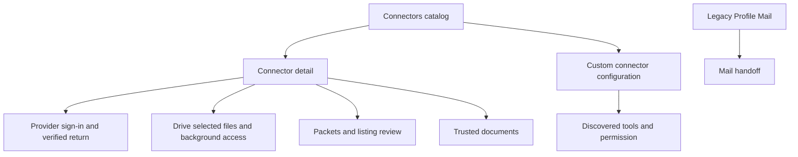

# Profile Connectors UI Contract

Status: current product and UI reference at revision `3ff2620b48567177dce5c667e77a70203e4a8c35`,
20 October 2026. Owner: frontend architecture. Classification: `canonical`,
package-local. This is the connector, provider-return and compatibility depth
of [Profile](./profile.md). It records existing provider and vault boundaries;
it does not create another connection registry. Font usage follows
[Profile nested typography](./typography.md).

The first-class Calendar workspace, setup, Schedule/Invitations/Insights,
attendance and meeting files have their complete interaction and API reference
in the [Calendar contract](./calendar.md). The Profile catalog's connector
confirmation remains a separate caller from Calendar's own disconnect dialog.

## Visual Map

## Catalog, detail, and admission

Panel `connectors` uses detail `connector:<catalog-id>`. Invalid bounded
lowercase IDs return to list. One mounted catalog/OAuth controller survives
query-owned list/detail changes; native renderer replacement retains it.
The catalog requires unlocked vault and current owner. Owner change clears
private editor/removal state. Busy writes block conflicting controls.

| Surface / CTA | Current effect |
| --- | --- |
| Connected / Available | Server-backed catalog groups; mutation keeps stable placement until revisit. |
| Loading / unavailable · Retry | Explicit status/read recovery; vault lock removes protected catalog. |
| Connector row | Opens query-owned detail. Connect/Reconnect may start authorization immediately; Disconnect opens confirmation first. |
| Search | Native catalog and drawer branch only. Profile web list has no search control. |
| Instagram / LinkedIn Profile link | Local unsaved input only. No submit, provider connection, or persistence; not a completed connector. |
| Curated connector | Requires rollout feature, server availability and declared curated OAuth. Existing grants retain recovery/disconnect when rollout is off. |

Owners: [Profile controller](../../components/profile/profile-connectors-section.tsx),
[catalog/detail](../../components/agent/connectors-panel.tsx),
[route mapper](../../lib/navigation/profile-routes.ts),
[native controller](../../components/profile/use-native-connectors.tsx).

## Connector actions

| Detail | Controls and commit boundary |
| --- | --- |
| Gmail | Connect/Reconnect starts Google authorization; read/send/drafts permission status. **Enable drafts** explicitly authorizes compose scope. **Cancel sign-in** aborts attempt, **Retry** reloads failed status. Confirmed Disconnect invokes existing Gmail disconnect. |
| Calendar | Connect/Reconnect requests read connection through existing Google flow. **Cancel sign-in**, status **Retry**, confirmed Disconnect. Completion must verify connected/service/access level. |
| Plaid | Encrypted financial connection list. Each bank Disconnect confirmation removes connected vault records and refreshes. Successful empty offers **Connect a bank** → portfolio sources; failed read is not an empty account. |
| Drive | Enabled selected/live connection profile. Selected files do not grant whole-Drive access. **Enable full Drive access** can upgrade, **Retry Drive** verifies status, **Cancel sign-in** aborts. Confirmed Disconnect removes One's selected records; existing Google sharing requires separate revocation and outcome stays explicit. |
| Curated | Connect/Reconnect/Cancel sign-in, confirmed Disconnect. Verifying is sign-in-needed, not falsely connected; provider revocation failure differs from local credential removal. |

## Drive nested pages and controls

| Surface / CTA | Effect and save boundary |
| --- | --- |
| Background Drive access | Immediate `setLiveBackground` preference; unknown/read failure offers retry, failed change retains confirmed value. |
| Choose files | Opens Google picker. Pending selection shows filenames and optional background processing choice. |
| Add selected files / Cancel | Only Add persists selected documents. Cancel drops web review or cancels native server attempt. |
| Selected file · Refresh files | Reconciles the selected-document list. |
| Per-file background processing / Sync now | Existing immediate setter / supported explicit synchronization action. |
| Selected-file Remove | Confirmation removes One's record, never the Google Drive original. |
| Prepare packets | Live Drive plus feature availability. Immediate processing preference. Background-off prevents enabling new preparation. |
| View details / Retry preparation | Processing counts/timing and recovery of failed reads. |
| Packet catalog | Loading/empty/paused/failed, **Retry**, **Load more**. Row opens owner packet page with contents, buyer-visible summary, price, gaps/status and checked time. |
| Change price | Local valid $0.50–$500 draft only. |
| List for $amount / Don't list | Explicit listing/price commit or denial/unlisting. Stale packet/listing/price requires recheck; no optimistic listing success. |
| Trusted documents | Recipient/purpose and file/future-file scope with readiness. **Revoke document trust** writes immediately on web, adds confirmation natively. Removing the rule does not remove already granted Google file access. |

Owners: [Drive collection](../../components/agent/drive-collection-panel.tsx),
[packet catalog](../../components/consent/drive-packet-catalog.tsx),
[trust rules](../../components/consent/trusted-document-rules.tsx),
[connector composition](../../components/agent/connectors-panel.tsx).

## Custom connectors

| CTA / state | Effect and boundary |
| --- | --- |
| Add connector | Local form: name/server URL/optional bearer credential; optional issuer/client ID/auth method/client secret. |
| Add / Cancel | Supplied oauthRegistration saves Sign-in needed without discovery. Otherwise usable discovery required, except verified no-credential auth challenge can save pending. Rejected supplied credential/empty catalog/other failure saves nothing. Cancel local; vault-owner credentials rejected. |
| Sign in | Existing OAuth attempt for a connector requiring authorization. |
| Refresh tools | Re-runs discovery through existing owner. |
| Tool count disclosure | Shows discovered tools; **Block** / **Allow** immediately persists fingerprint-bound permission for subsequent turns. Review-required versus runs-without-asking remains explicit. |
| Remove | Confirmation deletes saved vault configuration, not provider access or already executed actions. |
| Corrupt saved entry | Bounded Remove if possible, otherwise Needs repair. |
| Initial load failure | Close/reopen recovery; no dedicated Retry. |

Owner: [custom connector settings](../../components/agent/custom-connectors-settings.tsx).
Native has separate nested custom editor/detail; local Back cancels that layer
before the catalog. Private credentials are never documentation/trace payload.

## OAuth return pages

Provider `oauth/return` paths deliberately bypass the Profile web proxy.
Returned codes/state belong to the existing in-memory callback owner, not
durable route state. Completion verifies owner and exact attempt; uncertain
outcome reconciles status rather than blindly replaying a one-use callback.

| Return | Current behavior and recovery |
| --- | --- |
| `/one/profile/connectors/oauth/return` | Drive/curated popup is identified before vault guard, has Firebase identity but no vault key, and exchanges only the preauthorized attempt. Notifies redacted result and closes; manual **Close window** if needed. |
| Full-page connector return | Keeps callback in mounted memory, scrubs URL, waits for unlock. Custom completion verifies owner/revision/attempt, saves encrypted result, refreshes tools; committed phase prevents replay after re-unlock. **Connectors** returns even when post-save refresh failed. General completion returns after its outcome; Profile-started returns over One, chat-started over Chat. |
| `/one/profile/google/oauth/return` | One in-memory exchange, verified owner and actual Calendar connection/access. Popup settles opener; same-window completion returns Calendar/setup. Failure/cancel offers **Back to connections**. |
| `/one/profile/gmail/oauth/return` | Auth/provider error/completion/reconciliation/popup/setup states. Verified connection precedes receipt sync; completion can continue in background after Mail routing. Timeout/replay checks current status first. Error offers **Back to Mail** / **Back to setup**. |

Owners: [connector return](../../app/one/profile/connectors/oauth/return/page.tsx),
[Google return](../../app/profile/google/oauth/return/page.tsx),
[Gmail return](../../app/profile/gmail/oauth/return/page-client.tsx),
[return builders](../../lib/navigation/profile-pane.ts).

## Mail compatibility and local Connected Systems

The complete mounted Mail workspace, onboarding, KYC, receipt, draft/send and
responsive/font contract is [Mail subagent](./mail.md). The compatibility
entries below remain Profile-owned handoffs; they are not extra Mail tabs.

On web `/one/profile/gmail`, `/gmail/connection`, `/gmail/actions` resolve to
legacy pane root/Connection/Actions. Without the proxy, page exports redirect
to Mail. They are not root Profile menu rows.

| Legacy Mail CTA | Current behavior |
| --- | --- |
| Connection | Inbox/status/latest sync; status failure inline. |
| Actions · Sync now | Starts receipt sync or reports already running; explicit mutation. |
| Connect/Reconnect / Open receipts | Mail workspace handoff. |
| Refresh status | Reconciles status. |
| Disconnect Mail | Immediate revoke/receipt cleanup without confirmation in this legacy pane; busy disables mutating actions. |

`/receipts`, `/integrations`, and `/pkm` under Profile are unrecognized suffixes
in ordinary web proxy mapping and therefore open Profile root. Native/no-proxy
page exports instead redirect to Mail, Calendar and PKM respectively.
Source: [legacy Mail actions](../../components/profile/mail-actions-group.tsx),
[workspace](../../components/profile/profile-workspace-page.tsx),
[proxy](../../proxy.ts).

Connected Systems is a separate developer CRM surface, gated by development
and explicit local-CRM flag; its dedicated route additionally restricts host
to loopback and rejects native static export. It is not the curated catalog.
Its UI includes registry/refresh, object selection/schema retries, **Find my
record**, **Create profile** preparation, cross-object binding/check,
missing-record Unlink/create confirmation, field edit/**Stage change**,
**Reset local working copy**, **Update record** → **Review changes** →
**Confirm update**, permanent-delete review, and pending-intent
**Cancel**/**Confirm request**. Staging is local; external mutation occurs
only at reviewed update/intent approval. Created cross-object ID does not
become a verified private-record binding. Failure retains recovery.
Owners: [local CRM guard](../../lib/connected-systems/local-crm-route-guard.ts),
[CRM panel](../../components/profile/connected-systems-panel.tsx).

## Per-control endpoint and field contract

`C=/api/connectors`, `D=C/google_drive`; protected connector calls use vault
authority, Gmail/Calendar initial auth use Firebase as specified. Web
[connector root](../../app/api/connectors/route.ts) /
[catchall](../../app/api/connectors/[...path]/route.ts) /
[proxy](../../app/api/connectors/_proxy.ts) → same backend path in
[external connectors](../../../consent-protocol/api/routes/external_connectors.py)
and [Drive sharing](../../../consent-protocol/api/routes/drive_sharing.py).
Same query/method/auth/consent/body, private/no-store. Native can use direct
backend/native Google/picker owner rather than local Next round trip.

| Rendered row / CTA | Exact request/body | Response fields → UI; alternate branch |
| --- | --- | --- |
| Catalog/Retry | GET C | `{connectors,features,driveAgentPackagesEnabled}`; connector `connectorId,displayName,description,authStyle,status,accountLabel,connectedAt,validationState,profile,revocationOutcome,lastErrorCode,available,curatedOAuth,catalogCard,catalogState`→group/name/status/actions. Not Connected just because OAuth started. |
| Connector row/Back | Query-owned local detail, no mutation | Controller remains mounted; search native-only/local. Social profile-link inputs local/no submit/API. |
| Drive/curated Connect/Reconnect | POST C`/<id>/connect/oauth/start`, `{redirectUri,flow:"web"|"native",profile:"selected"|"live"}` | `{authorizeUrl,expiresAt,attemptId?,connectorId?}`→validated bounded HTTPS destination. No connection success yet. |
| General callback | POST C`/oauth/complete`, `{state,code}` | `{status,connectorId}` must reconcile real connection. One-use code not blindly retried. |
| Preauthorized popup callback | POST C`/oauth/complete/web`,Firebase,`{state,code,attemptId}` | Only authorized attempt exchanged without vault key; not arbitrary callback authority. |
| Native pending/finalize | GET C`/oauth/native/pending`; POST `/oauth/native/finalize`, `{attemptId}` | `{pending}` / `{status,connectorId}`→reconciled state. Opaque handoff contains no provider credential. |
| Cancel sign-in | Abort current popup/controller; no disconnect API | Clears current attempt UI/ignores obsolete completion. Does not universally revoke provider grants; existing callback owner decides pending attempt effects. |
| Retry Drive | POST D`/live/verify`,no body | `{status,connectorId}` verifies existing grant; never resubmits OAuth code. |
| Confirm Disconnect | POST C`/<id>/disconnect`,no authored new config body | `{status,connectorId,revocationOutcome?}`→local removed vs provider revocation outcome remain distinct. Cancel confirmation no call. |
| Background Drive/read | GET D`/live/background` | Confirmed enabled drives switch; unknown disables until retry. |
| Background Drive toggle | POST same `{enabled,confirmed:true}` | DriveLivePreferences readback; failed setting retains last confirmed. |
| Web Choose files | POST D`/picker/session`, `{origin}` | Session/token/config stays in memory; provider picker selection only local review. |
| Web Add selected files | POST D`/documents/select`, `{sessionId,fileIds,confirmed:true,processingConsent?:"selected-files-background-v1"}` | `{documents:[{documentId,name,mimeType,status,backgroundProcessing}]}`→saved records. Cancel review local/no call. |
| Native picker start/pending | POST D`/picker/native/start`, `{redirectUri}`; GET `/picker/native/pending` | `{authorizeUrl,expiresAt,attemptId}` / `{pending}`→same review owner. |
| Native Add/Cancel | POST D`/picker/native/confirm`, `{attemptId,processingConsent?}` / POST `/picker/native/cancel`, `{attemptId}` | Confirm persists; native Cancel is server cancellation, unlike web review Cancel. |
| Refresh files | GET D`/documents` | `documents` fields above→name/status/processing. |
| File processing | POST D`/documents/<id>/processing`, `{enabled,confirmed:true,disclosure:"selected-files-background-v1"}` when enabling | Immediate setting→readback. No Save after switch. |
| Sync now | POST D`/documents/<id>/sync`,no body | Queues supported sync→documents refresh; not promise finished extraction. |
| Remove file confirm | DELETE D`/documents/<id>`, `{confirmed:true}` | Removes One record, original Google file unchanged. Cancel no call. |
| Prepare packets/read | GET D`/collection/status` | `counts.discovered/indexed/pending/failed`, extraction counts/index/sync/duration times→progress/details. Poll visible15seconds. |
| Prepare packets on/off | POST D`/collection/processing`, `{enabled,confirmed:true,disclosure:"live-drive-collection-v1"}` on enable | Confirm response then GET status; cannot enable unless background true; independent serials fence late results. |
| Owner packets | GET D`/sharing/packets[?cursor=…]` | `{packets,nextCursor}`→rows; opening selected packet is local, no new route/details GET. |
| List/Don't list | POST D`/sharing/packets/<id>/listing`, `{version,decision:"allow"|"deny",priceCents,expectedRevision:listingRevision,disclosure:"drive-packet-listing-connections-v1"}` | Acknowledgement then authoritative list reread; no optimistic Listed. Change price/Cancel local only. |
| Document trust | GET D`/sharing/rules` | Rule `ruleId,version,recipientEmail,purpose:{purpose,periodStart,periodEnd},fileNames,scope,readiness`→scope/recipient/readiness. |
| Revoke document trust | POST D`/sharing/rules/<id>/revoke`, `{version,confirmed:true}` | Immediate web/native confirms first; stops future trust, not existing Google permissions. |

Packet fields projected by owner detail:
`packetId,version,listingRevision` bind write; `title,coverageSummary,description`
feed buyer-visible summary; `contents.documents[{name,type,pages,period}],
contents.period,documentCount` feed **What’s inside**; `priceCents,
suggestedPriceCents` feed price; `state,freshness,gaps,canList,listingEnabled,
verifiedAt` feed **Status/Checked** and listing admission. Owner filenames do
not enter buyer packet response. [Packet service](../../lib/services/drive-packet-service.ts).

### Gmail, Calendar and bank-specific authority

| Row/action | Wire and consumed fields | Branch |
| --- | --- | --- |
| Mail status/Retry | GET `/api/kai/gmail/status/<uid>`,Firebase | `configured,connected,needs_reauth,google_email,scope_csv,compose_permission_granted,send_permission_granted`→Mail/account/permission. Force bypasses1-minute cache. |
| Mail Connect/Enable drafts | POST `/api/kai/gmail/connect/start`, `{user_id,login_hint,include_granted_scopes,purpose:"read"|"compose",redirect_uri}` | `{configured,authorize_url,state,redirect_uri,expires_at}`→provider. Compose separate deliberate permission. |
| Mail complete | POST `/api/kai/gmail/connect/complete`, `{user_id,code,state,redirect_uri}` | Verified status before subsequent sync. Native complete `{user_id,server_auth_code}`. |
| Mail Disconnect | POST `/api/kai/gmail/disconnect`, `{user_id}` | Must confirm connected:false then invalidate status/receipt caches. Catalog confirms; legacy pane immediate. |
| Legacy Sync now/reconcile | POST `/api/kai/gmail/sync`, `{user_id}`→`{accepted,reason,run}`; POST `/reconcile` same user | accepted:false can mean already running; GET `/sync/<runId>?user_id=`→run. No false sync-complete claim. |
| Calendar status | GET `/api/one/calendar/status/<uid>`,Firebase | `configured,connected,google_email,status,access_level,scope_csv,calendar_list_access`→connection/permission. |
| Calendar Connect/complete | POST `/api/one/calendar/connect/start`, `{user_id,access_level:"read",redirect_uri}`; complete `{user_id,code,state,redirect_uri}` | Native start access/include-calendar-list; native complete `{user_id,access_level,server_auth_code,state}`. Generic `/api/one/google/connect/complete` must return service calendar and verified access. |
| Calendar Disconnect | POST `/api/one/calendar/disconnect`, `{user_id}` | Confirmation Cancel no call; successful disconnect verified. |
| Plaid rows | Existing encrypted financial PKM resource→vaultConnections | Item institution/status→name, Connected/Reconnect needed; no server list of plaintext access tokens. |
| Bank Disconnect confirm | `disconnectVaultPlaid`→POST `/api/kai/plaid/vault/remove`,vault bearer,`{access_token:<memory-only>}`, then merged encrypted financial PKM write | Remote removal can finish before local encrypted save; failure must not imply no side effect. Cancel no call. Response success/readback governs local removal. No credential values logged/copied. |
| Connect a bank | Closes detail→portfolio sources | No bank-link create merely at row tap; destination owns connection ceremony. |

Owners: [Gmail](../../lib/services/gmail-receipts-service.ts) →
[Kai proxy](../../app/api/kai/[...path]/route.ts) →
[Gmail backend](../../../consent-protocol/api/routes/kai/gmail.py);
[Calendar](../../lib/services/google-calendar-service.ts) → One proxy →
[Calendar backend](../../../consent-protocol/api/routes/one/calendar.py);
[Plaid disconnect](../../lib/kai/plaid-vault/vault-sync.ts) /
[passthrough](../../lib/kai/plaid-vault/vault-client.ts) →
[Plaid backend](../../../consent-protocol/api/routes/kai/plaid_vault.py).

### Custom connector: configuration and tools

| Action | Actual read/write and response | No/Cancel/failure |
| --- | --- | --- |
| Load | Decrypt PKM `runtime_secrets.connectors` bounded serialized entries, owner/epoch cache | Corrupt sibling separately reported; no registration GET. |
| Add | Local `{version:1,connectorId:custom_…,revision,displayName,endpoint,enabled:true,authentication,oauthRegistration?}`; optional credential maps API-key auth | With oauthRegistration save pending without discovery. Otherwise POST C`/<id>/mcp/catalog`, `{connectorConfiguration}`→usable tools required, except no-credential verified auth challenge. Failures retain draft/no save. |
| Config save | `storeRuntimeSecret` encrypted exact PKM record | No plaintext config registration endpoint. Vault-owner token rejected as supplied external credential. |
| Refresh tools | Re-read saved revision→POST catalog same body | Match connector/config revision; tools IDs/names/fingerprints/review/access/permission fields→tool disclosure. |
| Sign in | POST C`/<id>/mcp/oauth/begin`, `{revision,endpoint,registeredClient?}` | Bounded auth URL/attempt/return; prepare current recovery before external navigation. Created-attempt begin failure→`/cancel` `{revision,attemptId}`. |
| Return | POST C`/mcp/oauth/complete`, `{revision,attemptId,code,state,issuer}` | Owner/config/attempt verified; returned credentials immediately encrypted. Saved phase prevents replay; failed post-save tool refresh doesn't erase saved authorization. |
| Block/Allow tool | Verify saved config+tool fingerprint, update `blockedTools:[{id,fingerprint}]`, encrypt new revision | Immediate local-vault write for new turns; no backend tool-permission endpoint/confirmation. |
| Remove confirmed | Delete exact expected-revision encrypted record; invalid record compares exact stored string | Cancel local; no provider revocation or undo of completed external action. |

Owners: [custom setup](../../lib/connections/custom-connector-setup.ts),
[configuration](../../lib/connections/custom-connector-configuration.ts),
[settings](../../components/agent/custom-connectors-settings.tsx).
PKM request/version/commit shapes are in [Memory](./profile-memory.md).

### Local CRM: every preparation and commit

`R=/api/connected-systems`. Registry service→dedicated root/catchall proxies→
[backend](../../../consent-protocol/api/routes/connected_systems.py).
Development/explicit flag/loopback checks remain mandatory, including proxy;
native export is rejected. Provider-owned record binding, not entered record
ID, determines protected target.

| Control | Exact wire / response fields | Commit/Cancel |
| --- | --- | --- |
| Registry/Refresh | GET R→`{registryRevision,systems}` | System operations/capabilities/schema/allowlist/config revision choose rows. |
| Object/schema retry | GET R`/<id>/schema?objectType=<type>&forceRefresh=true` | Field permissions/constraints/profile maps/effective actions/fingerprint/freshness/guidance→editor. |
| Find my record | POST R`/<id>/records/search`, `{objectType,returnFields}` | Verified record/binding, not caller override. |
| Read | POST `/records/read`, `{objectType,returnFields}` | `records[{recordId,fields}],bindingStatus,binding,recoveryAction,resultClass`→read-only local baseline. |
| Binding/check/unlink | GET/DELETE `/record-binding?objectType=`; GET `/record-bindings` | Unlink binding distinct from deleting remote record. |
| Create profile | POST `/records/create-intents`, `{objectType}` | Pending intent, not external creation yet. |
| Stage/Reset/Update | Local working copy / local Review changes | No API merely editing/staging/reviewing. Review Cancel local only. |
| Confirm update | POST `/records/update-intents`, `{objectType,additionalFields:{},recordFields}`, then POST `/intents/<id>/approve` | External change at approval. Failed approval keeps prepared intent; retry doesn't prepare another update. |
| Encrypted-field update | Obtain config→prepare encrypted envelope with fieldNames/encryptedFields→approve-encrypted | Existing server contract, no plaintext field bypass. |
| Delete preparation | POST `/records/delete-intents`, `{objectType}` | Pending reviewed request only. |
| Confirm request | POST `/intents/<id>/approve` | Explicit provider mutation. |
| Pending-intent Cancel | POST `/intents/<id>/reject` | Server rejection, unlike local Review Cancel. |

Intent fields: `intentId,systemId,target,objectType,action,status,recordId,
approvalId,fieldNames,payloadSummary,resultClass,result,readback,binding,errorCode,
errorMessage,createdAt,updatedAt,deliveryMode,envelopeDigest,encryptedResponse`.
Created cross-object record never becomes verified Contact binding. Source:
[CRM panel](../../components/profile/connected-systems-panel.tsx).

## Exact English copy and decision supplement

| Surface | Exact content / CTA variants |
| --- | --- |
| Mail disconnect | `Disconnect Mail?` / `Drive stays connected.` / `Cancel` / `Disconnect`. |
| Drive disconnect | `Disconnect Google Drive?` / `This removes its selected files from One. Existing Google sharing stays active until you revoke it. Mail stays connected.` / `Cancel` / `Disconnect`. |
| Calendar disconnect | `Disconnect Calendar?` / `Other connections stay active.` / `Cancel` / `Disconnect`. |
| Curated disconnect | `Disconnect this connector?` / `Your information in that service is unchanged.` / `Cancel` / `Disconnect`. |
| Bank disconnect | `Disconnect this bank?` / `This removes its connected financial records from your vault. Other banks stay connected.` / `Cancel` / `Disconnect`. |
| Remove selected file | `Remove this file from One?` / `The original in Google Drive is unchanged.` / `Cancel` / `Remove`. |
| Bank status | `Could not check bank connections.`; `Checking bank connections…`; `{n} connected bank(s)`; `No banks connected`; `Bank connection`; `Reconnect needed`; `Connected`; `Disconnecting bank…`; `Bank disconnected.`; `Could not disconnect this bank. Retry.`; `Connect a bank`. |
| Prepare packets | `Prepare packets`; `View details`; `Retry preparation`; `Checking preparation…`; `Couldn’t check preparation.`; `Couldn’t turn on. Try again.`; `Couldn’t turn off. Try again.`; `Turn on Background Drive access first.`; `Agent One won’t prepare new packets.` Status/count/timing captions from [panel](../../components/agent/drive-collection-panel.tsx). |
| Packet sections/actions | `What’s inside`; `What buyers see`; `Price`; `Status`; `Checked`; `Change price`; `New price`; `Enter $0.50–$500, up to two decimal places.`; `List for {price}`; `Don’t list`. |
| Packet failures | `This packet changed. Check it and try again.` / `Couldn’t finish. Retry to check the latest status.` |
| Custom form | `Name`; `Server URL`; `Access token (optional)`; `OAuth settings`; `Authorization server issuer`; `Client ID`; `Token authentication`; `Public client`; `Client secret in request`; `Client secret in header`; conditional `Client secret`; `Add` / `Cancel`; `Add connector`. |
| Custom controls/status | `Sign in`; `Refresh tools`; `Remove`; `Blocked · Allow`; `Runs without asking · Block`; `Ask first · Block`; `Blocked for new turns`; `Saved credential rejected · remove and add again`; `Sign in needed`; `Connection check failed · verify server address and credential`; `{n} tools discovered`; `Sign in or refresh tools to verify`; `Tools not checked`; `Needs repair`. |
| Custom loading | `Loading saved connectors…`; `Could not load saved connectors. Close and reopen to retry.` No Retry button. |
| Remove custom | `Remove {displayName}?` / `This removes its saved settings from your vault. It does not revoke access at the provider or undo completed actions.` / `Cancel` / `Remove connector`. |
| Invalid custom | `Remove invalid connector?` / `Its saved settings cannot be used. This removes only that connector from your vault; it does not revoke access at the provider.` / `Cancel` / `Remove connector`. |

Confirmations author Cancel/Disconnect/Remove, not Yes/No. Cancel clears target
without the operation. Provider/OS/browser prompts and response-specific
errors remain dynamic owners. Full copy source:
[ConnectorConfirm](../../components/agent/connector-confirm.tsx) /
[custom settings](../../components/agent/custom-connectors-settings.tsx).

## Placement and portal ownership

No generic three-dot/ellipsis menu is mounted in this connector tree. Row
actions, native nested scenes, disclosures, OAuth windows, provider picker,
Sheet/Dialog/confirmation each have their own owner. Profile rows group in
17px-radius surfaces, minimum58px, px14/py7/gap9; trailing action min44×88;
detail padding16; social input min44. Profile parent geometry:
[Profile](./profile.md).

Packet detail is local AdaptiveDetailSurface max520 desktop, phone real
Sheet full-width/max85dvh−keyboard/radius24, inner scroll. Desktop TaskDialog
width viewport−32 overrides wrapper's authored viewport−24. Close44 has
task-owned top12/rightpad−6,localz20. Default generic detail max720; explicitly
important caps win. Source: [task CSS](../../lib/morphy-ux/ui/task-surfaces.module.css),
[surface](../../components/app-ui/settings-ui.tsx).

Web ConnectorConfirm is raw small centered AlertDialog; native bottom Drawer
radius20/safe-bottom≥12/side16/title17/22/description15/20 and48px controls
radius14. Sheet layers711/712; Dialog800/801; local header/close z belongs
inside surface, provider windows/OS pickers are not CSS z-index peers.
Dynamic rows use container+inset and cumulative heights, not fixed Y coordinates.

## Back, tests, and limits

Feature Back unwinds confirmation/editor, selected file, picker review,
packet price, packet, trust, custom editor or nested native panel before
Profile parent. Pending writes consume Back. Normal Profile dismissal does
not fabricate provider cancellation/revocation; the attempt owner decides it.

Nearest existing tests:
[catalog](../../__tests__/components/connectors-panel.test.tsx),
[custom connectors](../../__tests__/components/custom-connectors-settings.test.tsx),
[Drive collection](../../__tests__/components/drive-collection-panel.test.tsx),
[packets](../../__tests__/components/drive-packet-catalog.test.tsx),
[CRM](../../__tests__/components/connected-systems-panel.test.tsx), and
[Profile connector layout](../../e2e/profile-legal-connectors.layout.spec.ts).
Execution is reported with the change. No real provider sign-in, connection,
file selection, external write, listing or revocation was performed here.
Source review does not establish deployed flags, provider configuration,
account registry contents, native availability or actual callback delivery.
