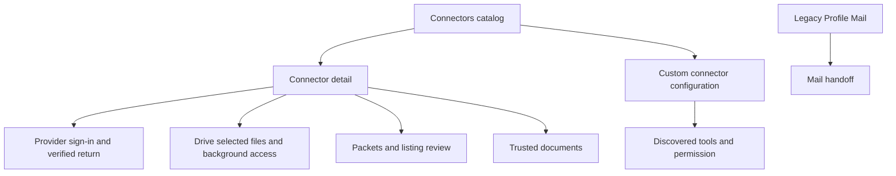

# Profile Connectors UI Contract

Status: current product and UI reference at revision `fd22c14a9`,
20 October 2026. Owner: frontend architecture. Classification: `canonical`,
package-local. This is the connector, provider-return and compatibility depth
of [Profile](./profile.md). It records existing provider and vault boundaries;
it does not create another connection registry. Font usage follows
[Profile nested typography](./typography.md).

## Visual Map

## Catalog, detail, and admission

Panel `connectors` uses detail `connector:<catalog-id>`. Invalid bounded
lowercase IDs return to list. One mounted catalog/OAuth controller survives
query-owned list/detail changes; native renderer replacement retains it.
The catalog requires unlocked vault and current owner. Owner change clears
private editor/removal state. Busy writes block conflicting controls.

| Surface / CTA | Current effect |
| --- | --- |
| Connected / Available | Server-backed catalog groups; mutation keeps stable placement until revisit. |
| Loading / unavailable · Retry | Explicit status/read recovery; vault lock removes protected catalog. |
| Connector row | Opens query-owned detail. Connect/Reconnect may start authorization immediately; Disconnect opens confirmation first. |
| Search | Native catalog and drawer branch only. Profile web list has no search control. |
| Instagram / LinkedIn Profile link | Local unsaved input only. No submit, provider connection, or persistence; not a completed connector. |
| Curated connector | Requires rollout feature, server availability and declared curated OAuth. Existing grants retain recovery/disconnect when rollout is off. |

Owners: [Profile controller](../../components/profile/profile-connectors-section.tsx),
[catalog/detail](../../components/agent/connectors-panel.tsx),
[route mapper](../../lib/navigation/profile-routes.ts),
[native controller](../../components/profile/use-native-connectors.tsx).

## Connector actions

| Detail | Controls and commit boundary |
| --- | --- |
| Gmail | Connect/Reconnect starts Google authorization; read/send/drafts permission status. **Enable drafts** explicitly authorizes compose scope. **Cancel sign-in** aborts attempt, **Retry** reloads failed status. Confirmed Disconnect invokes existing Gmail disconnect. |
| Calendar | Connect/Reconnect requests read connection through existing Google flow. **Cancel sign-in**, status **Retry**, confirmed Disconnect. Completion must verify connected/service/access level. |
| Plaid | Encrypted financial connection list. Each bank Disconnect confirmation removes connected vault records and refreshes. Successful empty offers **Connect a bank** → portfolio sources; failed read is not an empty account. |
| Drive | Enabled selected/live connection profile. Selected files do not grant whole-Drive access. **Enable full Drive access** can upgrade, **Retry Drive** verifies status, **Cancel sign-in** aborts. Confirmed Disconnect removes One's selected records; existing Google sharing requires separate revocation and outcome stays explicit. |
| Curated | Connect/Reconnect/Cancel sign-in, confirmed Disconnect. Verifying is sign-in-needed, not falsely connected; provider revocation failure differs from local credential removal. |

## Drive nested pages and controls

| Surface / CTA | Effect and save boundary |
| --- | --- |
| Background Drive access | Immediate `setLiveBackground` preference; unknown/read failure offers retry, failed change retains confirmed value. |
| Choose files | Opens Google picker. Pending selection shows filenames and optional background processing choice. |
| Add selected files / Cancel | Only Add persists selected documents. Cancel drops web review or cancels native server attempt. |
| Selected file · Refresh files | Reconciles the selected-document list. |
| Per-file background processing / Sync now | Existing immediate setter / supported explicit synchronization action. |
| Selected-file Remove | Confirmation removes One's record, never the Google Drive original. |
| Prepare packets | Live Drive plus feature availability. Immediate processing preference. Background-off prevents enabling new preparation. |
| View details / Retry preparation | Processing counts/timing and recovery of failed reads. |
| Packet catalog | Loading/empty/paused/failed, **Retry**, **Load more**. Row opens owner packet page with contents, buyer-visible summary, price, gaps/status and checked time. |
| Change price | Local valid $0.50–$500 draft only. |
| List for $amount / Don't list | Explicit listing/price commit or denial/unlisting. Stale packet/listing/price requires recheck; no optimistic listing success. |
| Trusted documents | Recipient/purpose and file/future-file scope with readiness. **Revoke document trust** writes immediately on web, adds confirmation natively. Removing the rule does not remove already granted Google file access. |

Owners: [Drive collection](../../components/agent/drive-collection-panel.tsx),
[packet catalog](../../components/consent/drive-packet-catalog.tsx),
[trust rules](../../components/consent/trusted-document-rules.tsx),
[connector composition](../../components/agent/connectors-panel.tsx).

## Custom connectors

| CTA / state | Effect and boundary |
| --- | --- |
| Add connector | Local form: name/server URL/optional bearer credential; optional issuer/client ID/auth method/client secret. |
| Add / Cancel | Discovery must verify before encrypted configuration save. OAuth challenge saves sign-in-pending, not connected. Failure retains form; Cancel discards local editor. Vault owner tokens are rejected as connector credentials. |
| Sign in | Existing OAuth attempt for a connector requiring authorization. |
| Refresh tools | Re-runs discovery through existing owner. |
| Tool count disclosure | Shows discovered tools; **Block** / **Allow** immediately persists fingerprint-bound permission for subsequent turns. Review-required versus runs-without-asking remains explicit. |
| Remove | Confirmation deletes saved vault configuration, not provider access or already executed actions. |
| Corrupt saved entry | Bounded Remove if possible, otherwise Needs repair. |
| Initial load failure | Close/reopen recovery; no dedicated Retry. |

Owner: [custom connector settings](../../components/agent/custom-connectors-settings.tsx).
Native has separate nested custom editor/detail; local Back cancels that layer
before the catalog. Private credentials are never documentation/trace payload.

## OAuth return pages

Provider `oauth/return` paths deliberately bypass the Profile web proxy.
Returned codes/state belong to the existing in-memory callback owner, not
durable route state. Completion verifies owner and exact attempt; uncertain
outcome reconciles status rather than blindly replaying a one-use callback.

| Return | Current behavior and recovery |
| --- | --- |
| `/one/profile/connectors/oauth/return` | Drive/curated popup is identified before vault guard, has Firebase identity but no vault key, and exchanges only the preauthorized attempt. Notifies redacted result and closes; manual **Close window** if needed. |
| Full-page connector return | Keeps callback in mounted memory, scrubs URL, waits for unlock. Custom completion verifies owner/revision/attempt, saves encrypted result, refreshes tools; committed phase prevents replay after re-unlock. **Connectors** returns even when post-save refresh failed. General completion returns after its outcome; Profile-started returns over One, chat-started over Chat. |
| `/one/profile/google/oauth/return` | One in-memory exchange, verified owner and actual Calendar connection/access. Popup settles opener; same-window completion returns Calendar/setup. Failure/cancel offers **Back to connections**. |
| `/one/profile/gmail/oauth/return` | Auth/provider error/completion/reconciliation/popup/setup states. Verified connection precedes receipt sync; completion can continue in background after Mail routing. Timeout/replay checks current status first. Error offers **Back to Mail** / **Back to setup**. |

Owners: [connector return](../../app/one/profile/connectors/oauth/return/page.tsx),
[Google return](../../app/profile/google/oauth/return/page.tsx),
[Gmail return](../../app/profile/gmail/oauth/return/page-client.tsx),
[return builders](../../lib/navigation/profile-pane.ts).

## Mail compatibility and local Connected Systems

On web `/one/profile/gmail`, `/gmail/connection`, `/gmail/actions` resolve to
legacy pane root/Connection/Actions. Without the proxy, page exports redirect
to Mail. They are not root Profile menu rows.

| Legacy Mail CTA | Current behavior |
| --- | --- |
| Connection | Inbox/status/latest sync; status failure inline. |
| Actions · Sync now | Starts receipt sync or reports already running; explicit mutation. |
| Connect/Reconnect / Open receipts | Mail workspace handoff. |
| Refresh status | Reconciles status. |
| Disconnect Mail | Immediate revoke/receipt cleanup without confirmation in this legacy pane; busy disables mutating actions. |

`/receipts`, `/integrations`, and `/pkm` under Profile are unrecognized suffixes
in ordinary web proxy mapping and therefore open Profile root. Native/no-proxy
page exports instead redirect to Mail, Calendar and PKM respectively.
Source: [legacy Mail actions](../../components/profile/mail-actions-group.tsx),
[workspace](../../components/profile/profile-workspace-page.tsx),
[proxy](../../proxy.ts).

Connected Systems is a separate developer CRM surface, gated by development
and explicit local-CRM flag; its dedicated route additionally restricts host
to loopback and rejects native static export. It is not the curated catalog.
Its UI includes registry/refresh, object selection/schema retries, **Find my
record**, **Create profile** preparation, cross-object binding/check,
missing-record Unlink/create confirmation, field edit/**Stage change**,
**Reset local working copy**, **Update record** → **Review changes** →
**Confirm update**, permanent-delete review, and pending-intent
**Cancel**/**Confirm request**. Staging is local; external mutation occurs
only at reviewed update/intent approval. Created cross-object ID does not
become a verified private-record binding. Failure retains recovery.
Owners: [local CRM guard](../../lib/connected-systems/local-crm-route-guard.ts),
[CRM panel](../../components/profile/connected-systems-panel.tsx).

## Back, tests, and limits

Feature Back unwinds confirmation/editor, selected file, picker review,
packet price, packet, trust, custom editor or nested native panel before
Profile parent. Pending writes consume Back. Normal Profile dismissal does
not fabricate provider cancellation/revocation; the attempt owner decides it.

Nearest existing tests:
[catalog](../../__tests__/components/connectors-panel.test.tsx),
[custom connectors](../../__tests__/components/custom-connectors-settings.test.tsx),
[Drive collection](../../__tests__/components/drive-collection-panel.test.tsx),
[packets](../../__tests__/components/drive-packet-catalog.test.tsx),
[CRM](../../__tests__/components/connected-systems-panel.test.tsx), and
[Profile connector layout](../../e2e/profile-legal-connectors.layout.spec.ts).
Execution is reported with the change. No real provider sign-in, connection,
file selection, external write, listing or revocation was performed here.
Source review does not establish deployed flags, provider configuration,
account registry contents, native availability or actual callback delivery.
