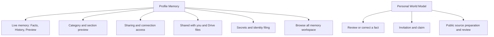

# Profile Memory and World Model UI Contract

Status: current product and UI reference at source revision `3ff2620b48567177dce5c667e77a70203e4a8c35`,
20 October 2026. Owner: frontend architecture. Classification: `canonical`,
package-local. This is the Memory/World Model depth of the
[Profile contract](./profile.md), including the immediate Browse all memory
workspace. Vault, PKM, consent and source owners retain mutation authority.
Use the [Profile detail type scale](./typography.md) for settings rows and
existing document readers for long text.

## Visual Map



## Entry, gates, and Back

Profile panel `my-data` has `domain:<key>`, `sharing`, and `connection:<id>`
details. `/one/profile/access` and its connection URL normalize into these
Memory states. Panel `world-model` owns research. These are protected
Profile entries: missing/locked vault invokes existing creation/unlock and
resumes the pending destination. Owner or vault-epoch changes retire private
reads and selections. See [Profile entry rules](./profile.md).

Missing/disappeared domain or connection retains a child body and Back depth:
loading, couldn't load/retry/go back, or no longer available/go back to
Memory. It does not silently show the parent. Ordinary Back follows the
feature layer then Profile detail/panel hierarchy.

Sources: [workspace](../../components/profile/profile-workspace-page.tsx),
[route mapping](../../lib/navigation/profile-routes.ts), and
[Memory panels](../../components/profile/pkm-data-manager.tsx).

## Memory root and category details

| Surface / CTA | Effect and save boundary |
| --- | --- |
| Live memory | Read-only Facts/History/Preview view; no parallel memory writer. |
| Manage sharing | Opens `sharing` detail. |
| Refresh | Force-refreshes metadata, consent state and visible manifests. |
| Category row | Opens `domain:<key>`. |
| Search saved details / clear | Local deferred title/summary/source/section filter, offered at six or more categories. |
| Browse all memory | Handoff to `/one/pkm`, detailed below. |
| Create vault fallback | Existing import/setup route, not a new editor. |
| Section eye | Decrypts only the selected top-level section into a dialog. Loading, error, exact values and empty are distinct; Close invalidates the request. |
| Ask before sharing | Immediate `consent_required`/`private` slice posture change. No separate Save. Upgrade/availability/pending guards apply. Optimistic failure rolls back; conflict reloads; committed change plus failed readback is reported accurately. |
| View details | Local entity disclosure, not a route. |
| Edit / Delete entry | Only for editable/deletable entities. Delete has browser confirmation and uses existing financial-context or explicit PKM deletion writer. Confirmed deletion with failed readback reports removed/refresh needed. |
| Financial context | Financial category only: General/Portfolio/Risk/KYC/Tax/Documents, note, **Save** or **Update**. Draft until explicit merged-domain write. |
| Edit financial context / Cancel | Stages category/text and closes preview; Cancel clears draft/edit target. Save validates target still exists, preserves other entries and retains draft on failure. Busy disables controls. |

Metadata unavailable, sharing still refreshing, no saved details, no search
matches and manifest preparation/failure are distinct. Cached category rows
stay visible while sharing refreshes; root Refresh is the recovery owner.
Sources: [category UI](../../components/profile/pkm-data-manager.tsx),
[preview UI](../../components/profile/pkm-section-preview.tsx),
[mutation handlers](../../components/profile/profile-workspace-page.tsx).

## Live memory document

| Tab / CTA | Current behavior |
| --- | --- |
| Facts | Source status, disagreements, current record rows, saved-detail sources; **Show more** per record kind. |
| History | Observed changes, No changes yet, Show more, dropped-change count. Explicitly only changes seen while open and unlocked. |
| Preview | Safe internal-link-only Markdown or Nothing to preview yet. |
| Record / conflict | Opens **Source details** sheet with fields, source/version/timestamps, or the disagreeing source claims. **Done**/dismiss closes. A conflict view does not choose a winner. |
| Correct source | Authored handoff to Account, Consents, Connect, Connectors, Payouts, sent documents or memory.md, depending on the source. |

Locked state exposes only status. Owner/epoch change resets selection/paging;
other people's identifiers are omitted, including disagreements. Checking,
current, updating, stale, partial, conflict and empty remain distinct. There
is no document-local Retry; recover through the source or Profile Refresh.
Sources: [document](../../components/profile/living-memory-document.tsx),
[source handoffs](../../lib/pkm/live-mirror-presentation.ts).

## Sharing and received information

| Surface / CTA | Effect and boundary |
| --- | --- |
| Sharing root | Resolved active-grant/category/connection counts, or loading/unavailable/no active access. Connection row opens requester identity, scopes/categories and expiry. |
| Revoke in connection detail | Web immediately revokes by normalized **category scope**, without request ID or authored confirmation. It can affect matching grants beyond the displayed connection. Owner-token service serializes work, reports result and refreshes consent. |
| Location sharing / Consent center | Handoffs to their existing owners. |
| Find/connect by phone | Immediate authenticated discoverability update. Confirmed server value replaces UI; busy disables switch; failed change preserves prior value. |
| Marketplace visibility | Immediate investor opt-in update; confirmed state invalidates marketplace cache and refreshes persona. Voice path separately requires confirmation of desired target. |
| Shared with you | One secure card per person; loading/failure **Try again**/Nothing shared. Cards open consented values on device; they are not person-profile links. |
| Secure card Copy / Hide / Show | Copies available value; masks/unmasks sensitive fields. Web can start readable after successful opening; native sensitive disclosure starts with Show. |
| Secure card Unlock to view / Try again | Existing unlock/retry owner. Undecryptable-device, ended/revoked/expired and unavailable states do not expose values. |
| Drive grant row | Expands/collapses confirmed Viewer files; recipient need not connect Drive. Running/queued can receive more files. |
| Received Drive file | External available open URL in a new tab with opener isolation; no access mutation. |
| Previous / Next 25 / Try again | Per-grant file paging and recovery; disabled during read. Collapse drops fetched-page presentation. |

Secure-card values retire on expiry, access end, lock, owner change, privacy
shield/background. Failed/timed-out opens alone are retryable. Sources:
[access panels](../../components/profile/pkm-data-manager.tsx),
[revoke owner](../../lib/consent/use-consent-actions.ts),
[received groups](../../components/profile/shared-with-you-group.tsx),
[secure-card model](../../components/agent/consent/shared-with-you-card.tsx).

## Secrets and identity filing

| CTA / state | Effect and boundary |
| --- | --- |
| Empty secrets / Reload Secrets | Empty success hides the section; failed empty read exposes reload. |
| Reveal | Decrypts one secret on device. No secret-edit action. |
| Hide / Copy | Reveal auto-hides after 45 seconds and on privacy/session retirement. Copy requires second tap within four seconds. |
| Remove from Secrets | Irreversible confirmation **Keep** / **Remove**. Only Remove writes; busy blocks dismissal. Uncertain outcome prevents replay and requires Refresh. |
| Filing offer | Stages Wallet handoff or local Identity documents filing card. |
| File <noun> / Not now | Only File reads the secret and explicitly files the identity document, then marks filed. Failed/unconfirmed filing asks to check identity documents before retry; no automatic replay. Filing does not share it. |

All reveal/write work is owner-, epoch-, active-visit-, visibility- and native
privacy-fenced. Values stay with the existing memory-only reveal owner.
Sources: [group](../../components/secrets/secrets-list-group.tsx),
[reveal model](../../components/secrets/use-secrets-list-model.ts),
[secret panel](../../components/secrets/secret-items-panel.tsx).

## Browse all memory handoff

`/one/pkm` is a separate workspace reached explicitly from Profile, with
swipeable **memory.md**, **Saved**, **Add**, **Sharing** tabs. This bounded
inventory records its immediate editors so that Browse all memory is a useful
handoff rather than an unexplained CTA.

| Tab / CTA | Effect and save boundary |
| --- | --- |
| memory.md · Edit memory.md | Local Markdown draft with labelled Legal name/Date of birth/Sex fields and preview. **Save changes** commits; **Cancel** restores original. Unchanged/oversize/busy disables Save; passwords are omitted. |
| Reload latest / Retry sync / Try again | Conflict, locally latest unsynced version, or load recovery respectively. |
| Saved search/clear/category | Local nested hierarchy to group levels then leaf; Back pops leaf, path segment, then category. Loading, partial/stale, failed and empty have authored recovery. |
| Recently learned / Add Memory | Recent-memory route / Add tab. |
| Leaf Sharing | Immediate ask/private scope change through existing sharing owner. |
| Leaf Edit / Forget Memory | Cancel/Save editor or destructive confirmation. Requires editable record and verified sharing impact; fresh coordinator state governs commit. Reserved branches instead offer **Open in owning app**. |
| Add · Review memory | Note up to 50,000 characters; prepares proposed/ignored/unresolved detail cards, without saving. |
| Retry this section | Retryable preparation failures only. Affected already-shared details need acknowledgment. |
| Save to Memory | Only explicit save persists reviewed saveable cards. Partial/failed save retains remaining note/review. |
| Sharing · Download Memory | Readable private export plus the encrypted backup when complete. Browser assembly validates the streamed account envelope and EOF, retains encrypted history as Blob parts and excludes consent audit. A readable-only fallback explicitly says the encrypted backup could not be included. Native share cancellation is distinguished from a saved file; native bridge/base64 handling remains buffered. |
| Bundle switch / Ask for all / Make all private | Immediate expected-manifest-version exposure update; private also revokes matching active grants. |
| Location memory / selected detail | Existing `/one/pkm/location` and detail selector. Invalid/deleted selection fails closed with return; Retry reloads selected information. |

Owners: [workspace](../../components/profile/pkm-natural-panel.tsx),
[memory.md model](../../components/profile/use-soul-memory-model.ts),
[capture/browse/sharing model](../../components/profile/use-pkm-natural-model.ts),
[location memory](../../components/profile/location-memory-view.tsx).

## Personal World Model

Research presentation consumes the existing app-level store and encrypted
confirmed/source memory. Decisions require a verified authenticated session,
unlocked key, current owner token and unexpired token.

| Surface / CTA | Effect and save boundary |
| --- | --- |
| Status/progress | Checking, retrying, off, preparing/paused/stalled, insufficient identity/setup, disabled, retryable outage/wait, exhausted, ready to review, done/nothing found. Partial cited findings/checkpoints remain visible; provisional findings have no memory decisions. |
| Try again / Turn on | Reload appropriate failed source/research, respecting outage retry time; Turn on explicitly updates preference. |
| Draft Yes / No | Explicit fact decision, serialized per fact. Yes is saved only after encrypted write; No records rejection, never creates an opposite fact. |
| Fact row | Opens sources/external links/certainty/reason. Draft offers Yes/No/Edit; saved offers Edit/Remove. |
| Edit · Save / Cancel | Corrected wording ≤600 characters. Save commits correction; Cancel drops draft. |
| Saved Remove | Separate confirmation mode. Back first cancels edit/remove, then closes sheet; busy consumes Back. Failure retains sheet/error; success closes. |
| Edit or remove these details | Confirmed-source row hands off to Profile Memory. |
| Citations / related search | Source links, Azure/Bing disclosure and secondary Google suggestions remain explicit; no implied truth from a suggestion. |
| Invite someone | Usable-model only. Name and email and/or E.164 phone; **Create invitation** persists contact-bound invitation. **Share invitation** invokes share/copy; **Revoke** immediately revokes selected invitation. Failure retains draft. |
| Research and email | **Research public pages**, **Email me when it’s ready** immediately persist preferences. **Check for updates** explicitly starts a new bounded check after completion or exhaustion and closes the sheet. Exhaustion never starts an automatic retry. Owner/consent checks, provider cooldown/breaker and three-starts-per-hour admission still apply. |
| Claim my model / Decline | Explicit bounded invitation decision, clears handoff and refreshes; nothing shared back. Other-account handoff allows review with current account. Google research opt-back-in checkbox does not grant Azure/Bing disclosure consent. |
| Public source preparation | URLs, current account name, explicit chosen-public-page checkbox → **Read these pages** prepares a draft. Review selects/corrects facts; explicit save persists selected details. Discard/Skip removes offer; affected-sharing acknowledgment precedes save. |

Web options currently have no ordinary **Add a public source** opener; the
sheet auto-opens when the claim flow increments its source request. Native
offers the direct opener. Do not claim identical reachability. Native Memory
also nests live/received/secrets panels with 40-row presentation paging and
adds a category-consequence confirmation before revoke. Web revoke is direct.

Owners: [model page](../../components/profile/personal-world-model-page.tsx),
[fact sheet](../../components/profile/world-model-fact-sheet.tsx),
[options](../../components/profile/world-model-options.tsx),
[invitations](../../components/profile/world-model-invitations.tsx),
[claim](../../components/profile/world-model-claim-invitation.tsx),
[sources](../../components/profile/world-model-sources.tsx),
[native memory](../../components/profile/use-native-memory.ts), and
[native World Model](../../components/profile/use-native-world-model.tsx).

## Row-to-API provenance and response contract

Auth: protected PKM/World Model uses current owner authority; metadata can
resolve Firebase authority where its service permits. No credential values
are documented. Web [PKM catchall](../../app/api/pkm/[...path]/route.ts)
forwards same `/api/pkm/*` path/query, auth and client-contract headers to
[PKM router](../../../consent-protocol/api/routes/pkm.py) /
[shared routes](../../../consent-protocol/api/routes/pkm_routes_shared.py) /
[PKM service](../../../consent-protocol/hushh_mcp/services/personal_knowledge_model_service.py).
World Model uses [One proxy](../../app/api/one/[...path]/route.ts) →
[World Model router](../../../consent-protocol/api/routes/one/world_model.py).
Native transport can use configured backend/bridges. Cache reuse does not
create a fictional network call per rendered field.

| Row/control | Read or write: exact path/body | Fields → render / branch |
| --- | --- | --- |
| Memory load/Refresh | GET `/api/pkm/metadata/<uid>`, force no-cache | `domains[].domain_key/key,display_name,icon_name,color_hex,attribute_count,summary,available_scopes,last_updated,readable_summary,readable_highlights,readable_updated_at,readable_source_label`→category identity/count/description. Contract/completeness versions→upgrade/preparation.404 normalized empty; transient failure can retain prior owner fallback. |
| Category sharing | GET `/api/pkm/manifest/<uid>/<domain>` | `manifest` scope registry/paths/versions→section controls. Missing manifest distinct from failed preparation. |
| Section eye | GET `/api/pkm/domain-data/<uid>/<domain>?segment_ids=<id>` (repeat segment_ids) | `encrypted_blob:{ciphertext,iv,tag,algorithm,segments},storage_mode,data_version,updated_at,manifest_revision,segment_ids`→client decrypt only selected section→value preview. Close invalidates read generation, no write. |
| Search/category/clear/View details | Loaded metadata/manifest or local `<details>`, no HTTP | Local query/path/disclosure; not a grant/change. |
| Ask before sharing | POST `/api/pkm/domains/<domain>/scope-exposure`, `{user_id,expected_manifest_version,revoke_matching_active_grants:true,changes:[{scope_handle,top_level_scope_path,exposure_enabled,visibility_posture}]}` | `{success,message,manifest_version,revoked_grant_count,revoked_grant_ids,manifest}`→confirmed controls. true consent_required,false private; immediate, no Save. Failure rolls back;409 current_manifest_version requires reload; reserved scope422. |
| Mutation impact prerequisite | GET `/api/pkm/memory/mutation-impact/<uid>/<domain>?scope_path=<path>` | `active_recipient_count,recipient_labels,enters_next_export_revision,summary` and affected IDs→sharing consequence/guard. Read failure blocks protected mutation. |
| Financial Save/Update | Existing merged-domain writer→POST store-domain below,domain financial | `context.entries[]:{id,category,text,status:"active",source:"profile_my_data",updated_at}`. Preserve siblings, new first/cap50; summary excludes raw note. Missing edit target rejects; failure keeps draft; Cancel clears local edit target/text/category. |
| Preview Delete | Browser confirm `Remove "{label}" from your saved details?`, then explicit entity/merged-context writer | Browser negative/Cancel no write. Platform owns actual buttons/geometry. Committed delete+failed refresh remains removed/refresh-needed, not failed deletion. |
| Sharing root/Refresh | GET `/api/consent/center?actor=investor&view=active`,Firebase bearer | `active_grants`→resolved category/requester/expiry counts and connection detail. Other center collections normalized but not separate per-connection GET. |
| Web connection-detail Revoke | POST `/api/consent/revoke`,vault bearer; ApiService payload has `token,userId,scope,requestId?`; Next forwards `{userId,scope}` | Scope/category-wide, not targeted request row. Response success/lockVault handled by shared owner; `Stopping...`→`Sharing stopped.`; cache/event refresh. No authored web confirmation; native adds consequence review. |
| Find/connect by phone | GET/POST `/api/iam/contact-discoverability`,Firebase; POST `{enabled,consent_version?}` only when enabled | Returned `user_id,contact_discoverable,stored_contact_discoverable,contact_sync_preference_state,…policy/version`→confirmed switch; error retains old state. No actual address-book sync at switch change. |
| Marketplace visibility | POST `/api/iam/marketplace/opt-in`,Firebase,`{enabled}` | `{user_id,investor_marketplace_opt_in}`→switch, cache invalidation/persona refresh. Voice confirmation is separate. |
| Received list | GET `/api/one/information-requests/shared-with-me`,vault | `shares[]` bundle/request/person/label/purpose/expiry/sensitivity marks→person cards; no values or profile navigation. |
| Received card opening/Retry | GET bundle, encrypted connector read, GET `/<bundle>/exports`, local decrypt, fresh bundle GET | Only currently granted bound request/scope can publish. Export GET also records EXPORT_READ audit once/request/hour; no new grant. Full chain/fields and exact copy in [person contract](./person-profile.md). |
| Card Hide/Show/Copy | Local mask/clipboard, no API | Web initial hidden=false; native disclosure separate. Hidden values lose Copy. Expiry/lock/owner/epoch/privacy clears values. |
| Received Drive group | GET `/api/connectors/google_drive/sharing/bulk/received` | `shares:[{shareId,status,sharedCount,createdAt,updatedAt}]`→group. Expand local then reads pages. |
| Received Drive pages | GET same `/received/<shareId>/files[?cursor=…]` | `{shareId,sharedCount,files:[{name,openUrl,modifiedTime}],nextCursor}`→original links/Previous/Next25. Collapse clears page presentation. Open original external/no app write. |

Sources: [PKM service](../../lib/services/personal-knowledge-model-service.ts),
[workspace writes](../../components/profile/profile-workspace-page.tsx),
[center](../../lib/services/consent-center-service.ts),
[revoke proxy](../../app/api/consent/revoke/route.ts),
[IAM](../../lib/services/ria-service.ts),
[Drive sharing](../../lib/services/drive-sharing-service.ts).

### Encrypted write shape and Secrets

All domain writes retain their existing coordinator/version contract:

```text
POST /api/pkm/store-domain
{user_id,domain,encrypted_blob,summary,structure_decision,manifest,
 write_projections,mutation_plan,expected_data_version,…}
```

Encrypted blob contains ciphertext/iv/tag/algorithm/optional segments. Response
includes success/message and version/update/revision/commit/replay/conflict
identity;409 current version requires owning reconciliation. An acknowledged
commit is not undone by readback failure. This is not a plaintext field-edit
API. Complete wire remains [PersonalKnowledgeModelService](../../lib/services/personal-knowledge-model-service.ts).

| Secret control | Inputs / operation | Yes/No/Cancel and state |
| --- | --- | --- |
| List / Reveal | Load encrypted domain `secrets`; `items[id]:{label,kind,pattern_id,file_to,offer_noun,value,created_at,filed_to}` | List only summaries, Reveal decrypts locally; no reveal endpoint. Saved security codes excluded from projection. |
| Hide | Local, no API |45-second timer/background/lock hides value. |
| Copy | Local staged confirmation4seconds then clipboard; copied state2seconds | First tap no clipboard/API; second copies; failure `Copying is not available here.` |
| Remove from Secrets | Confirmation then merged encrypted domain removing exact item | `Keep`/dismiss no write; Remove commits, busy blocks close. Uncertain disables replay until Refresh. |
| File identity | Explicit reveal→encrypted identity `identity_documents[id]:{document_type,number,label,filed_at,filed_from:"secrets"}`→mark source filed_to | Source ID gives filing identity; Not now local; partial/unconfirmed asks check identity before retry, no automatic replay. No sharing. |

Sources: [Secrets service](../../lib/pkm/secrets-vault-service.ts),
[identity documents](../../lib/services/kyc-identity-documents-service.ts),
[panel](../../components/secrets/secret-items-panel.tsx),
[model](../../components/secrets/use-secrets-list-model.ts).

### World Model: every decision's persistence

`W=/api/one/world-model`. Requests use existing verified owner/vault lifetime,
derived chat-key where required and no-store transport. Rendered job/report
fields are projections, not new authority to write memory.

| Control | Request / response projection | Commit / alternate branch |
| --- | --- | --- |
| Research settings | GET W`/preferences`; PUT `{enabled,email_enabled,consent_version}` | Returned preferences drive switches; consent version provider-specific native/Azure-Bing. Immediate setting, no Save. Research provider from server, not freely selected. |
| Check/Turn on/retry | Existing ensure/jobs/stream service below | Progress stage/topic/search/model/source counts/identity/times; report matched identity,summary,sections,facts,confidence,citations/evidence. Lost start reconciles; Retry-After honored. |
| Draft Yes | WorldModelDecisionService→appendMarkdownMemoryFacts→PKM writer domain **one_memory** | Append exact bullet + `_pwm_claims[key]:{decision:"accepted",text,topic,decided_at,basis:"owner_declaration"}` together; readback before Saved. No `/decision` API. |
| Draft No | Same writer,claim decision rejected | No opposite fact bullet. Decision serialized per fact. |
| Edit / Save | Local corrected text≤600 then same writer,decision edited | Replace/append correct bullet; verified readback. Cancel/back edit drops local wording, no write. |
| Saved Remove | Confirmation mode, same writer decision removed | Remove matching bullet and retain suppression. Cancel/back returns original; busy consumes Back. |
| Source offer load | GET W`/source-reviews?purpose=owner` | Current report/offer; no PKM write. |
| Read these pages | POST W`/source-reviews`, `{name,urls,purpose:"owner",permitted_public_sources:true}` | Discriminated ProfileResearchResult; offered has `pkm_written:false`. Checkbox/text entry local; requires≤3 chosen public links/name. |
| Save sources | Prepare reviewed capture, explicit scoped PKM commits; POST W`/source-reviews/complete`,`{draft_id,commits:[{domain,plan_id}]}` | Backend verifies actual PKM commit identity before discarding saved offer. Partial/lost response retains exact scopes, no fresh whole-request replay. |
| Sharing consequence confirmation | Local prepared review | `Cancel` no PKM write; `Confirm and save` commits prepared reviewed selections. |
| Skip/Discard | DELETE W`/source-reviews` or W`/jobs`,optional`?draft_id=` | `{discarded:true}`. **Server mutation**, not merely hiding a sheet. |
| Create invitation | POST W`/invitations`, `{contact,subject_name,secondary_contact?}` | `{id,token,expires_at}`→shareable fragment handoff; never use real token in docs. |
| List invitations | GET W`/invitations` | max20 `{id,state,created_at,expires_at}`→Claimed/Not claimed; failure has no dedicated list Retry. |
| Revoke invitation | DELETE W`/invitations/<id>` | `{revoked:true}`; immediate, no Yes/No dialog. |
| Share invitation | Platform Share/clipboard, no invitation mutation | Share cancellation quiet; does not revoke/create/claim. |
| Claim | POST W`/claims`, `{token,consent:true,research_consent}` | `{claimed:true,sharing_granted:false,research_started,draft_id?}`; grants nothing back to inviter. |
| Decline | POST W`/invitations/reject`, `{token}` | `{rejected:true}`; explicit server decline, not sheet close. |

Sources: [research](../../lib/services/world-model-research-service.ts),
[source review](../../lib/services/world-model-source-service.ts),
[decision writer](../../lib/services/world-model-decision-service.ts),
[one_memory](../../lib/pkm/markdown-memory.ts),
[source cards](../../components/agent/profile-research-card.tsx).

## Exact copy and local-state supplement

| Surface | Exact English content / choices |
| --- | --- |
| Memory root | `Loading saved details…`; `Updating sharing controls…`; `Manage sharing`; `Refresh`; `Search saved details`; accessible `Clear saved details search`. |
| Empty / no match | `No saved details yet` / `Details you save will appear here.`; `No matching details` / `Try another search.` |
| Manifest state | `Refresh needed`; `Preparing sharing controls`. |
| Financial context | `General`; `Portfolio`; `Risk`; `KYC`; `Tax`; `Documents`; placeholder `What should Hussh remember?`; `Save` / `Update` / `Saving...`; `Cancel` only while editing existing entry. |
| Live tabs | `Facts`; `History`; `Preview`; `Show more`; `Source details`; `Done`. |
| Live provenance | `From`; `Version`; `Changed`; `Checked`; `Saved`; `No changes yet`; `Nothing to preview yet`; `Updates while the app is open and unlocked.`; `Only changes seen while open and unlocked`. |
| Secrets | `Reload Secrets`; `Reveal`; `Hide`; `Hides in {n}s`; `Copy`; `Tap to confirm`; `Copied`; `Remove from Secrets`. |
| Secret types | `Key, token or password`; `Card number`; `Card code`; `ID number`; `Bank account`. |
| Remove secret | `Remove {label}?` / `It is deleted from your vault. This cannot be undone.` / `Keep` / `Remove`; uncertain `Removal wasn’t confirmed. Refresh before trying again.` |
| Identity filing | `Add {noun} to Identity documents`; `File {noun}` / `Not now`; `Filed in Identity documents`; `Filing wasn’t confirmed. Check your identity documents before trying again.` |
| Fact draft/saved | `Sources`; `Why this may be you`; `Source trail: {trail}`; `Yes` / `No` / `Edit`; saved `Confirmed on {date}` / `Edit` / `Remove`. |
| Fact editor/removal | `Corrected wording`; `Save` / `Cancel`; `Remove this detail?` / `Remove` / `Cancel`; `Saving…`; `Removing…`; `Couldn’t save. Try again.` |
| Research card | `Keep`; `Edit` / `Done editing`; `Sources disagree`; `Possible match`; `Still unknown`; `Preparing selected details…`; `Saving…`; `Some details saved. Retry to finish.`; `Save wasn’t confirmed. Try again.`; `Retry save`. |
| Sharing confirmation | `Update shared details?` / `These changes can affect what people with active sharing permissions receive.` / `Cancel` / `Confirm and save`. |
| Options | `Invite someone`; `Research public pages`; `Email me when it’s ready`; `Check for updates`; `Checking your settings…`; `Couldn’t save. Try again.` |
| Invitation | `Their name` max160; `Their email` max320; `Their phone` with country code max16; `Create invitation`; `Share invitation`; `Claimed` / `Not claimed yet`; `Revoke`; `Invitations couldn’t be opened. Try again.` |
| Source form | `Your name` / `Not added`; `Page links, one per line` max6144; `These are public pages I chose myself, not search results.`; `Read these pages` / `Reading pages…`. |

Secure-card full literal/error/ended-state inventory is shared with
[Person Profile](./person-profile.md), not an alternative implementation.
Live mirror/confidence/status prose remains rendered by the linked owner;
source confidence is not proof that a fact belongs to this person.

## Canvas layout and overlay ownership

| Surface | X/Y/anchor/scroll and Z contract |
| --- | --- |
| Memory/WorldModel/Connectors controls | No ellipsis/three-dot menu in these mounted owners. Direct rows/buttons/disclosures, not a generic anchored menu. Parent Profile pane owns inset/height. |
| Generic task Dialog | Width viewport−32,max512/400small/720large,radius24; max-height viewport−32−keyboard−effective safe insets. Centered primitive, internal body scroll. |
| Adaptive detail | Desktop TaskDialog lg max720; wrapper viewport−24 utility loses to module viewport−32. Live source important max480, packet520. |
| Mobile sheet detail | Real Radix Sheet+TaskSheetContent, full X,bottom keyboard,max85dvh−keyboard,radius24; handle44 with40×4; handle-only drag. Fullscreen mobile detail instead uses Vaul100dvh/no radius. |
| Task regions | Header top20/bottom18,side16/24≥768; body same side/bottom12; footer border/top16/gap12/safe bottom. Tiny available body/viewport≤440→frame scroll/sticky footer localz1. |
| Close | Generic task close44,top10/rightpad−6; desktop task-close top12/rightpad−6,localz20. Context is the surface, not full page. |
| Live Source details | Max480,phone sheet,no X; Done footer. |
| Raw section preview | Width viewport−40; max100svh−32; sm max min672/viewport−64,lg min768/viewport−96; sticky headerz20; inset32/36sm; Close36; own value scrolling. |
| Secret rows | Side16/gap12,min56; controls44;nested radius12; revealed mono14/20. Confirmation centered AlertDialog. |
| Shared values | Compact radius+6; header/item side16/20sm; value rows min44/px14/py8; Copy44mobile/36sm. Values align across masked/loading/ready. |
| Global layers | Sheet scrim711/content712; Dialog scrim800/content801; header/close local z inside them. Native scene coordinates/provider prompt geometry remain separate. |

Sources: [task CSS](../../lib/morphy-ux/ui/task-surfaces.module.css),
[settings surface](../../components/app-ui/settings-ui.tsx),
[section preview](../../components/profile/pkm-data-manager.tsx),
[Secrets](../../components/secrets/secret-items-panel.tsx),
[shared view](../../components/agent/consent/shared-with-you-card-view.tsx).
X/Y use owning container + inset; heights below content use accumulated
rendered height. No fixed account screenshot coordinates are implied.

## Memory workspace: complete prepare, review, save and leaf wire

The root **Browse all memory** CTA enters `/one/pkm`; its actual tab is
**Saved**. The duplicate warning still literally says “Open Browse”; that is
copy drift, not an additional tab. [Natural model](../../components/profile/use-pkm-natural-model.ts),
[proposal adapter](../../lib/agent/agent-pkm-memory.ts),
[coordinator](../../lib/services/pkm-write-coordinator.ts),
[Markdown model](../../components/profile/use-soul-memory-model.ts),
[document writer](../../lib/pkm/markdown-memory.ts), and
[leaf](../../components/profile/pkm-memory-detail.tsx) own the following paths.
The PKM proxy is [the catchall](../../app/api/pkm/[...path]/route.ts), forwarding
to [backend PKM routes](../../../consent-protocol/api/routes/pkm.py).
Authorization is the current owner's bearer, with the existing vault/encryption
context for protected reads and commits. Neither plaintext notes nor keys are
placed in an endpoint URL.

| Visible control / branch | Request and input | Projection, effect and opposite branch |
| --- | --- | --- |
| Add → type/paste | No API; note max50,000 characters | Oversize paste is rejected without replacing the existing note. Placeholder `I prefer morning flights whenever possible.` |
| Review memory | POST `/api/pkm/memory/proposals`, `{user_id,message,current_domains,current_manifests:[],memory_profile:"general"}`; JSON, owner bearer, `X-PKM-Ingestion-Id`, `X-PKM-Chunk-Index` | Bounded chunks prepare suggestions only. Backend owner match is required. Empty failed stage returns503 `PKM_PROPOSAL_UNAVAILABLE`. This does not save the note. |
| Proposal rows | Shared proposal response `preview_cards[]` | `card_id`→identity; `source_text`→flattened title or `Proposed saved detail`; `target_domain`, `primary_json_path`, `target_entity_scope`→destination; `write_mode`, `structure_decision`, `merge_decision`, `candidate_payload`, `manifest_draft`, `sharing_impact`→validated write/review. `do_not_save`/degraded entries are excluded; target/reserved/type checks still apply. Rows are read-only here: no per-card Keep or corrected-wording editor. |
| Retry this section | Same proposal endpoint, selected unchanged source range/context | Replaces that unresolved section, not the whole note or a new persisted memory. |
| Sharing acknowledgement | Local checkbox | Required for relevant prepared changes. No permission mutation and no PKM write until explicit save. |
| Save to Memory | `addToPKM` with reviewed cards, source `memory_workspace`, confirmation surface/action `web` / `memory_workspace_add`, `sharingImpactAcknowledged`; then `PkmWriteCoordinator.savePreparedDomain`→encrypted POST `/api/pkm/store-domain` described above | Per-domain ordering, at most3 parallel domains. Response `success,idempotent_replay,conflict,message,data_version,updated_at` determines acknowledgement.409 rebuilds through bounded CAS;428 requires confirmation; changed sharing returns to review. There is no ordinary `/commit`, `/review/save`, or `/store-domain/validate` call in this path. |
| Fully acknowledged save | No further commit | Clears note/cards/acknowledgement. Process-local owner lock prevents concurrent duplicate remount saves. |
| Partial/failed save | Retains unresolved review | Removes successful cards only; keeps note/remaining cards. A failed proposal is not a failed save. No dedicated Cancel button for Add prepare/review. |
| memory.md → Edit | No API | Local Markdown draft and Legal name / DOB / Sex fields rewrite labelled Markdown. They do not call account/profile APIs. |
| memory.md → Save changes | `replaceMarkdownMemoryDocument({markdown,expectedMarkdown,expectedPersisted,beforeEffect})`→`savePreparedDomain` for `one_memory`→same encrypted store-domain | Preserves sibling fields and `_pwm_claims`; document fields include `schema_version,markdown,_deleted_fact_labels,updated_at`; summary contains schema/storage mode, character count and update time; Markdown remains in encrypted domain content. Each fresh CAS rebuild checks original expected content. A conflict keeps the draft. Limit18,000; valid past DOB; credential stripping and newline canonicalization; pending auto-sync blocks unsafe overwrite. |
| Cancel / Back while editing | No API | Restores original draft. Busy save consumes Back. |
| Reload latest | Force encrypted document read | Explicitly discards local draft, loads latest. Try again retries a failed load. |
| Retry sync | Flush existing authorized retained queue | Does not save the currently unsaved draft. |
| Saved → category/group/leaf/search/clear | Local hierarchy plus shared manifest/domain reads above | Back pops leaf, path segment, then category; no mutation. There is no mounted standalone Structure Delete or Contradiction review page. Semantic proposal `delete_entity` is not an extra structure editor. |
| Leaf Edit → Cancel | Local raw Dialog, `Edit Memory`; no X | `New value for {primary}` Input/Textarea; Cancel drops draft, no API. |
| Leaf Edit → Save | `persistMemoryCardChange(edited)`→`saveMergedDomain(card.domain)`→encrypted store-domain | Confirmation `pkm_memory_edited_button`; expected old-path fingerprint; `merge_mode:replace_domain`, update/scope semantics. Save success `Memory updated.` |
| Forget → Cancel | No API | Keeps leaf and exits confirmation. |
| Forget → Forget Memory | Same domain writer, deleted exact fingerprint, delete operation | `Forget this memory?` / `One will no longer remember “{primary}”. This can’t be undone.` Successful acknowledgement `Memory forgotten.`; it is not merely hiding a row. |
| Sharing switch | Immediate scope-exposure mutation from the read/write table above | `Done` only dismisses. Null/unavailable controls do not guess a permission. Reserved application-owned details instead offer `Open in {appName}`; `{appName} manages this. Edit or remove it there.` |

| Workspace state | Exact English copy |
| --- | --- |
| Paste / preparation | `That paste is too long. Add smaller sections; your existing note is unchanged.`; `Preparing section {n} of {total}… Nothing has been saved yet.` |
| Duplicate / related | `That exact detail is already saved. Open Browse to correct it instead of creating a duplicate.`; `A related saved detail may already exist. Review this suggestion before saving.` |
| Review | `Review the proposed details before adding them.`; `Nothing new needs to be saved from that note.`; `That note couldn’t be prepared. Nothing was saved. Please try again.`; `{reason} Nothing from this section has been saved.`; `Retry this section` |
| Shared-detail acknowledgement | `I understand that this detail is already shared and will be refreshed for the current recipients.`; `Review this before saving. It does not change who can access the detail.` |
| Save | `Save to Memory`; `Saving reviewed memory…`; `Reviewed memory saved.`; `Some details still need attention. Your note is kept for review.`; `No details were saved. Your note is kept for review.`; `Memory couldn’t be saved. Your note is still here; please try again.`; `Check Memory before preparing this note again.` |
| memory.md loading | `Reconnect your account to open memory.md.`; `Opening memory.md…`; `memory.md couldn’t be opened.`; `Try again`; `The memory One uses in every conversation.` |
| memory.md sync / editor | `Syncing your latest memories…`; `Your latest memories are available here but haven’t synced yet.`; `Retry sync`; `Use Markdown headings, lists, and links. Passwords are omitted when saving.`; `Edit`; `Save changes`; `Cancel` |
| memory.md conflict / save | `memory.md changed while you were editing. Your draft is still here. Copy your changes, then reload the latest version.`; `Reload latest`; `memory.md could not be saved. Your draft is still here.`; `memory.md saved` |
| Leaf unavailable / moved | `This memory moved`; `Go back and open it again.`; `This couldn’t be opened`; `Go back and try again.` |
| Leaf committed, refresh failed | `Memory was updated, but the latest summary could not refresh. Refresh the page to see it.` |
| Leaf sharing | `Sharing controls for this memory aren’t available right now. Refresh and try again.`; `One asks for your approval before sharing this with anyone.`; `This stays private. One never offers it, even when someone asks.`; `Updating sharing choices…` |

### World Model research job and stream protocol

The earlier Yes/No/Edit fact decisions persist through the decision writer;
the job endpoints here run or discard research, not those owner decisions.
The [research service](../../lib/services/world-model-research-service.ts)
uses the current vault bearer plus derived `X-Hussh-Chat-Key`, no-store,
abort/current-session fences. The backend owns
[World Model](../../../consent-protocol/api/routes/one/world_model.py) and
[its stream](../../../consent-protocol/api/routes/one/world_model_stream.py).

| Trigger | Exact wire | Result and boundary |
| --- | --- | --- |
| Normal ensure | POST `/api/one/world-model/ensure`, no query; no body if no decisions, otherwise `{owner_decisions:{confirmed:[],rejected:[]}}` |202 pending/paused,200 otherwise;503 Retry-After60. Context-bound owner decisions, at most269 each, are research context, not permission grants. |
| Explicit new check | POST `/api/one/world-model/jobs`, `{refresh:true,owner_decisions?}`, no query |202 pending/200 result;503 Retry-After5. |
| Observe existing | GET `/api/one/world-model/jobs`, no body/query in ordinary observer | Backend optional `draft_id` is not sent by this normal observer. |
| Observe SSE | GET `/api/one/world-model/jobs/stream`, no query/body, `Accept:text/event-stream` | `progress`, `partial`, `result`; unknown frames only keep connection alive.429 existing stream/Retry-After;403 unlock;503 unavailable. |
| Discard | DELETE `/api/one/world-model/jobs?draft_id=<uuid>`, no body | `{discarded:true}`;409 `Draft changed. Try again.` Closing an unrelated editor is not this delete. |
| Complete reviewed research save | POST `/api/one/world-model/complete`, `{draft_id,commits:[{domain,plan_id}]}` | Verifies actual PKM receipts before completing source research. This is not the fact Yes/No writer. |

Result discriminants are projected rather than treated as interchangeable:
`offered` has `pkm_written:false,draft_id,report` (`match_status,name,summary,
sections[{kind,facts}]`), `grounded_answers,search_suggestions,research`
(`identity,coverage,gaps,checked_topics,searches_used,candidates,source_use,provider`).
`pending`/`paused` have `pkm_written:false,restart_required,progress?,validated_facts?`;
`unavailable` has `research_exhausted,draft_id,reason,retry_after_s,progress,
validated_facts`. `disabled,not_ready,insufficient_identity,saved,consent_required`
also carry `pkm_written:false` and optional `draft_id` in this research response.
None is an implicit approval of facts or information sharing.

Web Lock `pwm-research:<uid>` elects one initiator. Followers/read-only observers
use GET in place of POST. Two stream failures fall back to polling; hidden
pages pause. Minimum POST spacing60s; rate limits defer POST10min/read60s,
honoring Retry-After. A lost POST is reconciled with GET before another start;
five failures stop observation, failed startup observation stops after a120-second budget without usable progress, visible polling
has a one-hour bound. These fences do not turn arbitrary manual retries into
idempotent writes.

## Verification and limits

Nearest existing tests include
[category management](../../__tests__/components/pkm-data-manager.test.tsx),
[natural memory](../../__tests__/components/pkm-natural-panel.test.tsx),
[live document](../../__tests__/components/living-memory-document.test.tsx),
[secure cards](../../__tests__/components/shared-with-you-card.test.tsx),
[secrets](../../__tests__/components/secret-items-panel.test.tsx), and
[World Model](../../__tests__/components/personal-world-model-page.test.tsx).
These identify verification owners; execution is reported with the change.

This inventory performs no reveal, export, source research, revocation, write,
or invitation. Source review does not prove deployed flags, account counts,
background durable history, provider availability or native admission. In
particular, Live memory History covers observed open/unlocked changes only.
Run `./bin/hushh docs verify`; UI edits follow the
[contributor scaffold](../../../docs/reference/architecture/ui-contract-contributor-guide.md).
