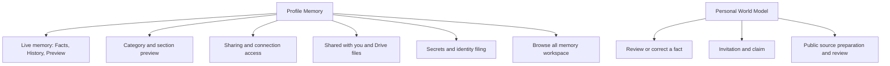

# Profile Memory and World Model UI Contract

Status: current product and UI reference. The Profile/World Model inventory was
checked at `3ff2620b48567177dce5c667e77a70203e4a8c35` on 20 October 2026;
the mounted `/one/pkm` workspace was refreshed against origin/main
`dcc4f611e39c80a0001df0ada3f47e85b445421e` on 24 October 2026. Owner:
frontend architecture. Classification: `canonical`, package-local. This is
the Memory/World Model depth of the [Profile contract](./profile.md). Vault,
PKM, consent and source owners retain mutation authority. Profile detail rows
use their [own type scale](./typography.md); `/one/pkm` opts into the scoped
Connect role mapping below. Existing document readers retain long-text rules.

## Visual Map



## Entry, gates, and Back

Profile panel `my-data` has `domain:<key>`, `sharing`, and `connection:<id>`
details. `/one/profile/access` and its connection URL normalize into these
Memory states. Panel `world-model` owns research. These are protected
Profile entries: missing/locked vault invokes existing creation/unlock and
resumes the pending destination. Owner or vault-epoch changes retire private
reads and selections. See [Profile entry rules](./profile.md).

Missing/disappeared domain or connection retains a child body and Back depth:
loading, couldn't load/retry/go back, or no longer available/go back to
Memory. It does not silently show the parent. Ordinary Back follows the
feature layer then Profile detail/panel hierarchy.

Sources: [workspace](../../components/profile/profile-workspace-page.tsx),
[route mapping](../../lib/navigation/profile-routes.ts), and
[Memory panels](../../components/profile/pkm-data-manager.tsx).

## Memory root and category details

| Surface / CTA | Effect and save boundary |
| --- | --- |
| Live memory | Read-only Facts/History/Preview view; no parallel memory writer. |
| Manage sharing | Opens `sharing` detail. |
| Refresh | Force-refreshes metadata, consent state and visible manifests. |
| Category row | Opens `domain:<key>`. |
| Search saved details / clear | Local deferred title/summary/source/section filter, offered at six or more categories. |
| Browse all memory | Handoff to `/one/pkm`, detailed below. |
| Create vault fallback | Existing import/setup route, not a new editor. |
| Section eye | Decrypts only the selected top-level section into a dialog. Loading, error, exact values and empty are distinct; Close invalidates the request. |
| Ask before sharing | Immediate `consent_required`/`private` slice posture change. No separate Save. Upgrade/availability/pending guards apply. Optimistic failure rolls back; conflict reloads; committed change plus failed readback is reported accurately. |
| View details | Local entity disclosure, not a route. |
| Edit / Delete entry | Only for editable/deletable entities. Delete has browser confirmation and uses existing financial-context or explicit PKM deletion writer. Confirmed deletion with failed readback reports removed/refresh needed. |
| Financial context | Financial category only: General/Portfolio/Risk/KYC/Tax/Documents, note, **Save** or **Update**. Draft until explicit merged-domain write. |
| Edit financial context / Cancel | Stages category/text and closes preview; Cancel clears draft/edit target. Save validates target still exists, preserves other entries and retains draft on failure. Busy disables controls. |

Metadata unavailable, sharing still refreshing, no saved details, no search
matches and manifest preparation/failure are distinct. Cached category rows
stay visible while sharing refreshes; root Refresh is the recovery owner.
Sources: [category UI](../../components/profile/pkm-data-manager.tsx),
[preview UI](../../components/profile/pkm-section-preview.tsx),
[mutation handlers](../../components/profile/profile-workspace-page.tsx).

## Live memory document

| Tab / CTA | Current behavior |
| --- | --- |
| Facts | Source status, disagreements, current record rows, saved-detail sources; **Show more** per record kind. |
| History | Observed changes, No changes yet, Show more, dropped-change count. Explicitly only changes seen while open and unlocked. |
| Preview | Safe internal-link-only Markdown or Nothing to preview yet. |
| Record / conflict | Opens **Source details** sheet with fields, source/version/timestamps, or the disagreeing source claims. **Done**/dismiss closes. A conflict view does not choose a winner. |
| Correct source | Authored handoff to Account, Consents, Connect, Connectors, Payouts, sent documents or memory.md, depending on the source. |

Locked state exposes only status. Owner/epoch change resets selection/paging;
other people's identifiers are omitted, including disagreements. Checking,
current, updating, stale, partial, conflict and empty remain distinct. There
is no document-local Retry; recover through the source or Profile Refresh.
Sources: [document](../../components/profile/living-memory-document.tsx),
[source handoffs](../../lib/pkm/live-mirror-presentation.ts).

## Sharing and received information

| Surface / CTA | Effect and boundary |
| --- | --- |
| Sharing root | Resolved active-grant/category/connection counts, or loading/unavailable/no active access. Connection row opens requester identity, scopes/categories and expiry. |
| Revoke in connection detail | Web immediately revokes by normalized **category scope**, without request ID or authored confirmation. It can affect matching grants beyond the displayed connection. Owner-token service serializes work, reports result and refreshes consent. |
| Location sharing / Consent center | Handoffs to their existing owners. |
| Find/connect by phone | Immediate authenticated discoverability update. Confirmed server value replaces UI; busy disables switch; failed change preserves prior value. |
| Marketplace visibility | Immediate investor opt-in update; confirmed state invalidates marketplace cache and refreshes persona. Voice path separately requires confirmation of desired target. |
| Shared with you | One secure card per person; loading/failure **Try again**/Nothing shared. Cards open consented values on device; they are not person-profile links. |
| Secure card Copy / Hide / Show | Copies available value; masks/unmasks sensitive fields. Web can start readable after successful opening; native sensitive disclosure starts with Show. |
| Secure card Unlock to view / Try again | Existing unlock/retry owner. Undecryptable-device, ended/revoked/expired and unavailable states do not expose values. |
| Drive grant row | Expands/collapses confirmed Viewer files; recipient need not connect Drive. Running/queued can receive more files. |
| Received Drive file | External available open URL in a new tab with opener isolation; no access mutation. |
| Previous / Next 25 / Try again | Per-grant file paging and recovery; disabled during read. Collapse drops fetched-page presentation. |

Secure-card values retire on expiry, access end, lock, owner change, privacy
shield/background. Failed/timed-out opens alone are retryable. Sources:
[access panels](../../components/profile/pkm-data-manager.tsx),
[revoke owner](../../lib/consent/use-consent-actions.ts),
[received groups](../../components/profile/shared-with-you-group.tsx),
[secure-card model](../../components/agent/consent/shared-with-you-card.tsx).

## Secrets and identity filing

| CTA / state | Effect and boundary |
| --- | --- |
| Empty secrets / Reload Secrets | Empty success hides the section; failed empty read exposes reload. |
| Reveal | Decrypts one secret on device. No secret-edit action. |
| Hide / Copy | Reveal auto-hides after 45 seconds and on privacy/session retirement. Copy requires second tap within four seconds. |
| Remove from Secrets | Irreversible confirmation **Keep** / **Remove**. Only Remove writes; busy blocks dismissal. Uncertain outcome prevents replay and requires Refresh. |
| Filing offer | Stages Wallet handoff or local Identity documents filing card. |
| File <noun> / Not now | Only File reads the secret and explicitly files the identity document, then marks filed. Failed/unconfirmed filing asks to check identity documents before retry; no automatic replay. Filing does not share it. |

All reveal/write work is owner-, epoch-, active-visit-, visibility- and native
privacy-fenced. Values stay with the existing memory-only reveal owner.
Sources: [group](../../components/secrets/secrets-list-group.tsx),
[reveal model](../../components/secrets/use-secrets-list-model.ts),
[secret panel](../../components/secrets/secret-items-panel.tsx).

## Mounted Memory workspace and handoff

`/one/pkm` mounts `PkmSettingsShell`, `PkmSharingPriceReview`, and
`PkmNaturalPanel`. Its **two** visible tabs are **Saved** and **Add**, owned by
`SegmentedTabs` and `SwipeViews` with one selected state and active pane height.
`memory.md`, Live memory, search, earnings, recent, categories, export and the
Sharing settings accordion are inside Saved. `memory.md` and Sharing are not
tabs. The retained `soul`/`sharing` model union members do not add DOM tabs.
There is no Memory setup route, compulsory setup step, separate native renderer
for this web route, new private-agent specialist, or auto-saving Add wizard.

| Route or state / entry | Visible text and action result | Owner, request and return |
| --- | --- | --- |
| One roster, direct or Profile **Browse all memory** → `/one/pkm` | Shared Back, **Memory**, shared avatar; Saved selected, Add available. Protected admission can show **Opening Memory…**, **Sign in to open Memory** / **Your saved details stay connected to your account.**, or **Unlock your vault to open Memory** / unlocked-session explanation. | `app/one/pkm/page.tsx`, `pkm-settings-shell.tsx`, `back-navigation-graph.ts`, auth/vault owner. No Memory-only wizard or request from tapping an inactive tab; first protected read begins after current authority. Back uses overlay → route feature layer → authored `/one` parent. |
| Saved initial, retained refresh, empty and search | **Search Memory** / accessible **Clear Memory search**; **Recently learned**, **Categories**, **Add Memory**; **One hasn’t saved anything yet.**, **Some saved details couldn’t be opened.** / **Try again**, **Some saved details couldn’t be loaded.** / Try again, retained rows with **Some saved details couldn’t be refreshed. Your available details are still here.** / Retry; `No memories match “{query}”.` | `pkm-natural-panel.tsx`, `use-pkm-natural-model.ts`. Search/clear/category selection/Add Memory have no write; search is local, category/leaf may start the selective protected reads below. Retry forces the failed reader only. Empty success does not stand in for failed hydration. |
| Inline `memory.md` reader/edit inside Saved | Live preview above the document while reading, hidden during edit. **Reconnect your account to open memory.md.**, **Opening memory.md…**, **memory.md couldn’t be opened.** / Try again, **The memory One uses in every conversation.**; Edit memory.md → Legal name, Date of birth, Sex, 18-row Markdown draft, 18,000-character counter, password-omission helper. Cancel restores original; Save changes/Saving… commits only a changed, valid draft; conflict keeps the draft and **Reload latest version** explicitly discards it. Retry sync flushes queued authorized work, never an unsaved draft. | `soul-memory-panel.tsx`, `use-soul-memory-model.ts`, `soul-memory-document.tsx`. Editor field changes and Cancel have no API. Save uses expected-document CAS via encrypted `one_memory` store-domain; Try again/reload read latest; sync flushes its existing queue. Markdown headings, lists, code, links, 64ch reader and unbroken financial tables remain intact. |
| Live memory preview and source handoff | **Live memory**, boundary explanation, locked/checking/current/updating/stale/partial/conflict/empty headline; fact/source claims, badges and disagreements show each side. **See all** enters Profile `my-data`; source correction enters its actual owner. No Open Memory row while already in Memory. | `live-mirror-preview.tsx`, `use-live-mirror-view.ts`, `live-mirror-presentation.ts`. Shared owner/epoch-fenced read; navigation has no mutation. Facts/History/Preview and Source details are Profile destination controls, not `/one/pkm` tabs. |
| Category, nested group and leaf | Dynamic category/group title and count, one-level breadcrumb and Back; immediate group/leaf children; **Opening {title}…**, **This couldn’t be opened** / **Go back and try again.**, **This memory moved** / **Go back and open it again.**, or **Nothing is saved in {title} yet.** Leaf shows primary label, value, optional context and Sharing Checking…/Shared/Not available/Private. | `pkm-memory-level.tsx`, `pkm-memory-row.tsx`, `pkm-memory-detail.tsx`. Category/path/search navigation is local; selected encrypted domain data/manifest/impact may read. Back unwinds leaf → path segment → category, never raw history fallback. No fabricated per-memory source or timestamp. |
| Leaf edit, forget, reserved owner and sharing | **Edit** opens **Edit Memory** with dynamic **New value for {label}**, Input or multiline Textarea, Cancel/Save. **Forget Memory** opens **Forget this memory?** and irreversible text, Cancel/Forget Memory. **Sharing** opens Ask before sharing switch with private/ask-first explanation, loading/error and Done; section price is conditional. Reserved records show **Open in {appName}** and the app-owned edit/removal explanation. | `pkm-memory-detail.tsx`; ordinary Dialogs cap 380px at `sm`, omit X; Forget uses small AlertDialog. Cancel/outside/Escape/Back when permitted have no write; pending save blocks close. Impact failure blocks protected mutation. Confirmed update/deletion versus failed readback/unknown outcome stay distinct; sharing switch writes exact scope posture immediately, Done only closes. Reserved handoff has no generic edit/delete. |
| `/one/pkm/recent` | Bounded **Recently learned** list or **Nothing learned yet.**; row opens leaf, shell Back returns to Memory. | Same model/row owners. Current snapshot read, row opening itself no mutation. Child PageHeader title is already visually hidden. |
| `/one/pkm/location` and `/one/pkm/location/detail?memory={selector}` | Search Location memory / accessible Clear; grouped readable fields and counts, Opening/error/Try again/empty/no-match; partial projection warns saved Memory is unchanged. Selected detail shows value/context/Sharing. Invalid/deleted selector shows **This detail is no longer available.** / **Open Location memory**. | `location-memory-view.tsx`, `location-memory-presentation.ts`, nested pages. Selector is an opaque field selector, never a private value. Ambiguous fields remain non-clickable. Search/clear no request; retry rereads existing owner. Child breadcrumb/Back retain parent semantics. No map or live tracking. |
| Add note and review | **Memory note**, example placeholder, 50,000-character bound; oversize paste leaves note unchanged. Exact note/epoch processing checkbox permits the private agent's configured model to process personal identifiers including SSN; sharing still needs separate approval. **Review memory** prepares read-only proposed detail/destination/privacy rows, ignored notice, unresolved section/reason and retryable **Retry this section**. Edit note or approval invalidates preparation. | `pkm-natural-panel.tsx`, model and proposal adapter. Preparation POST below, no storage commit. Proposed rows cannot Keep/Edit/Dismiss. Retry reruns only its unresolved source block; busy/disabled and partial coverage are preserved. |
| Add explicit save | Shared-recipient checkbox acknowledges updates without changing recipients; **Save to Memory** is enabled only for saveable review with required acknowledgment and no conflicting busy state. Full success clears note/review; partial/no-save/failure/timeout keep remaining note and honest receipt, including **Check Memory before preparing this note again.** | `use-pkm-natural-model.ts`, `pkm-write-coordinator.ts`. Explicit encrypted domain commit below, source/revision/idempotency bindings retained. Preparation is evidence, not grant or write permission. No Add Cancel stage or implicit save. |
| Saved Sharing accordion/category section/bundle | **Checking sharing settings…**, **Sharing settings**, sections people can request, ask-first/private switches, section price and conditional whole-bundle price. Whole bundle and sections have separate terms. Failure offers **Retry sharing settings** or **Retry bundle availability**; missing manifest/scope/catalog does not silently expose. **Nothing to share yet.** is a successful empty state. | `pkm-saved-sharing.tsx`, `pkm-domain-sharing.tsx`, exact-scope exposure owner. Accordion/Back collapse is local; switches commit expected-manifest-version private/consent_required. Private may revoke matching grants. Review and tariff pricing remain separate from listing, access approval and payment. |
| Section/whole-bundle price and private-agent review bridge | Trigger **Sharing price**, **Check sharing price**, **Free · Set price**, or saved amount/term → **Price for {label}**; USD base price, base access term (1/3/7/30 days), free/approval/proration/cost explanation. **Review sharing price** stages **Confirm free sharing terms** or **Confirm sharing price**; Cancel closes confirmation only; **Confirm free** / **Save price** commits exact tariff, **Sharing terms saved.** only after acknowledgement. **Close price review** closes editor when allowed. Bundle review title **{bundle}: sharing and price**, listing/approval/payment separation and **Close bundle review**. | `scope-tariff-editor.tsx`, `pkm-sharing-price-review.tsx`. Existing tariff/readiness requests and explicit idempotent POST below. Nested Back closes confirmation before editor; busy prevents dismissal. Review-only opening has no listing/price mutation. Payments link hands off to existing owner. |
| Earnings, export and source/payment links | Conditional Pending/Available earnings, Unrecovered costs, Withdrawal in progress, **Checking earnings…**/error and payouts/wallet link. **Download Memory** / Preparing… row; **Readable file. Keep it private.** or **Unlock to download.**, status/error. | `memory-commerce-summary.tsx`, `pkm-saved-sharing.tsx`, `pkm-export-service.ts`. Canonical commerce read, no Memory funding action. Export validates current account envelope/completeness and guarded browser download or native share; cancellation is not a saved file. Readable-only backup fallback is explicit, secrets/audit information excluded. No real information is exported for visual verification. |

### Mounted text, control, and outcome ledger

The route table above identifies the owning request and return contract; the
[row-to-API table](#row-to-api-provenance-and-response-contract) and
[prepare/review/save wire table](#memory-workspace-complete-prepare-review-save-and-leaf-wire)
specify payload and consumed response fields. In the ledger below, **local**
means the named tap or edit makes no request; a later selected-domain read is
listed separately. **Read**, **prepare**, and **commit** refer to those exact
tables. `Aligned` means the current behavior and presentation role are retained;
`changed` means this presentation refresh changed its visible styling or root
heading placement; `exception` preserves a different owning semantic role.
`Fixture` means the synthetic optimized-CSS browser case exercises that role,
not the protected route. `Pending` means the mounted, unlocked route or native
platform result has not been observed. Dynamic values are templates; no actual
person's information is part of this contract. Source line references below
are for this branch after the 2026-10-24 main merge.

| Entry and state | Exact visible copy; accessible-only copy is prefixed `aria:` | Tap, cancel, Back, and request boundary | Source; role, disposition, proof |
| --- | --- | --- | --- |
| `/one/pkm` initial | `Opening Memory…` | Admission wait; no Memory write. | `pkm-natural-panel.tsx:246–254`; status; aligned, Pending. |
| Signed out or verification required | `Sign in to open Memory`; `Your saved details stay connected to your account.` | Existing auth owner admits the route; no Memory setup wizard. | `pkm-natural-panel.tsx:258–270`; status/body; aligned, Pending. |
| Locked vault | `Unlock your vault to open Memory`; `Your saved details are decrypted only for this unlocked session.` | Existing vault challenge; opening alone does not create a document. | `pkm-natural-panel.tsx:273–287`; status/body; aligned, Pending. |
| Authenticated root chrome | Shared `Memory` current crumb beside Back and avatar; body `Memory` heading remains accessible but visually hidden. | Back uses the authored `/one` parent after feature layers; avatar retains Profile owner. | `app/one/pkm/page.tsx:7–9`, `top-app-bar.tsx:331–386`, `back-navigation-graph.ts:953`; current crumb aligned, body heading changed, Pending. |
| Root tabs | `Saved`, `Add`; `aria: Memory` tab list. | Selection and swipe update one active pane locally; no inactive-tab request. | `use-pkm-natural-model.ts:84–88`, `pkm-natural-panel.tsx:445–466`; agent tab exception, Fixture for synthetic panes, mounted transition Pending. |
| Saved search | `Search Memory`; `aria: Clear Memory search`. | Type/clear are local; opening a result may read its selected encrypted domain. | `pkm-natural-panel.tsx:470–485`; input/utility, changed/exception, Pending. |
| Saved search results | `Memories`, `Categories`, or `No memories match “{query}”.` | Search filters the current projection locally; row selection is the separate read boundary. | `pkm-natural-panel.tsx:510–541`; section/empty, changed, Pending. |
| Saved recent row | `Recently learned`; `{count} memory/memories`; `aria: Open recently learned memories`. | Navigates to `/one/pkm/recent`; no write. | `pkm-natural-panel.tsx:545–559`; Settings row changed, Pending. |
| Saved categories and add row | `Categories`, dynamic category labels/counts, `Add Memory`; successful empty `One hasn’t saved anything yet.` | Category selection may read its domain; Add selects its tab locally. | `pkm-natural-panel.tsx:236–243,561–583`; section/row/empty changed, Pending. |
| Saved cold read | `Opening Memory…` or `Some saved details couldn’t be opened.` / `Try again`. | Retry refreshes failed memory-card read; failed hydration is never the empty state. | `pkm-natural-panel.tsx:488–509`; status/compact action changed, Pending. |
| Saved bootstrap failure | `Some saved details couldn’t be loaded.` / `Try again`. | Retry requests fresh metadata; already shown detail is not silently discarded. | `pkm-natural-panel.tsx:585–598`; status/compact action changed, Pending. |
| Saved retained refresh failure | `Some saved details couldn’t be refreshed. Your available details are still here.` / `Retry`. | Retry requests memory cards while retained rows remain visible. | `pkm-natural-panel.tsx:599–617`; status/compact action changed, Pending. |
| Recent list or empty | Dynamic card title; `aria: Open memory: {primary}`; or `Nothing learned yet.` | Open selects a leaf; shell Back returns to Memory. | `pkm-memory-row.tsx:22–39`, `pkm-natural-panel.tsx:420–436`; row/empty changed, Pending. |

| Saved `memory.md` state | Exact visible copy; accessible-only copy is prefixed `aria:` | Result and request boundary | Source; role, disposition, proof |
| --- | --- | --- | --- |
| Reconnect/loading/failure | `Reconnect your account to open memory.md.`, `Opening memory.md…`, or `memory.md couldn’t be opened.` / `Try again`. | Existing authority and encrypted read; Try again retries that read. A failed read never creates an empty document. | `soul-memory-panel.tsx:40–72`; status/compact action changed, Pending. |
| Reader and live preview | `The memory One uses in every conversation.`; rendered Markdown headings, lists, code, links and tables; `Edit memory.md`. | Reader has no write; Edit opens a local draft and hides Live memory preview. | `soul-memory-panel.tsx:46–49,73–115,211–214`; body/document/compact action changed, Fixture for document layout, mounted preview Pending. |
| Edit actions | `Cancel`, `Save changes` / `Saving…`. | Cancel restores original draft. Save commits only a changed, valid draft through expected-document CAS; busy save blocks close/Back. | `soul-memory-panel.tsx:84–103`, `use-soul-memory-model.ts`; utility exception/compact changed, Fixture for editor layout; write Pending. |
| Queued sync | `Syncing your latest memories…` or `Your latest memories are available here but haven’t synced yet.` / `Retry sync`. | Retry flushes authorized queued work, never the unsaved draft. | `soul-memory-panel.tsx:118–132`; status/compact changed, Pending. |
| Identity fields | `Identity details`; `Legal name`, `Date of birth`, `Sex`; `Optional. Edit or clear a field to remove it. Your account name and photo already work for approved questions; no KYC is needed.` | Input edits modify only the local Markdown draft; native date input keeps platform formatting. | `soul-memory-panel.tsx:135–170`; form label/helper/input changed, Fixture for form layout, native picker Pending. |
| Identity explanation | `Age is calculated from your birth date. Sharing age does not share that date. Sex is used only when you provide it.` | Informational; no request. | `soul-memory-panel.tsx:171–175`; helper changed, Fixture. |
| Markdown editor | `aria: memory.md Markdown`; `Use Markdown headings, lists, and links. Passwords are omitted when saving.`; `{length} / 18,000`. | Typing is local. Invalid/overlimit draft cannot commit; credential stripping stays in the writer. | `soul-memory-panel.tsx:176–196`; input/helper/count changed, Fixture for multiline layout, actual keyboard Pending. |
| Conflict | `Reload latest version`; retained-draft conflict explanation from the document model. | Explicit reload discards the local draft and rereads latest; no replay of an uncertain save. | `soul-memory-panel.tsx:197–208`, `use-soul-memory-model.ts`; compact changed, Pending. |

| Nested route or leaf state | Exact visible copy; accessible-only copy is prefixed `aria:` | Result and request boundary | Source; role, disposition, proof |
| --- | --- | --- | --- |
| Category/path | Dynamic parent label, crumb path, title and child count; `aria: Open {group}`. | Drill and unwinding are local; selected domain/manifest may read. Back pops leaf, path, then category. | `pkm-memory-level.tsx:75–127`; content title/row changed, Pending. |
| Group unavailable | `Opening {title}…`, `This memory moved` / `Go back and open it again.`, `This couldn’t be opened` / `Go back and try again.`, or `Nothing is saved in {title} yet.` | Distinct loading, stale, failed and successful-empty results; Back remains local. | `pkm-memory-level.tsx:102–143`; status/empty changed, Pending. |
| Leaf content | Dynamic context, label and value; `Sharing` plus Checking/Shared/Not available/Private; `aria: Open sharing settings`. | Opening Sharing is local; impact/manifest reads are separately authority fenced. | `pkm-memory-detail.tsx:140–175`; content title/value/row changed, Fixture for Location detail, mounted read Pending. |
| Reserved owner | `Open in {appName}`; `{appName} manages this. Edit or remove it there.` | App-owned route handoff; no generic Memory edit/delete. | `pkm-memory-detail.tsx:177–198`; row/helper exception, Pending. |
| Leaf actions | `Edit`; `Forget Memory`. | Open their own dialogs locally; absent authority or pending action disables rows. | `pkm-memory-detail.tsx:199–218`; Settings rows exception, Fixture for Location leaf. |
| Edit dialog | `Edit Memory`; dynamic label; `aria: New value for {primary}`; `Cancel`, `Save`, spinner. | Cancel/outside/Escape/Back close when allowed with no write. Save uses exact fingerprint and encrypted domain writer; unchanged/blank/busy disables Save. | `pkm-memory-detail.tsx:237–276`; overlay title/form/utility/compact changed, Fixture for open/cancel, commit Pending. |
| Forget confirmation | `Forget this memory?`; `One will no longer remember “{primary}”. This can’t be undone.`; `Cancel`, `Forget Memory`. | Cancel/dismiss has no write; destructive confirm deletes exact fingerprint. Busy prevents dismissal. | `pkm-memory-detail.tsx:220–235`; AlertDialog/destructive exception, Fixture for cancellation, commit Pending. |
| Sharing dialog | `Sharing`; dynamic label; `Ask before sharing`; consent-required/private explanation; `aria: Make this memory private` or `Ask before sharing this memory`; `Updating sharing choices…`; `Done`. | Switch commits exact posture immediately; Done/dismiss only closes when allowed. Missing posture shows `Sharing controls for this memory aren’t available right now. Refresh and try again.` | `pkm-memory-detail.tsx:278–340`; overlay/form/switch/utility changed or exception, Fixture for unavailable dialog, mutation Pending. |
| Leaf failure and acknowledgement | `Current sharing couldn’t be verified. Refresh and try again.`; `This detail has changed. Open Location memory again before updating it.`; `Memory updated.` / `Memory forgotten.`; committed-but-refresh-failed `Memory was updated, but the latest summary could not refresh. Refresh the page to see it.` | Impact failure blocks write; changed fingerprint demands fresh open; confirmed write is recorded before best-effort metadata refresh. Unknown/failed write is not replayed. | `use-pkm-natural-model.ts:1229–1359`; status/toast aligned, Pending. |
| Sharing outcome | `One will ask before sharing this.` / `This is private again.`; stale, update-failed and recipient-impact recheck errors. | Exact scope exposure may revoke matching grants; impact is reread before detail mutation. | `use-pkm-natural-model.ts:1829–1891`; status/toast aligned, Pending. |
| `/one/pkm/location` | `Search Location memory`; `aria: Clear Location memory search`; grouped fields; `Opening Location memory…`, failure / `Try again`, successful empty / no-match, partial warning. | Search/clear are local; retry rereads current owner. Ambiguous fields have no click handler. | `location-memory-view.tsx:22–42`; input/row/status changed, Fixture for Location at 390/1440, mounted route Pending. |
| Location stale selector | `This detail is no longer available.` / `Open Location memory`. | Replaces route with `/one/pkm/location`; the query selector never contains a private value. | `pkm-natural-panel.tsx:290–325`; status/compact changed, Pending. |

| Add or commerce state | Exact visible copy; accessible-only copy is prefixed `aria:` | Result and request boundary | Source; role, disposition, proof |
| --- | --- | --- | --- |
| Add note | `aria: Memory note`; example `I prefer morning flights whenever possible.`; oversize `That paste is too long. Add smaller sections; your existing note is unchanged.` | Type/paste are local. Oversize paste leaves existing note intact; no save. | `pkm-natural-panel.tsx:627–654`; input/status changed, Fixture for note layout. |
| Processing approval | `Allow my private agent’s configured model to process personal identifiers in this note, including SSN, to prepare Memory. Sharing requires a separate approval.` | Exact note/epoch checkbox is local and distinct from recipient approval. | `pkm-natural-panel.tsx:655–659`; checkbox exception, Fixture for wrapping; model boundary Pending. |
| Preparation | `Review memory`; spinner/disabled; `Preparing section {n} of {total}… Nothing has been saved yet.` | Explicit prepare POST only; no encrypted storage commit. | `pkm-natural-panel.tsx:660–685`, `use-pkm-natural-model.ts:1417–1438`; compact changed, Fixture for Add review, live prepare Pending. |
| Proposed and ignored rows | Source-text title or `Proposed saved detail`; destination/visibility description; `Some of this note will not be saved` / `Only appropriate details can be added to Memory.` | Read-only proposal rows: no Keep/Edit/Dismiss action. | `pkm-natural-panel.tsx:51–78,687–712`; row/description changed, Fixture for synthetic proposal. |
| Unresolved source | Dynamic section label; `{reason} Nothing from this section has been saved.`; `Retry this section`; `aria: Retry this section: {label}`. | Retry prepares only unchanged unresolved source; busy or non-retryable state blocks it. | `pkm-natural-panel.tsx:713–761`; row/compact changed, Fixture for partial review, live retry Pending. |
| Duplicate and prepare outcomes | `That exact detail is already saved. Open Browse to correct it instead of creating a duplicate.`; related-detail warning; review-ready, nothing-new and preparation-failed status. | Exact duplicate stops preparation; failure keeps note. “Open Browse” is existing copy drift, not a tab. | `use-pkm-natural-model.ts:1404–1484`; status aligned, Pending. |
| Recipient impact | `I understand that this detail is already shared and will be refreshed for the current recipients.`; `Review this before saving. It does not change who can access the detail.` | Checkbox is local, required only for affected recipients; does not grant/revoke. | `pkm-natural-panel.tsx:762–789`; checkbox/helper exception, Fixture for wrapping. |
| Explicit save | `Save to Memory`, spinner/disabled; full, partial, no-save, failed or interrupted receipt. | Commits only reviewed saveable cards with required acknowledgement. Full success clears note; partial/unknown keeps a truthful recovery path and never replays uncertain writes. | `pkm-natural-panel.tsx:790–815`, `use-pkm-natural-model.ts:1586–1737`; full primary exception, Fixture for button geometry, live commit Pending. |
| Export | `Download Memory` / `Preparing…`; `Readable file. Keep it private.` or `Unlock to download.`; dynamic success/cancel/error status. | Validates account envelope and complete encrypted snapshot before browser download/native share. Lock and busy disable; cancellation is not saved. | `pkm-saved-sharing.tsx:48–70`; Settings row/platform exception, native and OS outcome Pending. |
| Sharing accordion | `Checking sharing settings…`; `Sharing settings`; request-and-approval explanation; failure / `Retry sharing settings`; successful empty `Nothing to share yet.` | Disclosure and Back collapse locally. Manifest/scope reads and retry are bounded; missing data never becomes an available switch. | `pkm-saved-sharing.tsx:40–98`; section/row/utility changed or exception, Pending. |
| Section/bundle availability | `Sharing and price`, dynamic section/bundle names; `Available to request · Ask first` or `Private · Allow requests before changing its price`; conditional whole-bundle price; retry bundle availability. | Switch writes only exact scope exposure at expected manifest version; read failure leaves pricing unavailable. | `pkm-domain-sharing.tsx:54–76`; row/switch/utility exception, Pending. |
| Tariff review | Saved price/`Check sharing price`/`Sharing price`; `Price for {label}`; USD base price, 1/3/7/30-day term, readiness/cost copy; `Review sharing price`, `Close price review`. | Opening and field edits are local; readiness/tariff reads are separate. Review stages exact terms without POST; Back first closes nested confirmation. | `scope-tariff-editor.tsx:80–104`; overlay/form/compact/utility changed or exception, Pending. |
| Tariff confirmation | `Confirm free sharing terms` or `Confirm sharing price`; dynamic amount/term/approval and refund text; `Cancel`, `Confirm free` or `Save price`; `Sharing terms saved.` or error. | Cancel makes no price POST. Confirm sends exact idempotent tariff POST; failed/unknown response never becomes a saved-price success. | `scope-tariff-editor.tsx:105–118`; AlertDialog/confirmation exception, Pending. |
| Bundle review and private-agent bridge | `{bundle}: sharing and price`; `Close bundle review`; blocked/ready review feedback. | Opening is read-only. Close/Back only dismiss when not pending; listing and price retain distinct confirmations. | `pkm-sharing-price-review.tsx:82–183`; overlay/utility exception, Pending. |
| Earnings and handoff | `Pending earnings`, `Available earnings`, conditional `Unrecovered costs` / `Withdrawal in progress`; `Checking earnings…` or error; `Set up payouts and view your wallet` / `View payments and earnings`. | Canonical commerce read; link navigates to Payments and earnings without a Memory funding/withdrawal action. | `memory-commerce-summary.tsx:12–28`; row/utility exception, Pending. |
| Live memory and source handoff | `Live memory`, dynamic checking/current/stale/partial/conflict headline, `See all`, source route labels. `Open Memory` is intentionally absent here. | Owner/epoch-fenced read only; See all enters Profile, correction links enter source owners. No second Memory tab. | `live-mirror-preview.tsx:98–146`; row/status/handoff exception, Pending. |

The exact transport payloads and response projections for proposals, encrypted
domain saves, metadata, manifest, selected data and scope exposure are in
[Row-to-API provenance](#row-to-api-provenance-and-response-contract) and
[the workspace wire table](#memory-workspace-complete-prepare-review-save-and-leaf-wire).
The duplicate warning still literally says “Open Browse”; this is copy drift
against the current Saved label, not a hidden Browse tab. Compatibility links,
Profile, Payments and source-owner pages are handoffs, not extra Memory tabs.

### Memory header, type and CTA presentation

The shared shell owns the 44px Back and profile targets, 32px avatar and the
17/22/600 **Memory** current breadcrumb beside Back. The breadcrumb container
requests 17/22/550/normal; its current-page child requests weight 600, while a
Memory parent link on a nested route retains 550. The root body PageHeader remains
semantic but visually hidden through `titleVisuallyHidden`; nested route
breadcrumb/parent labels stay authored. Agent-width root and reading-width
children retain their shell measures, gutters, scroll and safe-area owners.
Neither a second header nor Connect's 728px directory width is applied.

| Role in mounted Memory | Previous source default → scoped target, px/line/weight | Effective owner or exception |
| --- | --- | --- |
| Saved/Add labels and header | Agent tab 15/20/550 → unchanged; shared final crumb 17/22/600 → unchanged | `top-shell-tabs.tsx`, `back-navigation-graph.ts`; two real tracks at all widths. Removed legacy four-track mobile override. |
| Category/row, description, section, source group | 17/22/400 → 14/21/550; 13/18/400 → 12/18/400; 15/20/600 → 14/22/600; explicit source group 12/18/600 | Scoped workspace/portal variables and Settings slot cascade in `app/globals.css`; source-group role only when mounted. |
| Content title, value, document | Foundation h2 about 20–22/1.2/600 → category/leaf 28/36/600; saved value 14/21/400; Markdown prose 14/21/400 | Content title is not duplicate root chrome. Document h1 20/28/600, h2 16/24/600, deeper headings 14/22/600; 64ch prose, code mono, lists/links and table scroll retained. |
| Form label, input, helper, status | 15/20/600 → 15/22/550; 17/22/400 → 14/22/400 above 620, 16/22/400 at ≤620; helper 13/18/400; status 13/18/600 | Scoped raw Input/Textarea/Select, labels and status hooks; native date picker retains platform formatting and at least 44px target. |
| Compact/utility/full primary | Generic compact 15/20/650 → 12/18/550; utility 13/21/550 → 12/21/550 ≤620; full primary 17/22/650 remains | `data-pkm-action` role on actual Morphy/stock callers. Save to Memory remains the full-flow filled primary. |
| Memory overlay title, description and confirmation action | Raw Dialog/AlertDialog text-lg/leading-none or text-sm → 20/28/600, 14/20/400, 13/20/600 | `data-pkm-overlay` on Edit/Sharing/Forget/tariff/bundle hosts and select portal; actual Dialog geometry/keyboard/safe-area constraints remain primitive-owned. Shared toast 13/20/500 title and 12/20 description unchanged. |

Static cascade inspection gives these tracking values: Saved/Add tabs,
navigation and ordinary rows/sections request `normal`; row descriptions
request `0`; category/leaf and Memory dialog titles inherit the foundation
title3 `-0.012em`. The app self-hosts Plus Jakarta Sans 400/600/700 while
several CSS roles request 550. The browser's computed `font-weight` and its
selected physical face are different questions; the selected face and fully
effective mounted cascade remain pending a real route measurement. The root
agent shell is capped at 880px and nested reading shells at 54rem; page gutters
are 16px, then 20px at 640px, 24px at 1024px and 28px at 1280px. The agent-top tab
track remains 36px under its selector owner. Edit and Sharing dialogs cap at
380px from `sm`; Forget uses the small AlertDialog. These dimensions are
source contracts, not measured keyboard or short-height outcomes.

Ordinary matched actions have a transparent, frameless outer **≥44px** Button
that retains ripple/focus/busy/disabled behavior and an inner **≥44px** neutral
pill: accent ink, 1px accent/32%-on-neutral border, full radius, 88px minimum
and 15px horizontal padding (78/11 at ≤620; 72/9 at ≤350). Long labels wrap;
full-width Review memory keeps its full measure. Try again/retry and editor
Save changes/Save use this role. Cancel, Done, price triggers, close and
payment/source links remain quiet utility roles. Forget's destructive
AlertDialogAction, its shared Cancel/ripple, switches, checkboxes, tab selector,
entire Settings rows, search clear, shell Back/avatar, native picker/share
controls and the final Save to Memory retain their owning semantics. Pending,
disabled and error colors are not changed to success or broader permission.

| CTA state | Current owner and visible effect | Rendered proof |
| --- | --- | --- |
| Normal | Scoped compact outer target transparent; inner neutral outlined accent pill. Final Save to Memory is the existing filled full-flow primary; destructive Forget retains AlertDialogAction styling. | Synthetic compact and primary geometry only; mounted color/border measurement pending. |
| Hover/pressed | Memory pill receives a scoped tint; Morphy/stock Button retains its ripple/pressed semantics. | Static cascade inspected; actual pressed frame pending. |
| Focus | Stock/Morphy focus ring and keyboard order remain authoritative; portals retain primitive focus trapping. | Actual mounted keyboard, focus return and background-interaction proof pending. |
| Disabled/busy | Disabled neutral treatment and primitive opacity remain; Review, Retry, Save and tariff confirmations disable according to their own guards. Existing spinners/status text communicate work. | Selected synthetic disabled geometry only; full per-action busy, short-height and soft-keyboard proof pending. |
| Success/failure/conflict/partial/unknown | Owning model returns the distinct receipts in the ledger; a failed or uncertain write never receives success styling. | Behavioral contract tests and static source inspected; live protected outcome pending. |

Portals sit under `document.body`, outside `[data-pkm-workspace]`. The Memory
overlay marker is set on actual Edit/Sharing/Forget, section tariff, tariff
confirmation, tariff Select and bundle-review hosts; shared primitives are not
restyled for unrelated routes. Leaf Edit/Sharing stay ordinary Dialogs with
`sm:max-w-[380px]` and no X; Forget keeps small AlertDialog. Pricing and
bundle review keep their own dimensions. Popup height, overflow, keyboard and
safe-area behavior are owned by Dialog/Select/AlertDialog.

Verification of this presentation refresh after merging `origin/main`
`63ca3c2d078bcadf6dc802f306def6f0e20874c6` into feature source
`a834f9479e697d96367c44ca4bee0d647517796a` (2026-10-24):

| Evidence | Result and boundary |
| --- | --- |
| Static and contract checks | Typecheck, focused lint, docs verification, cache coherence, UI doctor, generated Back/Search and route/surface checks pass. Focused Memory behavior and pricing/export tests pass without changing their service owners. Design-system, accent, hierarchy, restraint and rendering checks pass; the separate brand-asset generator reports stale assets already present at this source revision. |
| Optimized rendered layout | All 112 Memory Chromium and WebKit cases pass in the current merged checkout. A paired Mail regression run totals 295 passed and 9 Mail KYC cases that passed on retry; no Memory case was flaky. The synthetic fixture compiles shipped Tailwind/CSS with Lightning CSS and loads the product font. It covers Saved reader/editor and Add note/review at 350, 351, 360, 393, 430, 620, 621, 639, 640, 767, 768, 1024 and 1440px in light/dark, and Location/detail/Edit/Sharing/Forget portals at 390/1440px in light/dark. These checks measure selected computed type, target boxes, 620/640 transitions, wrapping and horizontal overflow with synthetic records, at 100% zoom and reduced motion. They do not mount the Next route or full shared top bar. |
| Protected and platform acceptance | This feature checkout has no running backend/proxy or separate web origin. Port 3000 is occupied by another active checkout and was left alone. The read-only reviewer preflight stopped before Chromium because this Windows Node process could not spawn the installed `gcloud.cmd`; no reviewer identity or secret was printed or changed. The fixture's synthetic model does not prove protected same-session navigation, live Add/price/export writes, native accessibility, actual keyboard/safe-area behavior, or an OS file-save/share outcome. Those checks remain pending. No real Memory, tariff or grant was changed for visual proof. |

Owners: [workspace](../../components/profile/pkm-natural-panel.tsx),
[memory.md model](../../components/profile/use-soul-memory-model.ts),
[capture/browse/sharing model](../../components/profile/use-pkm-natural-model.ts),
[location memory](../../components/profile/location-memory-view.tsx),
[Connect roles](./connect.md), [typography](./typography.md).

## Personal World Model

Research presentation consumes the existing app-level store and encrypted
confirmed/source memory. Decisions require a verified authenticated session,
unlocked key, current owner token and unexpired token.

| Surface / CTA | Effect and save boundary |
| --- | --- |
| Status/progress | Checking, retrying, off, preparing/paused/stalled, insufficient identity/setup, disabled, retryable outage/wait, exhausted, ready to review, done/nothing found. Partial cited findings/checkpoints remain visible; provisional findings have no memory decisions. |
| Try again / Turn on | Reload appropriate failed source/research, respecting outage retry time; Turn on explicitly updates preference. |
| Draft Yes / No | Explicit fact decision, serialized per fact. Yes is saved only after encrypted write; No records rejection, never creates an opposite fact. |
| Fact row | Opens sources/external links/certainty/reason. Draft offers Yes/No/Edit; saved offers Edit/Remove. |
| Edit · Save / Cancel | Corrected wording ≤600 characters. Save commits correction; Cancel drops draft. |
| Saved Remove | Separate confirmation mode. Back first cancels edit/remove, then closes sheet; busy consumes Back. Failure retains sheet/error; success closes. |
| Edit or remove these details | Confirmed-source row hands off to Profile Memory. |
| Citations / related search | Source links, Azure/Bing disclosure and secondary Google suggestions remain explicit; no implied truth from a suggestion. |
| Invite someone | Usable-model only. Name and email and/or E.164 phone; **Create invitation** persists contact-bound invitation. **Share invitation** invokes share/copy; **Revoke** immediately revokes selected invitation. Failure retains draft. |
| Research and email | **Research public pages**, **Email me when it’s ready** immediately persist preferences. **Check for updates** explicitly starts a new bounded check after completion or exhaustion and closes the sheet. Exhaustion never starts an automatic retry. Owner/consent checks, provider cooldown/breaker and three-starts-per-hour admission still apply. |
| Claim my model / Decline | Explicit bounded invitation decision, clears handoff and refreshes; nothing shared back. Other-account handoff allows review with current account. Google research opt-back-in checkbox does not grant Azure/Bing disclosure consent. |
| Public source preparation | URLs, current account name, explicit chosen-public-page checkbox → **Read these pages** prepares a draft. Review selects/corrects facts; explicit save persists selected details. Discard/Skip removes offer; affected-sharing acknowledgment precedes save. |

Web options currently have no ordinary **Add a public source** opener; the
sheet auto-opens when the claim flow increments its source request. Native
offers the direct opener. Do not claim identical reachability. Native Memory
also nests live/received/secrets panels with 40-row presentation paging and
adds a category-consequence confirmation before revoke. Web revoke is direct.

Owners: [model page](../../components/profile/personal-world-model-page.tsx),
[fact sheet](../../components/profile/world-model-fact-sheet.tsx),
[options](../../components/profile/world-model-options.tsx),
[invitations](../../components/profile/world-model-invitations.tsx),
[claim](../../components/profile/world-model-claim-invitation.tsx),
[sources](../../components/profile/world-model-sources.tsx),
[native memory](../../components/profile/use-native-memory.ts), and
[native World Model](../../components/profile/use-native-world-model.tsx).

## Row-to-API provenance and response contract

Auth: protected PKM/World Model uses current owner authority; metadata can
resolve Firebase authority where its service permits. No credential values
are documented. Web [PKM catchall](../../app/api/pkm/[...path]/route.ts)
forwards same `/api/pkm/*` path/query, auth and client-contract headers to
[PKM router](../../../consent-protocol/api/routes/pkm.py) /
[shared routes](../../../consent-protocol/api/routes/pkm_routes_shared.py) /
[PKM service](../../../consent-protocol/hushh_mcp/services/personal_knowledge_model_service.py).
World Model uses [One proxy](../../app/api/one/[...path]/route.ts) →
[World Model router](../../../consent-protocol/api/routes/one/world_model.py).
Native transport can use configured backend/bridges. Cache reuse does not
create a fictional network call per rendered field.

| Row/control | Read or write: exact path/body | Fields → render / branch |
| --- | --- | --- |
| Memory load/Refresh | GET `/api/pkm/metadata/<uid>`, force no-cache | `domains[].domain_key/key,display_name,icon_name,color_hex,attribute_count,summary,available_scopes,last_updated,readable_summary,readable_highlights,readable_updated_at,readable_source_label`→category identity/count/description. Contract/completeness versions→upgrade/preparation.404 normalized empty; transient failure can retain prior owner fallback. |
| Category sharing | GET `/api/pkm/manifest/<uid>/<domain>` | `manifest` scope registry/paths/versions→section controls. Missing manifest distinct from failed preparation. |
| Section eye | GET `/api/pkm/domain-data/<uid>/<domain>?segment_ids=<id>` (repeat segment_ids) | `encrypted_blob:{ciphertext,iv,tag,algorithm,segments},storage_mode,data_version,updated_at,manifest_revision,segment_ids`→client decrypt only selected section→value preview. Close invalidates read generation, no write. |
| Search/category/clear/View details | Loaded metadata/manifest or local `<details>`, no HTTP | Local query/path/disclosure; not a grant/change. |
| Ask before sharing | POST `/api/pkm/domains/<domain>/scope-exposure`, `{user_id,expected_manifest_version,revoke_matching_active_grants:true,changes:[{scope_handle,top_level_scope_path,exposure_enabled,visibility_posture}]}` | `{success,message,manifest_version,revoked_grant_count,revoked_grant_ids,manifest}`→confirmed controls. true consent_required,false private; immediate, no Save. Failure rolls back;409 current_manifest_version requires reload; reserved scope422. |
| Mutation impact prerequisite | GET `/api/pkm/memory/mutation-impact/<uid>/<domain>?scope_path=<path>` | `active_recipient_count,recipient_labels,enters_next_export_revision,summary` and affected IDs→sharing consequence/guard. Read failure blocks protected mutation. |
| Financial Save/Update | Existing merged-domain writer→POST store-domain below,domain financial | `context.entries[]:{id,category,text,status:"active",source:"profile_my_data",updated_at}`. Preserve siblings, new first/cap50; summary excludes raw note. Missing edit target rejects; failure keeps draft; Cancel clears local edit target/text/category. |
| Preview Delete | Browser confirm `Remove "{label}" from your saved details?`, then explicit entity/merged-context writer | Browser negative/Cancel no write. Platform owns actual buttons/geometry. Committed delete+failed refresh remains removed/refresh-needed, not failed deletion. |
| Sharing root/Refresh | GET `/api/consent/center?actor=investor&view=active`,Firebase bearer | `active_grants`→resolved category/requester/expiry counts and connection detail. Other center collections normalized but not separate per-connection GET. |
| Web connection-detail Revoke | POST `/api/consent/revoke`,vault bearer; ApiService payload has `token,userId,scope,requestId?`; Next forwards `{userId,scope}` | Scope/category-wide, not targeted request row. Response success/lockVault handled by shared owner; `Stopping...`→`Sharing stopped.`; cache/event refresh. No authored web confirmation; native adds consequence review. |
| Find/connect by phone | GET/POST `/api/iam/contact-discoverability`,Firebase; POST `{enabled,consent_version?}` only when enabled | Returned `user_id,contact_discoverable,stored_contact_discoverable,contact_sync_preference_state,…policy/version`→confirmed switch; error retains old state. No actual address-book sync at switch change. |
| Marketplace visibility | POST `/api/iam/marketplace/opt-in`,Firebase,`{enabled}` | `{user_id,investor_marketplace_opt_in}`→switch, cache invalidation/persona refresh. Voice confirmation is separate. |
| Received list | GET `/api/one/information-requests/shared-with-me`,vault | `shares[]` bundle/request/person/label/purpose/expiry/sensitivity marks→person cards; no values or profile navigation. |
| Received card opening/Retry | GET bundle, encrypted connector read, GET `/<bundle>/exports`, local decrypt, fresh bundle GET | Only currently granted bound request/scope can publish. Export GET also records EXPORT_READ audit once/request/hour; no new grant. Full chain/fields and exact copy in [person contract](./person-profile.md). |
| Card Hide/Show/Copy | Local mask/clipboard, no API | Web initial hidden=false; native disclosure separate. Hidden values lose Copy. Expiry/lock/owner/epoch/privacy clears values. |
| Received Drive group | GET `/api/connectors/google_drive/sharing/bulk/received` | `shares:[{shareId,status,sharedCount,createdAt,updatedAt}]`→group. Expand local then reads pages. |
| Received Drive pages | GET same `/received/<shareId>/files[?cursor=…]` | `{shareId,sharedCount,files:[{name,openUrl,modifiedTime}],nextCursor}`→original links/Previous/Next25. Collapse clears page presentation. Open original external/no app write. |

Sources: [PKM service](../../lib/services/personal-knowledge-model-service.ts),
[workspace writes](../../components/profile/profile-workspace-page.tsx),
[center](../../lib/services/consent-center-service.ts),
[revoke proxy](../../app/api/consent/revoke/route.ts),
[IAM](../../lib/services/ria-service.ts),
[Drive sharing](../../lib/services/drive-sharing-service.ts).

### Encrypted write shape and Secrets

All domain writes retain their existing coordinator/version contract:

```text
POST /api/pkm/store-domain
{user_id,domain,encrypted_blob,summary,structure_decision,manifest,
 write_projections,mutation_plan,expected_data_version,…}
```

Encrypted blob contains ciphertext/iv/tag/algorithm/optional segments. Response
includes success/message and version/update/revision/commit/replay/conflict
identity;409 current version requires owning reconciliation. An acknowledged
commit is not undone by readback failure. This is not a plaintext field-edit
API. Complete wire remains [PersonalKnowledgeModelService](../../lib/services/personal-knowledge-model-service.ts).

| Secret control | Inputs / operation | Yes/No/Cancel and state |
| --- | --- | --- |
| List / Reveal | Load encrypted domain `secrets`; `items[id]:{label,kind,pattern_id,file_to,offer_noun,value,created_at,filed_to}` | List only summaries, Reveal decrypts locally; no reveal endpoint. Saved security codes excluded from projection. |
| Hide | Local, no API |45-second timer/background/lock hides value. |
| Copy | Local staged confirmation4seconds then clipboard; copied state2seconds | First tap no clipboard/API; second copies; failure `Copying is not available here.` |
| Remove from Secrets | Confirmation then merged encrypted domain removing exact item | `Keep`/dismiss no write; Remove commits, busy blocks close. Uncertain disables replay until Refresh. |
| File identity | Explicit reveal→encrypted identity `identity_documents[id]:{document_type,number,label,filed_at,filed_from:"secrets"}`→mark source filed_to | Source ID gives filing identity; Not now local; partial/unconfirmed asks check identity before retry, no automatic replay. No sharing. |

Sources: [Secrets service](../../lib/pkm/secrets-vault-service.ts),
[identity documents](../../lib/services/kyc-identity-documents-service.ts),
[panel](../../components/secrets/secret-items-panel.tsx),
[model](../../components/secrets/use-secrets-list-model.ts).

### World Model: every decision's persistence

`W=/api/one/world-model`. Requests use existing verified owner/vault lifetime,
derived chat-key where required and no-store transport. Rendered job/report
fields are projections, not new authority to write memory.

| Control | Request / response projection | Commit / alternate branch |
| --- | --- | --- |
| Research settings | GET W`/preferences`; PUT `{enabled,email_enabled,consent_version}` | Returned preferences drive switches; consent version provider-specific native/Azure-Bing. Immediate setting, no Save. Research provider from server, not freely selected. |
| Check/Turn on/retry | Existing ensure/jobs/stream service below | Progress stage/topic/search/model/source counts/identity/times; report matched identity,summary,sections,facts,confidence,citations/evidence. Lost start reconciles; Retry-After honored. |
| Draft Yes | WorldModelDecisionService→appendMarkdownMemoryFacts→PKM writer domain **one_memory** | Append exact bullet + `_pwm_claims[key]:{decision:"accepted",text,topic,decided_at,basis:"owner_declaration"}` together; readback before Saved. No `/decision` API. |
| Draft No | Same writer,claim decision rejected | No opposite fact bullet. Decision serialized per fact. |
| Edit / Save | Local corrected text≤600 then same writer,decision edited | Replace/append correct bullet; verified readback. Cancel/back edit drops local wording, no write. |
| Saved Remove | Confirmation mode, same writer decision removed | Remove matching bullet and retain suppression. Cancel/back returns original; busy consumes Back. |
| Source offer load | GET W`/source-reviews?purpose=owner` | Current report/offer; no PKM write. |
| Read these pages | POST W`/source-reviews`, `{name,urls,purpose:"owner",permitted_public_sources:true}` | Discriminated ProfileResearchResult; offered has `pkm_written:false`. Checkbox/text entry local; requires≤3 chosen public links/name. |
| Save sources | Prepare reviewed capture, explicit scoped PKM commits; POST W`/source-reviews/complete`,`{draft_id,commits:[{domain,plan_id}]}` | Backend verifies actual PKM commit identity before discarding saved offer. Partial/lost response retains exact scopes, no fresh whole-request replay. |
| Sharing consequence confirmation | Local prepared review | `Cancel` no PKM write; `Confirm and save` commits prepared reviewed selections. |
| Skip/Discard | DELETE W`/source-reviews` or W`/jobs`,optional`?draft_id=` | `{discarded:true}`. **Server mutation**, not merely hiding a sheet. |
| Create invitation | POST W`/invitations`, `{contact,subject_name,secondary_contact?}` | `{id,token,expires_at}`→shareable fragment handoff; never use real token in docs. |
| List invitations | GET W`/invitations` | max20 `{id,state,created_at,expires_at}`→Claimed/Not claimed; failure has no dedicated list Retry. |
| Revoke invitation | DELETE W`/invitations/<id>` | `{revoked:true}`; immediate, no Yes/No dialog. |
| Share invitation | Platform Share/clipboard, no invitation mutation | Share cancellation quiet; does not revoke/create/claim. |
| Claim | POST W`/claims`, `{token,consent:true,research_consent}` | `{claimed:true,sharing_granted:false,research_started,draft_id?}`; grants nothing back to inviter. |
| Decline | POST W`/invitations/reject`, `{token}` | `{rejected:true}`; explicit server decline, not sheet close. |

Sources: [research](../../lib/services/world-model-research-service.ts),
[source review](../../lib/services/world-model-source-service.ts),
[decision writer](../../lib/services/world-model-decision-service.ts),
[one_memory](../../lib/pkm/markdown-memory.ts),
[source cards](../../components/agent/profile-research-card.tsx).

## Exact copy and local-state supplement

| Surface | Exact English content / choices |
| --- | --- |
| Memory root | `Loading saved details…`; `Updating sharing controls…`; `Manage sharing`; `Refresh`; `Search saved details`; accessible `Clear saved details search`. |
| Empty / no match | `No saved details yet` / `Details you save will appear here.`; `No matching details` / `Try another search.` |
| Manifest state | `Refresh needed`; `Preparing sharing controls`. |
| Financial context | `General`; `Portfolio`; `Risk`; `KYC`; `Tax`; `Documents`; placeholder `What should Hussh remember?`; `Save` / `Update` / `Saving...`; `Cancel` only while editing existing entry. |
| Live tabs | `Facts`; `History`; `Preview`; `Show more`; `Source details`; `Done`. |
| Live provenance | `From`; `Version`; `Changed`; `Checked`; `Saved`; `No changes yet`; `Nothing to preview yet`; `Updates while the app is open and unlocked.`; `Only changes seen while open and unlocked`. |
| Secrets | `Reload Secrets`; `Reveal`; `Hide`; `Hides in {n}s`; `Copy`; `Tap to confirm`; `Copied`; `Remove from Secrets`. |
| Secret types | `Key, token or password`; `Card number`; `Card code`; `ID number`; `Bank account`. |
| Remove secret | `Remove {label}?` / `It is deleted from your vault. This cannot be undone.` / `Keep` / `Remove`; uncertain `Removal wasn’t confirmed. Refresh before trying again.` |
| Identity filing | `Add {noun} to Identity documents`; `File {noun}` / `Not now`; `Filed in Identity documents`; `Filing wasn’t confirmed. Check your identity documents before trying again.` |
| Fact draft/saved | `Sources`; `Why this may be you`; `Source trail: {trail}`; `Yes` / `No` / `Edit`; saved `Confirmed on {date}` / `Edit` / `Remove`. |
| Fact editor/removal | `Corrected wording`; `Save` / `Cancel`; `Remove this detail?` / `Remove` / `Cancel`; `Saving…`; `Removing…`; `Couldn’t save. Try again.` |
| Research card | `Keep`; `Edit` / `Done editing`; `Sources disagree`; `Possible match`; `Still unknown`; `Preparing selected details…`; `Saving…`; `Some details saved. Retry to finish.`; `Save wasn’t confirmed. Try again.`; `Retry save`. |
| Sharing confirmation | `Update shared details?` / `These changes can affect what people with active sharing permissions receive.` / `Cancel` / `Confirm and save`. |
| Options | `Invite someone`; `Research public pages`; `Email me when it’s ready`; `Check for updates`; `Checking your settings…`; `Couldn’t save. Try again.` |
| Invitation | `Their name` max160; `Their email` max320; `Their phone` with country code max16; `Create invitation`; `Share invitation`; `Claimed` / `Not claimed yet`; `Revoke`; `Invitations couldn’t be opened. Try again.` |
| Source form | `Your name` / `Not added`; `Page links, one per line` max6144; `These are public pages I chose myself, not search results.`; `Read these pages` / `Reading pages…`. |

Secure-card full literal/error/ended-state inventory is shared with
[Person Profile](./person-profile.md), not an alternative implementation.
Live mirror/confidence/status prose remains rendered by the linked owner;
source confidence is not proof that a fact belongs to this person.

## Canvas layout and overlay ownership

| Surface | X/Y/anchor/scroll and Z contract |
| --- | --- |
| Memory/WorldModel/Connectors controls | No ellipsis/three-dot menu in these mounted owners. Direct rows/buttons/disclosures, not a generic anchored menu. Parent Profile pane owns inset/height. |
| Generic task Dialog | Width viewport−32,max512/400small/720large,radius24; max-height viewport−32−keyboard−effective safe insets. Centered primitive, internal body scroll. |
| Adaptive detail | Desktop TaskDialog lg max720; wrapper viewport−24 utility loses to module viewport−32. Live source important max480, packet520. |
| Mobile sheet detail | Real Radix Sheet+TaskSheetContent, full X,bottom keyboard,max85dvh−keyboard,radius24; handle44 with40×4; handle-only drag. Fullscreen mobile detail instead uses Vaul100dvh/no radius. |
| Task regions | Header top20/bottom18,side16/24≥768; body same side/bottom12; footer border/top16/gap12/safe bottom. Tiny available body/viewport≤440→frame scroll/sticky footer localz1. |
| Close | Generic task close44,top10/rightpad−6; desktop task-close top12/rightpad−6,localz20. Context is the surface, not full page. |
| Live Source details | Max480,phone sheet,no X; Done footer. |
| Raw section preview | Width viewport−40; max100svh−32; sm max min672/viewport−64,lg min768/viewport−96; sticky headerz20; inset32/36sm; Close36; own value scrolling. |
| Secret rows | Side16/gap12,min56; controls44;nested radius12; revealed mono14/20. Confirmation centered AlertDialog. |
| Shared values | Compact radius+6; header/item side16/20sm; value rows min44/px14/py8; Copy44mobile/36sm. Values align across masked/loading/ready. |
| Global layers | Sheet scrim711/content712; Dialog scrim800/content801; header/close local z inside them. Native scene coordinates/provider prompt geometry remain separate. |

Sources: [task CSS](../../lib/morphy-ux/ui/task-surfaces.module.css),
[settings surface](../../components/app-ui/settings-ui.tsx),
[section preview](../../components/profile/pkm-data-manager.tsx),
[Secrets](../../components/secrets/secret-items-panel.tsx),
[shared view](../../components/agent/consent/shared-with-you-card-view.tsx).
X/Y use owning container + inset; heights below content use accumulated
rendered height. No fixed account screenshot coordinates are implied.

## Memory workspace: complete prepare, review, save and leaf wire

The root **Browse all memory** CTA enters `/one/pkm`; its actual tab is
**Saved**. The duplicate warning still literally says “Open Browse”; that is
copy drift, not an additional tab. [Natural model](../../components/profile/use-pkm-natural-model.ts),
[proposal adapter](../../lib/agent/agent-pkm-memory.ts),
[coordinator](../../lib/services/pkm-write-coordinator.ts),
[Markdown model](../../components/profile/use-soul-memory-model.ts),
[document writer](../../lib/pkm/markdown-memory.ts), and
[leaf](../../components/profile/pkm-memory-detail.tsx) own the following paths.
The PKM proxy is [the catchall](../../app/api/pkm/[...path]/route.ts), forwarding
to [backend PKM routes](../../../consent-protocol/api/routes/pkm.py).
Authorization is the current owner's bearer, with the existing vault/encryption
context for protected reads and commits. Neither plaintext notes nor keys are
placed in an endpoint URL.

| Visible control / branch | Request and input | Projection, effect and opposite branch |
| --- | --- | --- |
| Add → type/paste | No API; note max50,000 characters | Oversize paste is rejected without replacing the existing note. Placeholder `I prefer morning flights whenever possible.` |
| Review memory | POST `/api/pkm/memory/proposals`, `{user_id,message,current_domains,current_manifests:[],memory_profile:"general"}`; JSON, owner bearer, `X-PKM-Ingestion-Id`, `X-PKM-Chunk-Index` | Bounded chunks prepare suggestions only. Backend owner match is required. Empty failed stage returns503 `PKM_PROPOSAL_UNAVAILABLE`. This does not save the note. |
| Proposal rows | Shared proposal response `preview_cards[]` | `card_id`→identity; `source_text`→flattened title or `Proposed saved detail`; `target_domain`, `primary_json_path`, `target_entity_scope`→destination; `write_mode`, `structure_decision`, `merge_decision`, `candidate_payload`, `manifest_draft`, `sharing_impact`→validated write/review. `do_not_save`/degraded entries are excluded; target/reserved/type checks still apply. Rows are read-only here: no per-card Keep or corrected-wording editor. |
| Retry this section | Same proposal endpoint, selected unchanged source range/context | Replaces that unresolved section, not the whole note or a new persisted memory. |
| Sharing acknowledgement | Local checkbox | Required for relevant prepared changes. No permission mutation and no PKM write until explicit save. |
| Save to Memory | `addToPKM` with reviewed cards, source `memory_workspace`, confirmation surface/action `web` / `memory_workspace_add`, `sharingImpactAcknowledged`; then `PkmWriteCoordinator.savePreparedDomain`→encrypted POST `/api/pkm/store-domain` described above | Per-domain ordering, at most3 parallel domains. Response `success,idempotent_replay,conflict,message,data_version,updated_at` determines acknowledgement.409 rebuilds through bounded CAS;428 requires confirmation; changed sharing returns to review. There is no ordinary `/commit`, `/review/save`, or `/store-domain/validate` call in this path. |
| Fully acknowledged save | No further commit | Clears note/cards/acknowledgement. Process-local owner lock prevents concurrent duplicate remount saves. |
| Partial/failed save | Retains unresolved review | Removes successful cards only; keeps note/remaining cards. A failed proposal is not a failed save. No dedicated Cancel button for Add prepare/review. |
| memory.md → Edit | No API | Local Markdown draft and Legal name / DOB / Sex fields rewrite labelled Markdown. They do not call account/profile APIs. |
| memory.md → Save changes | `replaceMarkdownMemoryDocument({markdown,expectedMarkdown,expectedPersisted,beforeEffect})`→`savePreparedDomain` for `one_memory`→same encrypted store-domain | Preserves sibling fields and `_pwm_claims`; document fields include `schema_version,markdown,_deleted_fact_labels,updated_at`; summary contains schema/storage mode, character count and update time; Markdown remains in encrypted domain content. Each fresh CAS rebuild checks original expected content. A conflict keeps the draft. Limit18,000; valid past DOB; credential stripping and newline canonicalization; pending auto-sync blocks unsafe overwrite. |
| Cancel / Back while editing | No API | Restores original draft. Busy save consumes Back. |
| Reload latest | Force encrypted document read | Explicitly discards local draft, loads latest. Try again retries a failed load. |
| Retry sync | Flush existing authorized retained queue | Does not save the currently unsaved draft. |
| Saved → category/group/leaf/search/clear | Local hierarchy plus shared manifest/domain reads above | Back pops leaf, path segment, then category; no mutation. There is no mounted standalone Structure Delete or Contradiction review page. Semantic proposal `delete_entity` is not an extra structure editor. |
| Leaf Edit → Cancel | Local raw Dialog, `Edit Memory`; no X | `New value for {primary}` Input/Textarea; Cancel drops draft, no API. |
| Leaf Edit → Save | `persistMemoryCardChange(edited)`→`saveMergedDomain(card.domain)`→encrypted store-domain | Confirmation `pkm_memory_edited_button`; expected old-path fingerprint; `merge_mode:replace_domain`, update/scope semantics. Save success `Memory updated.` |
| Forget → Cancel | No API | Keeps leaf and exits confirmation. |
| Forget → Forget Memory | Same domain writer, deleted exact fingerprint, delete operation | `Forget this memory?` / `One will no longer remember “{primary}”. This can’t be undone.` Successful acknowledgement `Memory forgotten.`; it is not merely hiding a row. |
| Sharing switch | Immediate scope-exposure mutation from the read/write table above | `Done` only dismisses. Null/unavailable controls do not guess a permission. Reserved application-owned details instead offer `Open in {appName}`; `{appName} manages this. Edit or remove it there.` |

### Mounted read, commerce and export provenance

All examples here are field names or synthetic labels; they contain no owner
information. Warm cache may project the same validated response before a
background refresh. It must not be documented as a fresh request per row.

| Mounted control or initial read | Web path, input and consumed response | Negative, return and no-request boundary |
| --- | --- | --- |
| First unlocked Saved read | `getMetadata(uid,force,ownerToken)` → GET `/api/pkm/metadata/<uid>`; `domains[].key/displayName/attributeCount/lastUpdated/readable*`, contract versions drive visible categories, counts and preparation states. `PkmDomainResourceService.getManyStaleFirst` uses per-domain encrypted GET `/api/pkm/domain-data/<uid>/<domain>`; client decrypts into bounded card snapshot (400 total, 80/domain) and location projection. | Stale validated rows can appear while refreshing; failed domain sets partial/error without a false empty success. Search, tab switch, Add Memory, card-row click and document disclosure have **no request by themselves**; selected category/leaf may trigger a domain/manifest/impact read. No plaintext value in URL. |
| Recent and Location | Same owner-scoped snapshot; Recent takes the bounded newest subset. Location projects saved places/visits and resolves the `memory` selector locally from the safe projection. | `/one/pkm/recent`, `/location`, `/location/detail` reuse current owner; search/clear no API. Invalid selector renders unavailable; no cold URL payload carries a saved address/note. |
| Sharing availability and listing | GET `/api/pkm/manifest/<uid>/<domain>` → manifest scope handles, top-level paths, `manifest_version`, `visibility_posture`; GET `/api/pkm/scopes/<uid>` → `scope_entries` for exact section/whole-bundle tariff targets. GET `/api/consent/center?actor=investor&view=active` supplies active grant context. POST scope-exposure is specified in the table above. | Accordion open/collapse and price-review navigation do not list or grant. Missing manifest/catalog, owner mismatch and failed scope discovery leave controls unavailable. Private may revoke matching active grants; ask-first never grants automatically. |
| Memory earnings and Payments handoff | Firebase bearer GET `/api/scope-commerce/account`; validated `earnings.pending_cents/available_cents/debt_cents/withdrawing_cents`, `readiness.capabilities.start_onboarding`, `seller.eligible` feed amounts and one conditional Profile Payments link. | The link navigates to Payments and earnings; no withdrawal/funding request in Memory. Error/loading is not zero earnings. |
| Sharing-price trigger/editor | Firebase bearer GET `/api/scope-commerce/tariffs?scope_handle=<handle>&machine_scope=<scope>` → exact `price_cents/base_duration_seconds` or null; GET `/api/scope-commerce/readiness` → capabilities. Fields are local until second confirmation. | Trigger, field edits, term select, Review sharing price, Cancel, Close and Back make **no price POST**. Tariff/readiness failure blocks unsafe save and retains recovery copy. Payment link leaves for Profile without saving a tariff. |
| Confirm free / Save price | POST `/api/scope-commerce/tariffs` `{scope_handle,machine_scope,price_cents,base_duration_seconds,idempotency_key}` from the reviewed exact section/bundle. | Same operation key guards retry; only confirmed response updates shown saved terms. Failed/unknown response never becomes a saved-price success or access grant. Cancel of confirmation has no POST. |
| Download Memory | Current owner/vault-key protected domain reads → client-readable projection; browser GET `/api/account/export` streams encrypted account envelope and validates EOF/current owner before assembling optional restorable Blob. Native uses existing buffered export/share bridge. | Guard blocks lock/account/epoch retirement and late completion; no console or tracked fixture gets plaintext. Browser completion and accepted native share report saved; native cancellation reports `Nothing was saved. You can try again whenever you like.` Missing encrypted backup is explicitly named. |

| Workspace state | Exact English copy |
| --- | --- |
| Paste / preparation | `That paste is too long. Add smaller sections; your existing note is unchanged.`; `Preparing section {n} of {total}… Nothing has been saved yet.` |
| Duplicate / related | `That exact detail is already saved. Open Browse to correct it instead of creating a duplicate.`; `A related saved detail may already exist. Review this suggestion before saving.` |
| Review | `Review the proposed details before adding them.`; `Nothing new needs to be saved from that note.`; `That note couldn’t be prepared. Nothing was saved. Please try again.`; `{reason} Nothing from this section has been saved.`; `Retry this section` |
| Shared-detail acknowledgement | `I understand that this detail is already shared and will be refreshed for the current recipients.`; `Review this before saving. It does not change who can access the detail.` |
| Save | `Save to Memory`; `Saving reviewed memory…`; `Reviewed memory saved.`; `Some details still need attention. Your note is kept for review.`; `No details were saved. Your note is kept for review.`; `Memory couldn’t be saved. Your note is still here; please try again.`; `Check Memory before preparing this note again.` |
| memory.md loading | `Reconnect your account to open memory.md.`; `Opening memory.md…`; `memory.md couldn’t be opened.`; `Try again`; `The memory One uses in every conversation.` |
| memory.md sync / editor | `Syncing your latest memories…`; `Your latest memories are available here but haven’t synced yet.`; `Retry sync`; `Use Markdown headings, lists, and links. Passwords are omitted when saving.`; `Edit memory.md`; `Save changes` / `Saving…`; `Cancel` |
| memory.md conflict / save | `memory.md changed while you were editing. Your draft is still here. Copy your changes, then reload the latest version.`; `Reload latest version`; `memory.md could not be saved. Your draft is still here.`; `memory.md saved` |
| Leaf unavailable / moved | `This memory moved`; `Go back and open it again.`; `This couldn’t be opened`; `Go back and try again.` |
| Leaf committed, refresh failed | `Memory was updated, but the latest summary could not refresh. Refresh the page to see it.` |
| Leaf sharing | `Sharing controls for this memory aren’t available right now. Refresh and try again.`; `One asks for your approval before sharing this with anyone.`; `This stays private. One never offers it, even when someone asks.`; `Updating sharing choices…` |

### World Model research job and stream protocol

The earlier Yes/No/Edit fact decisions persist through the decision writer;
the job endpoints here run or discard research, not those owner decisions.
The [research service](../../lib/services/world-model-research-service.ts)
uses the current vault bearer plus derived `X-Hussh-Chat-Key`, no-store,
abort/current-session fences. The backend owns
[World Model](../../../consent-protocol/api/routes/one/world_model.py) and
[its stream](../../../consent-protocol/api/routes/one/world_model_stream.py).

| Trigger | Exact wire | Result and boundary |
| --- | --- | --- |
| Normal ensure | POST `/api/one/world-model/ensure`, no query; no body if no decisions, otherwise `{owner_decisions:{confirmed:[],rejected:[]}}` |202 pending/paused,200 otherwise;503 Retry-After60. Context-bound owner decisions, at most269 each, are research context, not permission grants. |
| Explicit new check | POST `/api/one/world-model/jobs`, `{refresh:true,owner_decisions?}`, no query |202 pending/200 result;503 Retry-After5. |
| Observe existing | GET `/api/one/world-model/jobs`, no body/query in ordinary observer | Backend optional `draft_id` is not sent by this normal observer. |
| Observe SSE | GET `/api/one/world-model/jobs/stream`, no query/body, `Accept:text/event-stream` | `progress`, `partial`, `result`; unknown frames only keep connection alive.429 existing stream/Retry-After;403 unlock;503 unavailable. |
| Discard | DELETE `/api/one/world-model/jobs?draft_id=<uuid>`, no body | `{discarded:true}`;409 `Draft changed. Try again.` Closing an unrelated editor is not this delete. |
| Complete reviewed research save | POST `/api/one/world-model/complete`, `{draft_id,commits:[{domain,plan_id}]}` | Verifies actual PKM receipts before completing source research. This is not the fact Yes/No writer. |

Result discriminants are projected rather than treated as interchangeable:
`offered` has `pkm_written:false,draft_id,report` (`match_status,name,summary,
sections[{kind,facts}]`), `grounded_answers,search_suggestions,research`
(`identity,coverage,gaps,checked_topics,searches_used,candidates,source_use,provider`).
`pending`/`paused` have `pkm_written:false,restart_required,progress?,validated_facts?`;
`unavailable` has `research_exhausted,draft_id,reason,retry_after_s,progress,
validated_facts`. `disabled,not_ready,insufficient_identity,saved,consent_required`
also carry `pkm_written:false` and optional `draft_id` in this research response.
None is an implicit approval of facts or information sharing.

Web Lock `pwm-research:<uid>` elects one initiator. Followers/read-only observers
use GET in place of POST. Two stream failures fall back to polling; hidden
pages pause. Minimum POST spacing60s; rate limits defer POST10min/read60s,
honoring Retry-After. A lost POST is reconciled with GET before another start;
five failures stop observation, failed startup observation stops after a120-second budget without usable progress, visible polling
has a one-hour bound. These fences do not turn arbitrary manual retries into
idempotent writes.

## Verification and limits

Nearest existing tests include
[category management](../../__tests__/components/pkm-data-manager.test.tsx),
[natural memory](../../__tests__/components/pkm-natural-panel.test.tsx),
[live document](../../__tests__/components/living-memory-document.test.tsx),
[secure cards](../../__tests__/components/shared-with-you-card.test.tsx),
[secrets](../../__tests__/components/secret-items-panel.test.tsx), and
[World Model](../../__tests__/components/personal-world-model-page.test.tsx).
These identify verification owners; execution is reported with the change.

This inventory performs no reveal, export, source research, revocation, write,
or invitation. Source review does not prove deployed flags, account counts,
background durable history, provider availability or native admission. In
particular, Live memory History covers observed open/unlocked changes only.
Run `./bin/hushh docs verify`; UI edits follow the
[contributor scaffold](../../../docs/reference/architecture/ui-contract-contributor-guide.md).
