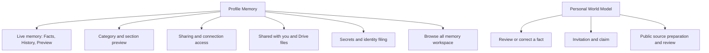

# Profile Memory and World Model UI Contract

Status: current product and UI reference at source revision `fd22c14a9`,
20 October 2026. Owner: frontend architecture. Classification: `canonical`,
package-local. This is the Memory/World Model depth of the
[Profile contract](./profile.md), including the immediate Browse all memory
workspace. Vault, PKM, consent and source owners retain mutation authority.
Use the [Profile detail type scale](./typography.md) for settings rows and
existing document readers for long text.

## Visual Map

## Entry, gates, and Back

Profile panel `my-data` has `domain:<key>`, `sharing`, and `connection:<id>`
details. `/one/profile/access` and its connection URL normalize into these
Memory states. Panel `world-model` owns research. These are protected
Profile entries: missing/locked vault invokes existing creation/unlock and
resumes the pending destination. Owner or vault-epoch changes retire private
reads and selections. See [Profile entry rules](./profile.md).

Missing/disappeared domain or connection retains a child body and Back depth:
loading, couldn't load/retry/go back, or no longer available/go back to
Memory. It does not silently show the parent. Ordinary Back follows the
feature layer then Profile detail/panel hierarchy.

Sources: [workspace](../../components/profile/profile-workspace-page.tsx),
[route mapping](../../lib/navigation/profile-routes.ts), and
[Memory panels](../../components/profile/pkm-data-manager.tsx).

## Memory root and category details

| Surface / CTA | Effect and save boundary |
| --- | --- |
| Live memory | Read-only Facts/History/Preview view; no parallel memory writer. |
| Manage sharing | Opens `sharing` detail. |
| Refresh | Force-refreshes metadata, consent state and visible manifests. |
| Category row | Opens `domain:<key>`. |
| Search saved details / clear | Local deferred title/summary/source/section filter, offered at six or more categories. |
| Browse all memory | Handoff to `/one/pkm`, detailed below. |
| Create vault fallback | Existing import/setup route, not a new editor. |
| Section eye | Decrypts only the selected top-level section into a dialog. Loading, error, exact values and empty are distinct; Close invalidates the request. |
| Ask before sharing | Immediate `consent_required`/`private` slice posture change. No separate Save. Upgrade/availability/pending guards apply. Optimistic failure rolls back; conflict reloads; committed change plus failed readback is reported accurately. |
| View details | Local entity disclosure, not a route. |
| Edit / Delete entry | Only for editable/deletable entities. Delete has browser confirmation and uses existing financial-context or explicit PKM deletion writer. Confirmed deletion with failed readback reports removed/refresh needed. |
| Financial context | Financial category only: General/Portfolio/Risk/KYC/Tax/Documents, note, **Save** or **Update**. Draft until explicit merged-domain write. |
| Edit financial context / Cancel | Stages category/text and closes preview; Cancel clears draft/edit target. Save validates target still exists, preserves other entries and retains draft on failure. Busy disables controls. |

Metadata unavailable, sharing still refreshing, no saved details, no search
matches and manifest preparation/failure are distinct. Cached category rows
stay visible while sharing refreshes; root Refresh is the recovery owner.
Sources: [category UI](../../components/profile/pkm-data-manager.tsx),
[preview UI](../../components/profile/pkm-section-preview.tsx),
[mutation handlers](../../components/profile/profile-workspace-page.tsx).

## Live memory document

| Tab / CTA | Current behavior |
| --- | --- |
| Facts | Source status, disagreements, current record rows, saved-detail sources; **Show more** per record kind. |
| History | Observed changes, No changes yet, Show more, dropped-change count. Explicitly only changes seen while open and unlocked. |
| Preview | Safe internal-link-only Markdown or Nothing to preview yet. |
| Record / conflict | Opens **Source details** sheet with fields, source/version/timestamps, or the disagreeing source claims. **Done**/dismiss closes. A conflict view does not choose a winner. |
| Correct source | Authored handoff to Account, Consents, Connect, Connectors, Payouts, sent documents or memory.md, depending on the source. |

Locked state exposes only status. Owner/epoch change resets selection/paging;
other people's identifiers are omitted, including disagreements. Checking,
current, updating, stale, partial, conflict and empty remain distinct. There
is no document-local Retry; recover through the source or Profile Refresh.
Sources: [document](../../components/profile/living-memory-document.tsx),
[source handoffs](../../lib/pkm/live-mirror-presentation.ts).

## Sharing and received information

| Surface / CTA | Effect and boundary |
| --- | --- |
| Sharing root | Resolved active-grant/category/connection counts, or loading/unavailable/no active access. Connection row opens requester identity, scopes/categories and expiry. |
| Revoke in connection detail | Web immediately revokes by normalized **category scope**, without request ID or authored confirmation. It can affect matching grants beyond the displayed connection. Owner-token service serializes work, reports result and refreshes consent. |
| Location sharing / Consent center | Handoffs to their existing owners. |
| Find/connect by phone | Immediate authenticated discoverability update. Confirmed server value replaces UI; busy disables switch; failed change preserves prior value. |
| Marketplace visibility | Immediate investor opt-in update; confirmed state invalidates marketplace cache and refreshes persona. Voice path separately requires confirmation of desired target. |
| Shared with you | One secure card per person; loading/failure **Try again**/Nothing shared. Cards open consented values on device; they are not person-profile links. |
| Secure card Copy / Hide / Show | Copies available value; masks/unmasks sensitive fields. Web can start readable after successful opening; native sensitive disclosure starts with Show. |
| Secure card Unlock to view / Try again | Existing unlock/retry owner. Undecryptable-device, ended/revoked/expired and unavailable states do not expose values. |
| Drive grant row | Expands/collapses confirmed Viewer files; recipient need not connect Drive. Running/queued can receive more files. |
| Received Drive file | External available open URL in a new tab with opener isolation; no access mutation. |
| Previous / Next 25 / Try again | Per-grant file paging and recovery; disabled during read. Collapse drops fetched-page presentation. |

Secure-card values retire on expiry, access end, lock, owner change, privacy
shield/background. Failed/timed-out opens alone are retryable. Sources:
[access panels](../../components/profile/pkm-data-manager.tsx),
[revoke owner](../../lib/consent/use-consent-actions.ts),
[received groups](../../components/profile/shared-with-you-group.tsx),
[secure-card model](../../components/agent/consent/shared-with-you-card.tsx).

## Secrets and identity filing

| CTA / state | Effect and boundary |
| --- | --- |
| Empty secrets / Reload Secrets | Empty success hides the section; failed empty read exposes reload. |
| Reveal | Decrypts one secret on device. No secret-edit action. |
| Hide / Copy | Reveal auto-hides after 45 seconds and on privacy/session retirement. Copy requires second tap within four seconds. |
| Remove from Secrets | Irreversible confirmation **Keep** / **Remove**. Only Remove writes; busy blocks dismissal. Uncertain outcome prevents replay and requires Refresh. |
| Filing offer | Stages Wallet handoff or local Identity documents filing card. |
| File <noun> / Not now | Only File reads the secret and explicitly files the identity document, then marks filed. Failed/unconfirmed filing asks to check identity documents before retry; no automatic replay. Filing does not share it. |

All reveal/write work is owner-, epoch-, active-visit-, visibility- and native
privacy-fenced. Values stay with the existing memory-only reveal owner.
Sources: [group](../../components/secrets/secrets-list-group.tsx),
[reveal model](../../components/secrets/use-secrets-list-model.ts),
[secret panel](../../components/secrets/secret-items-panel.tsx).

## Browse all memory handoff

`/one/pkm` is a separate workspace reached explicitly from Profile, with
swipeable **memory.md**, **Browse**, **Add**, **Sharing** tabs. This bounded
inventory records its immediate editors so that Browse all memory is a useful
handoff rather than an unexplained CTA.

| Tab / CTA | Effect and save boundary |
| --- | --- |
| memory.md · Edit memory.md | Local Markdown draft with labelled Legal name/Date of birth/Sex fields and preview. **Save changes** commits; **Cancel** restores original. Unchanged/oversize/busy disables Save; passwords are omitted. |
| Reload latest / Retry sync / Try again | Conflict, locally latest unsynced version, or load recovery respectively. |
| Browse search/clear/category | Local nested hierarchy to group levels then leaf; Back pops leaf, path segment, then category. Loading, partial/stale, failed and empty have authored recovery. |
| Recently learned / Add Memory | Recent-memory route / Add tab. |
| Leaf Sharing | Immediate ask/private scope change through existing sharing owner. |
| Leaf Edit / Forget Memory | Cancel/Save editor or destructive confirmation. Requires editable record and verified sharing impact; fresh coordinator state governs commit. Reserved branches instead offer **Open in owning app**. |
| Add · Review memory | Note up to 50,000 characters; prepares proposed/ignored/unresolved detail cards, without saving. |
| Retry this section | Retryable preparation failures only. Affected already-shared details need acknowledgment. |
| Save to Memory | Only explicit save persists reviewed saveable cards. Partial/failed save retains remaining note/review. |
| Sharing · Download Memory | Readable private export; native share cancellation is distinguished from a saved file. |
| Bundle switch / Ask for all / Make all private | Immediate expected-manifest-version exposure update; private also revokes matching active grants. |
| Location memory / selected detail | Existing `/one/pkm/location` and detail selector. Invalid/deleted selection fails closed with return; Retry reloads selected information. |

Owners: [workspace](../../components/profile/pkm-natural-panel.tsx),
[memory.md model](../../components/profile/use-soul-memory-model.ts),
[capture/browse/sharing model](../../components/profile/use-pkm-natural-model.ts),
[location memory](../../components/profile/location-memory-view.tsx).

## Personal World Model

Research presentation consumes the existing app-level store and encrypted
confirmed/source memory. Decisions require a verified authenticated session,
unlocked key, current owner token and unexpired token.

| Surface / CTA | Effect and save boundary |
| --- | --- |
| Status/progress | Checking, retrying, off, preparing/paused/stalled, insufficient identity/setup, disabled, retryable outage/wait, exhausted, ready to review, done/nothing found. Partial cited findings/checkpoints remain visible; provisional findings have no memory decisions. |
| Try again / Turn on | Reload appropriate failed source/research, respecting outage retry time; Turn on explicitly updates preference. |
| Draft Yes / No | Explicit fact decision, serialized per fact. Yes is saved only after encrypted write; No records rejection, never creates an opposite fact. |
| Fact row | Opens sources/external links/certainty/reason. Draft offers Yes/No/Edit; saved offers Edit/Remove. |
| Edit · Save / Cancel | Corrected wording ≤600 characters. Save commits correction; Cancel drops draft. |
| Saved Remove | Separate confirmation mode. Back first cancels edit/remove, then closes sheet; busy consumes Back. Failure retains sheet/error; success closes. |
| Edit or remove these details | Confirmed-source row hands off to Profile Memory. |
| Citations / related search | Source links, Azure/Bing disclosure and secondary Google suggestions remain explicit; no implied truth from a suggestion. |
| Invite someone | Usable-model only. Name and email and/or E.164 phone; **Create invitation** persists contact-bound invitation. **Share invitation** invokes share/copy; **Revoke** immediately revokes selected invitation. Failure retains draft. |
| Research and email | **Research public pages**, **Email me when it’s ready** immediately persist preferences. **Check for updates** requests research and closes; failure remains. |
| Claim my model / Decline | Explicit bounded invitation decision, clears handoff and refreshes; nothing shared back. Other-account handoff allows review with current account. Google research opt-back-in checkbox does not grant Azure/Bing disclosure consent. |
| Public source preparation | URLs, current account name, explicit chosen-public-page checkbox → **Read these pages** prepares a draft. Review selects/corrects facts; explicit save persists selected details. Discard/Skip removes offer; affected-sharing acknowledgment precedes save. |

Web options currently have no ordinary **Add a public source** opener; the
sheet auto-opens when the claim flow increments its source request. Native
offers the direct opener. Do not claim identical reachability. Native Memory
also nests live/received/secrets panels with 40-row presentation paging and
adds a category-consequence confirmation before revoke. Web revoke is direct.

Owners: [model page](../../components/profile/personal-world-model-page.tsx),
[fact sheet](../../components/profile/world-model-fact-sheet.tsx),
[options](../../components/profile/world-model-options.tsx),
[invitations](../../components/profile/world-model-invitations.tsx),
[claim](../../components/profile/world-model-claim-invitation.tsx),
[sources](../../components/profile/world-model-sources.tsx),
[native memory](../../components/profile/use-native-memory.ts), and
[native World Model](../../components/profile/use-native-world-model.tsx).

## Verification and limits

Nearest existing tests include
[category management](../../__tests__/components/pkm-data-manager.test.tsx),
[natural memory](../../__tests__/components/pkm-natural-panel.test.tsx),
[live document](../../__tests__/components/living-memory-document.test.tsx),
[secure cards](../../__tests__/components/shared-with-you-card.test.tsx),
[secrets](../../__tests__/components/secret-items-panel.test.tsx), and
[World Model](../../__tests__/components/personal-world-model-page.test.tsx).
These identify verification owners; execution is reported with the change.

This inventory performs no reveal, export, source research, revocation, write,
or invitation. Source review does not prove deployed flags, account counts,
background durable history, provider availability or native admission. In
particular, Live memory History covers observed open/unlocked changes only.
Run `./bin/hushh docs verify`; UI edits follow the
[contributor scaffold](../../../docs/reference/architecture/ui-contract-contributor-guide.md).
