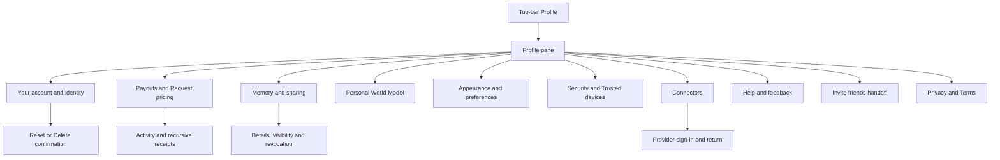

# Profile UI Contract

Status: current product and UI reference, checked against source revision
`3ff2620b48567177dce5c667e77a70203e4a8c35` on 20 October 2026. Owner: frontend architecture. Classification:
`canonical`, package-local. This contract inventories the signed-in person's
Profile: its menu, nested screens, editors, confirmations, and immediate
handoffs. Other-person profiles have their complete [Person Profile contract](./person-profile.md).
The [typography contract](./typography.md) explains which font role to use;
the [navigation contract](./navigation.md) owns shared shell controls.

## Visual Map

## Entry, navigation, and authority

Profile is normally a pane over the current route. Its URL uses
`profile_pane=1`, `profile_panel`, and `profile_detail`; these are pane states,
not independent full pages. The pane owns its nested history and scroll
restoration. Inactive stack bodies are hidden/inert during transitions.
Back first unwinds a registered feature layer, then detail, panel, and pane.
Close dismisses the pane and restores the underlying route.

On web, the proxy intercepts `/one/profile`, `/profile`, and their descendants
and redirects to the Profile pane over `/one`. It resolves recognized path
suffixes through the existing Profile route mapper. Provider `oauth/return`
addresses and the World Model `?claim` entry are exceptions. Native static
exports can reach page implementations without this proxy. A page file alone
therefore does not prove an ordinary web destination.

Sources: [web proxy](../../proxy.ts), [Profile routes](../../lib/navigation/profile-routes.ts),
[pane state](../../lib/navigation/profile-pane.ts),
[Back owner](../../lib/navigation/profile-pane-back.ts),
[pane presentation](../../components/app-ui/profile-pane.tsx), and
[stack navigator](../../components/profile/profile-stack-navigator.tsx).

| Surface | Panel/detail or entry | Current meaning |
| --- | --- | --- |
| Profile home | No panel/detail | Identity and grouped menu. |
| Your account | `account`; `phone` | Identity editor, phone verification, account lifecycle. |
| Payouts / Request pricing | `payouts`; `request-pricing` | Money, activity, Stripe handoffs; default future request price. |
| Memory | `my-data` | Live memory, saved details, sharing and received information. |
| Memory detail | `domain:<key>`, `sharing`, `connection:<id>` | Existing category, sharing list, or one connection's access. |
| Personal World Model | `world-model` | Existing personal research model and its sources/invitations. |
| Appearance & preferences | `preferences` | Appearance, accent, Gemini, Voice, writing style. |
| Finance preferences | `preferences` / `kai-preferences` | Implemented direct entry; no current Preferences menu row. |
| Gemini / Voice | `preferences` / `gemini` or `voice` | Runtime choice/key and voice preferences. |
| Security & privacy | `security` | Vault methods entry. |
| Vault methods / Account access | `security` / `vault` or `session` | Unlock methods; compatibility Sign out screen. |
| Trusted devices | `security` / `trusted-devices` | Pane-only root menu entry, not a standalone devices page. |
| Connectors | `connectors`; `connector:<catalog-id>` | Catalog and connector detail. |
| Help & feedback | `support` | One composer; historical routing/compose details resolve here. |
| Legal | `legal` / `privacy` or `terms` | In-place reader, rather than leaving Profile for public legal pages. |
| Gmail compatibility | `gmail`; `gmail-connection`, `gmail-actions` | Retained authored pane states; not a root menu group. |
| Referrals compatibility | `referrals` | Retained panel; root Invite friends instead opens `/one/referrals`. |

Root render waits for auth and requires a signed-in person. Memory, Payouts,
World Model, Request pricing, Connected Systems, Connectors, Gmail, Security,
and Finance/Gemini details require vault access in the Profile owner. Menu
selection can open vault creation/unlock and resume its pending destination
after success; Cancel clears that destination. Security has its own no-vault
recovery. Do not infer identical no-vault rendering for every panel from the
shared locked-vault guard.

Native scenes require acknowledged presentation/navigation capabilities,
feature availability, and owner/vault/privacy fences. An unsupported scene
falls back to the web body; an iOS version alone does not prove admission.
Sources: [workspace](../../components/profile/profile-workspace-page.tsx),
[native admission](../../components/profile/native-profile-menu.tsx),
[scene fence](../../lib/capacitor/native-profile-scene-fence.ts).

## Home menu and identity

The authored [menu model](../../components/profile/profile-menu-model.ts)
owns the labels and order. Rows open the panel in the table above, except:

| CTA | Effect and boundary |
| --- | --- |
| Profile photo | Existing portrait opens full-photo view; otherwise opens photo options. Busy disables entry. |
| Camera | Launches the change-photo picker directly, rather than first opening full-photo view. |
| Photo options | Explicit action inside full-photo view opens the options sheet. Ordinary dialog dismissal only closes the view. |
| View photo | Opens the existing portrait; dismissal closes that view. |
| Upload a photo | Web file picker. Native says **Take photo or choose from library**. Selecting a valid photo commits through the identity service; no separate Save step. |
| Remove photo | Commits removal immediately from photo options. |
| Invite friends | Leaves the pane for the `/one/referrals` owner. |
| Developer tools · Local | Development and allowed developer-host only. Targets the lab route, subject to the web proxy limitation below. |
| Privacy Policy / Terms of Use | Opens that document within Profile's Legal reader. |
| Sign out | Calls the existing auth sign-out owner; no confirmation. Failure is logged; this handler has no inline failure panel. |

Photo owner: [avatar editor](../../components/profile/profile-avatar-editor.tsx).

## Your account and phone verification

| CTA or state | Effect, validation, and save boundary |
| --- | --- |
| Display name · Edit / Close | Toggles the inline editor. **Cancel** closes without committing. |
| Save name | Collapses whitespace; requires 2–60 characters and rejects control characters, links, and handles. Disabled for unchanged/invalid/busy/unowned input. Confirmed server-normalized identity closes the editor. |
| Name failure | Validation/auth/unavailable errors remain inline. An accepted save with unavailable readback remains open and explains the uncertainty. |
| Mail / Sign-in provider | Read-only identity rows. |
| Phone number · Add / Change | Opens phone detail. Unresolved lookup disables entry; **Retry** retries lookup. A blocked detail offers **Try again** and **Cancel**. |
| Country chooser / search | Selects calling code before entering the number; a local selector state. |
| Send verification code | Validates the number, sends explicitly, then enters the six-digit **One-time code** step. |
| Save phone number | Confirms the code, syncs the current identity, and replaces the detail with Account. |
| Resend code / Use a different number | Explicit resend or return to number entry. Wrong/expired code, conflict, recent-login requirement and rate limit keep recovery in the flow. |
| Phone Back | Code step returns to number entry before returning to Account. Stale owner/vault/visit work cannot commit into a different session. |
| Wallet Card | Conditional feature entry; hands off to the existing wallet-card route. |
| Native portrait row | Native Account can expose its portrait scene; web Account does not duplicate the home avatar editor. |

Sources: [name editor](../../components/profile/display-name-editor.tsx),
[phone flow](../../components/auth/phone-verification-flow.tsx), and
[Account composition](../../components/profile/profile-workspace-page.tsx).

### Account lifecycle

**Reset account** and **Delete account** run existing owner/vault preflight;
a locked vault requires unlock before confirmation. Idle confirmations expire
when the account, vault session, or active Account screen changes. Busy
confirmation controls and native Back/close cannot replay the operation.

| Confirmation | Explicit commit | Confirmed result |
| --- | --- | --- |
| Reset account? | **Cancel** / **Reset account** | After bank-revocation preflight, requires backend `success && account_reset`; then clears owned local state/receipts and restarts setup while preserving identity/vault. |
| Delete account? | **Cancel** / **Delete account**; locked entry can read **Unlock to delete account** | Requires verified deletion, performs account cleanup, and signs out to the account-deleted login notice. |

Both operations revoke vault bank connections **before** the backend
reset/delete request. A failed or unknown account operation can therefore
already have disconnected banks. Local erasure and the success result require
verified backend completion. Sources:
[verified deletion](../../lib/flows/delete-account.ts) and
[reset handler](../../components/profile/profile-workspace-page.tsx).

A lost response remains an unknown outcome for reconciliation. The UI must
not report an unconfirmed reset/deletion as success or submit a fresh retry
automatically. Source: [lifecycle owner](../../components/profile/profile-workspace-page.tsx)
and [confirmation preparation](../../components/profile/account-confirmation-preparation.ts).

## Payouts, activity, and Request pricing

Payouts composes independent wallet, bank, and activity readers: failure of
one must not imply the other balances are unavailable. Protected money UI
requires its owner token. Live and test activity remain separately labelled.

| Surface / CTA | Effect and boundary |
| --- | --- |
| Hussh Coins | Opens local Activity filtered to Coins; displays holds/review context. |
| In Stripe | Opens Available/Settling/next-availability details or empty state; no transfer action. |
| Payout bank · Link bank / Finish setup / Manage | Creates an authenticated Stripe onboarding/manage destination and hands off externally. Busy reads **Checking…** / **Opening…**. Bounded return rechecks status. Bank details stay masked. |
| Retry bank check | Reconciles an unavailable bank status; separate bank and verification errors. |
| Verify details | Conditional Stripe verification handoff; an in-review status is read-only. |
| Redeem $… | Live, server-enabled only; requires ready bank, healthy unheld wallet and a fresh read. One paid request at a time. |
| Sending… / Updating balance… / Check transfer | Pending/unknown redemption reconciliation. Retry retains the existing client request identity instead of creating another transfer. |
| Test redeem / Check test redemption | Test-server-mode only; uses the separate sandbox balance/history. |
| Activity filters | **All**, **Earnings**, **Redemptions**, **Bank deposits**, **Adjustments**. Real/Test activity are distinct; Coins is also available in View all. |
| Activity row / View all | Opens a receipt, or the paginated Activity sheet. Current summary shows up to five rows. **Load more** and **Retry** retain good reads. |
| Receipt linked stage | Opens the corresponding receipt above its parent, with cycle protection. Topmost Close/Back returns one level and restores the opener. |
| Copy reference | Copies the receipt's available reference. |
| Receipt Next step | **Update bank** / **Verify details** closes receipt ancestry before invoking the existing bank flow; it does not move money. |
| Missing/incompatible receipt | “This activity isn't available.”; incompatible contract offers web **Reload** / native **Update app**. |
| Native Activity | **View all activity**, previous/next pages of 20, receipt details pages of 40, at most six receipt levels. Busy blocks navigation; owner change retires sheets. |
| Price per request | **Default price (USD)** for Google Drive, $0.50–$500; fee information and conditional **Ask each time**. |
| Save price | Valid dirty draft only; confirmed default affects future requests, never existing quotes. Safe `from` can return a route presentation after save; the pane remains inline. |
| Ask each time / Retry | Keeps the pricing editor for per-request decisions, or retries its failed read. |

Owners: [Payouts composition](../../components/consent/document-hashcoins.tsx),
[bank row](../../components/consent/payouts/payout-bank-row.tsx),
[redemption](../../components/consent/payouts/redeem-action.tsx),
[activity](../../components/consent/payouts/activity-card.tsx),
[receipts](../../components/consent/payouts/receipts/payout-receipt-sheet.tsx),
[native payouts](../../components/profile/use-native-payouts.ts), and
[pricing](../../components/consent/document-request-pricing-card.tsx).

## Memory, World Model, and Connectors

These substantial nested flows have their own maintained contract pages:

- [Memory and World Model](./profile-memory.md): every category/section CTA,
  sharing/revocation, received cards/files, Secrets, Browse all memory,
  research decisions, source preparation and invitation/claim states.
- [Connectors](./profile-connectors.md): catalog and provider details, selected
  files, packet/listing review, document trust, custom tools, OAuth returns,
  legacy Mail and gated Connected Systems.

Both inherit the entry/unlock/Back hierarchy above. Their immediate actions
must be read from these child contracts before changing a nested CTA.

## Appearance, writing, Gemini, and Voice

| Surface / CTA | Effect and save boundary |
| --- | --- |
| Appearance / Accent | Existing theme and accent choices commit immediately. |
| App haptics | Native preference only; immediate update, disabled until ready/during save; saving/saved/error feedback. |
| How One writes to you · Unlock to edit | Unlocks before editing protected writing preferences. Web fields are inline; native **Writing style** opens a scene. |
| Writing fields | **Call me** (64 max), **Tone** (No preference/Direct/Warm/Casual/Formal/Executive), **Length** (Short/Balanced/Detailed), **Language** (12 languages plus no preference), **Avoid em dashes**, **Style note** (280 max, one paragraph). |
| Writing icons | The five field glyphs use Profile's theme-aware neutral outlines with selected-accent details. Web and native artwork retain the same official Phosphor geometry. |
| Writing Save | Draft until explicit Save writes encrypted `identity.communication_preferences`; disabled unless dirty/available. Failure preserves draft. Native Save stays open; Cancel/Back closes the scene but shared in-memory draft may remain for that visit. No separate web Cancel button in inline writing group. |
| Gemini · Use Hussh's AI / Use my own key | Managed choice is an owner operation. Own-key entry selects **API endpoint**: Google AI Studio or Google Cloud Vertex API key, with conditional project/location and secret-key fields. |
| Validate key → Confirm and save | Checking then ready confirmation; protected owner/vault-fenced operation. Inline errors retain recovery. **Remove key** exists only for a saved key. Native blocks Back while pending. |
| Live voice | Read-only readiness: Checking/Ready/Off/Unavailable. |
| Test microphone | Three-second local check and tone with level/sample-rate/echo/worklet result; this test does not transmit a recording. |
| Speakerphone-safe mode | Immediate per-user preference. |
| Voice control | Immediate switch; sensitive-action explanation remains read-only. |
| Location voice defaults | Conditional on token/default availability: **Auto-approve requests**, **Visible in Nearby Check-In**, **Allow connection requests**, **In an emergency** → Open the screen/Send the alert. Per-field server mutation/busy state. |
| Connect · Reuse access from last time | Authenticated preference to reuse the last request's asks/offers for the same person. |
| Domain restrictions | Only **Location** and **Connections** have switches. Mail, Connected Systems, Consent Center, Identity verification, Finance and Calendar show **Coming soon** restriction controls; that label does not prove their underlying voice actions are off. |

Owners: [appearance](../../components/profile/profile-appearance-controls.tsx),
[writing fields](../../components/profile/communication-preferences-group.tsx),
[writing owner](../../components/profile/communication-preferences-section.tsx),
[Gemini](../../components/connections/gemini-runtime-settings-card.tsx),
[voice overview](../../components/profile/one-voice-preferences-section.tsx),
[voice preferences](../../components/profile/voice-preferences-panel.tsx),
[domain restriction catalog](../../lib/agent/voice-engine-domains.ts).

### Finance preferences direct entry

`preferences` / `kai-preferences` exists behind vault access but is not offered
as a Preferences row. It loads the current profile, then asks horizon
(under 3 / 3–7 / over 7 years), drawdown response (reduce/stay/buy more), and
volatility (small/moderate/large). **Next** advances; terminal **Save changes**
commits all preferences. A changed horizon can open **Update horizon anchor?**
with **Apply from now (default)** / **Keep original start date**, **Cancel**,
and **Apply**.

Web edit mode hides its own Back button; it has no equivalent wizard-step
Back layer in the inspected hook. Native Back closes the horizon decision,
then moves to the previous question, then parent. Unavailable web content
asks to reopen; native provides **Try again**. Owners:
[panel](../../components/profile/profile-kai-preferences-panel.tsx),
[wizard](../../components/kai/onboarding/KaiPreferencesWizard.tsx), and
[wizard model](../../components/kai/onboarding/use-kai-preferences-wizard.ts).

## Security, vault methods, and devices

Security & privacy currently offers **Vault methods**. Trusted devices is a
separate root menu entry. **Account access** is a compatibility detail with
Sign out, not an offered Security row.

| Surface / CTA | Effect and boundary |
| --- | --- |
| Create your vault / Unlock vault | Existing creation/unlock recovery before methods can be managed. |
| Default unlock | Selects an available wrapper as default through the existing vault owner. |
| Refresh methods | Reconciles unavailable/uncertain state before further mutation. |
| Add passkey / native biometric option | Capability-dependent enrollment; no fabricated available method. |
| Wrapper row | Opens detail with **Use as default** and permitted **Remove passkey**. Generated local biometric wrappers are not removable here. |
| Change password | New/confirmation fields, minimum eight characters; **Cancel** / **Save new password**. Requires matching valid fields; busy prevents cancellation/replay. Existing other wrappers remain. |
| Remove passkey? | **Cancel** / **Remove passkey** confirmation; warns the password stays and a password-manager copy may remain. |
| Trusted devices · Refresh | Loads/reconciles the device list, empty state, or failed status. |
| Unlink device | Active device trash button named **Unlink <name>** → **Cancel** / **Unlink device** confirmation. Warns sync stops, local vault seals and reapproval/reinitialization is needed. |
| Uncertain unlink | Lost/5xx/408 response prevents retry until fresh reconciliation. Confirmed revocation remains visible even if follow-up refresh fails. |

Owners: [methods panel](../../components/profile/vault-methods-panel.tsx),
[methods model](../../components/profile/use-profile-vault-methods-model.ts),
[trusted devices](../../components/profile/trusted-devices-page.tsx),
[device model](../../components/profile/use-trusted-devices-model.ts).

The incoming `/one/profile/security/devices/authorize` page implements
**Approve device** → backend authorization → optional passkey handoff →
returned redirect. It disables incomplete/unowned/busy requests and retains
failure recovery. That suffix is not recognized by the web pane mapper and is
normally proxy-shadowed to Profile root. This is a native/no-proxy entry
implementation, not proof of ordinary web reachability.

## Help, invitations, and Legal

| Surface / CTA | Effect and boundary |
| --- | --- |
| Help & feedback | One composer with **Problem**, **Help**, **Feedback** choices. Historical support-routing/compose states render this same composer. |
| Send report / Send request / Send feedback | Explicit submit only; trimmed message 10–8000 characters, offline rejected locally. Busy guards duplicate submission. Accepted response shows sent heading; **Done** returns to Profile root. |
| Support failure | Error/unknown delivery retains draft. A newer draft revision survives acknowledgement of an older submission; no false sent state. Copy explains no automatic receipt. |
| Invite friends | `/one/referrals` handoff. Retained Profile Referrals panel offers link **Copy**, **Share** (clipboard fallback), load **Try again**, and public handle **Save**. |
| Referral handle | Server validates 3–24 letters/numbers/hyphens and uniqueness. Share cancellation is quiet. Counts, ranks, coins and milestones come from server authority. Compatibility team APIs remain preview-only; Progress anonymity does not mean Recent rows never show names. |
| In progress | Conditional toggle opens anonymous progress when count is nonzero. Stream or foreground polling refreshes; optional gamification failure does not hide the core invitation link. |
| Privacy Policy / Terms of Use | In-place legal document reader. **On this page** scrolls sections; **See also** replaces the document so Back returns to the opener. External/mail links retain authored destinations. |
| Native legal link | Existing native reader handles HTTPS/mail links and delete-account handoff; no second legal copy. |

Owners: [support workspace](../../components/profile/profile-workspace-page.tsx),
[referrals panel](../../components/profile/referrals-panel.tsx),
[legal section](../../components/profile/profile-legal-section.tsx),
[legal reader](../../components/legal/legal-reader.tsx), and
[native legal handler](../../components/profile/profile-native-legal.ts).

## Spatial layout, editors, and layers

Source-derived web rules below do not certify native host scene geometry.
Both WebProfilePane and NativeProfilePane return no pane when vault locked;
destination can be retained for resume. An isolated panel's auth-only helper
does not bypass upstream pane admission.

| Surface | Placement / size / lifecycle |
| --- | --- |
| Web pane desktop | Right fixed Sheet, width min430px/available safe viewport; height min820px/safe100dvh; vertically centered; radius25; p0/gap0/overflow-hidden. Header fixed, body flex1/min-h0/Y-scroll with safe bottom≥24. |
| Phone/coarse pointer | Max639/coarse rule fills viewport, no border/radius/shadow; header/close honor effective top/right safe area. |
| Header | Min79px; grid44/1fr/44, balanced title, X gutter28; Back/Close44. Close local z10; pane header/body local z2. Focus title on entry; opener restoration only same unlocked owner/non-inert/no competing native overlay. |
| Nested stack | One grid cell; inactive body absolute/inert/aria-hidden/no pointer events; active relative z10. Exit retained150ms with generation fence; scroll restoration per entry. |
| Account/payout groups | Radius17; row min58, padding9px12px/gap10; separator leading53/trailing12. Name editor indents53 with top border. |
| Avatar |44px hero; camera17 at right−3/bottom−2. Photo dialog width min90vw/512,max image60dvh; photo options bottom Sheet. Picker/library/camera OS geometry external. |
| Lifecycle confirmation | Centered AlertDialog; feature padding16/gap6, footer controls36 where overridden. No fabricated mouse-X/Y anchor. |
| Support | Max580; textarea min176,resizeY,radius12,16px entered text; choice targets≥44; submit52. Sent Done replaces composer locally. |
| Z | Sheet711/712; Dialog/Alert800/801; transient10099/10100. Local header/close z are relative to owning surface. Profile home has no generic three-dot action menu; portrait options, theme/selects and specific disclosures own their actual presentation. |

Owners: [pane](../../components/app-ui/profile-pane.tsx),
[stack](../../components/profile/profile-stack-navigator.tsx),
[Account styles](../../components/profile/profile-your-account.module.css),
[avatar capture](../../lib/profile/avatar-capture.ts),
[global pane rules](../../app/globals.css), [workspace](../../components/profile/profile-workspace-page.tsx).
Actual X is determined by pane bounds and these insets; Y below a growing
row is cumulative rendered height, not a fixed screenshot coordinate.

## Per-row reads, wire shapes, and commit branches

F=Firebase bearer; V=vault-owner bearer. Web [account proxy](../../app/api/account/[...path]/route.ts)
forwards same account path/query/body, but exports GET/POST/DELETE **not PATCH**.
[One proxy](../../app/api/one/[...path]/route.ts) and
[connector proxy](../../app/api/connectors/[...path]/route.ts) own their families.
[Kai proxy](../../app/api/kai/[...path]/route.ts) owns Support/runtime families
where used; Support has no special upstream deadline, while browser transport
has its ordinary60-second ceiling. Native generic ApiService uses configured
backend directly and some vault/account operations use native bridges.

| Row/control | Request/body and response fields → UI | Save / Cancel / failure |
| --- | --- | --- |
| Home menu | Static `PROFILE_MENU_GROUPS`, no menu API. `{id,title,entries:[{id,label,icon,symbol,voiceControlId?,voiceActionId?,voicePurpose?,localOnly?,destructive?}]}` | Entry callbacks own destination; opening/closing pane not a settings save. Developer gate removes localOnly rows. |
| Identity hydration / portrait | POST `/api/account/identity/refresh?force=false`,F,no body→`{success,user_id,identity}`; identity fields `display_name,email,phone_number,photo_url,email_verified,phone_verified,source,last_synced_at,created_at,updated_at` | SWR owner cache first; background/cold refresh deduped by UID/auth generation. Empty/wrong-owner cannot replace good cache. Home name/email use live auth fields, avatar effective cached photo then auth photo, phone auth-context verified reconciliation, not wholesale identity rendering. |
| Edit/Close/Cancel name | Local editor/draft only, no HTTP | No save on opening/closing. Validation2–60/normalization before submit; source-defined busy semantics rather than invented unsaved confirmation. |
| Save name | PATCH `/api/account/identity/display-name`,F,`{display_name}`→`{success,user_id,identity,display_name,shadow_sync}` | Confirm subject/readback then reload auth/close. No client idempotency key. **Web proxy PATCH export missing:** source implies405; native direct endpoint exists. Runtime failure not exercised. |
| Pick photo | OS/web chooser→local normalize256-square JPEG quality.82; native Camera prompt edits512/quality85 | Cancel before selection no call. Valid selection immediately POSTs; no extra Save. |
| Upload/remove photo | POST `/api/account/avatar` `{image_data_url}` / DELETE same,no body,F→`{success,identity}` | Identity readback owns success, not preview. Server accepts bounded PNG/JPEG/WebP; generation fences, no client idempotency key. |
| Phone lookup/status | Existing auth context and verified identity refresh, not standalone phone-row GET | Verified claim wins; confirmed absence prevents provider phone resurrection. Masks display. Retry forces recovery; country/search local. |
| Send/resend phone code | Firebase SDK/native phone owner; UAT-only POST `/api/account/phone/uat-test/start`,F,`{phone_number}`→`{success,eligible,verification_id,reason}` | Explicit sending, six-digit code; wrong/expired/rate-limit retains flow. Already linked Continue can skip OTP. OS verification UI external. |
| Save phone | POST `/api/account/phone/claim`,F,`{phone_id_token,expected_user_id}`; linked provider refresh `?require_success=true` with `{verified_phone_number}` | `{success,user_id,identity,phone_verified,phone_session_cleanup}`; exact phone/UID readback required. UAT confirm body `{phone_number,verification_code,verification_id,expected_user_id}`. Back to number does not claim identity. |
| Reset final | POST `/api/account/reset`,V,no body | Require `success && account_reset`; banks revoked first, then reset/clear local owned state. Cancel no reset. Unknown may already have disconnected banks; reconcile, no automatic fresh retry. |
| Delete final | DELETE `/api/account/delete`,V,`{target:"both"}` | `{success,account_deleted,requested_target,deleted_target,remaining_personas,ready_to_start_fresh,details}` required proof→cleanup/signout notice. Native HushhAccount variant. Cancel only closes preflight; issuing token/unlock is not erasure. |
| Trusted devices/Refresh | GET `/api/account/trusted-devices`,F→`{devices:[{device_id,device_name,platform,status,…syncFields}]}` | Sync display derives heartbeat age/model/sync/seal state; failed read not equivalent to no devices. |
| Unlink device confirm | DELETE `/api/account/trusted-devices/<id>`,F,no body | Confirmed revocation retained even failed refresh. Cancel no DELETE; lost/5xx/408 blocks replay until reconciliation. |
| Incoming Approve device | POST `/api/account/trusted-device-authorizations`,F,`{redirect_uri,code_challenge,code_challenge_method,device_public_key,device_name,platform,state,replaces_device_id?,vault_handoff_public_key?}` | `{authorization_id,device_id,redirect_uri,redirect_url,expires_at,…replacement/handoff}`; optional POST `/<id>/vault-handoff` encrypted fields→`{attached:true}`. Rollout+verified email/phone+owner required. Normal web suffix proxy limitation above still applies. |
| Methods/Refresh | GET `/api/vault/get?userId=<uid>[&fresh=1]`,F→wrappers/default/key-hash state | Local/browser/native capability probe, no separate capability API. Native HushhVault. Methods read failure/uncertainty requires fresh reconciliation. |
| Add/change wrapper | POST `/api/vault/wrapper/upsert`,F+consent, `{userId,vaultKeyHash,method,wrapperId,encryptedVaultKey,salt,iv,passkeyCredentialId?,passkeyPrfSalt?,passkeyRpId?,passkeyProvider?,passkeyDeviceLabel?,passkeyLastUsedAt?}`→`{success}` | Password/passkey material wrapped locally; prove persisted wrapper decrypts same key before default commit. No plaintext password HTTP. |
| Remove passkey confirm | POST `/api/vault/wrapper/delete`,same authority,`{userId,vaultKeyHash,method,wrapperId,fallbackPrimaryMethod,fallbackPrimaryWrapperId}` | Cancel no write. Uncertain needsRefresh disables further mutations; no blind replay. Password-manager credential may remain separately. |
| Use as default | POST `/api/vault/primary/set`,`{userId,primaryMethod,primaryWrapperId}` | Immediate setting, no Yes/No. Generation/owner fences; readback/refresh governs result. |
| Save new password | Locally rewrap same key→wrapper upsert, preserve default via keepPrimaryMethod | Matching untrimmed≥8; volatile fields cleared on submit even refused/uncertain; intentional rekey lock. Cancel idle only. Other wrappers remain. |

Sources: [identity](../../lib/services/account-identity-service.ts),
[account backend](../../../consent-protocol/api/routes/account.py),
[phone](../../components/auth/phone-verification-flow.tsx),
[vault transport](../../lib/services/vault-service.ts),
[wrapper owner](../../lib/services/vault-method-service.ts),
[vault backend](../../../consent-protocol/api/routes/db_proxy.py),
[deletion](../../lib/flows/delete-account.ts), [sync verdict](../../lib/trusted-device/sync-display.ts).
Identity/provider values are not placed in examples. A wrapper/device operation
is not successful merely because a preview or OS prompt appeared.

### Money readers and writes

All payout paths below use V under `/api/one/payouts`, existing
[payout service](../../lib/services/document-payout-service.ts) and
[activity service](../../lib/services/payout-activity-service.ts) → One proxy →
[payout router](../../../consent-protocol/api/routes/one/payouts.py),
[balance](../../../consent-protocol/api/routes/one/payout_balance.py),
[activity](../../../consent-protocol/api/routes/one/payout_activity.py).

| Row/control | Exact wire / consumed response | Branch and effect |
| --- | --- | --- |
| Coins/read/retry | GET `/hashcoins`→`{coinName,coinsPerDollar,currency,live,sandbox,payoutMode,testPayouts,liveRedemptionEnabled,maxRedeemCoins,latestRedemption,redemptionHistory}` | Wallet uses `balanceCoins,reservedCoins,availableCoins,amountCents,held,redeemableCoins,nextRedeemCoins,holds`; no fabricated spendable balance from gross. |
| Redeem/Test redeem | POST `/hashcoins/redeem` `{amountCoins,clientRequestId,mode}` | `{id,clientRequestId,amountCoins,status,stripeMode,reversalStatus,createdAt}`. Integer1–50000; same operation ID until settled; fresh<60s for new live operation; unknown reconciliation is not another transfer. |
| Bank/read/retry | GET `/account[?fresh=true]` | Account `detailsSubmitted,transfersEnabled,payoutsEnabled,ready,status,bankStatus,canManageBank,bank,verification,payoutSchedule`, plus stripeMode→controls/status. |
| Bank Link/Finish/Verify | POST `/account/onboard`,no body or`{purpose:"verify"}`→`{url}` | Validated Stripe handoff, no card/bank editor in Profile. Provider Cancel is not bank success. |
| Manage bank | POST `/account/manage`,no body→`{url}` | Gesture-created web tab/native current-page navigation; return recheck. |
| In Stripe | GET `/account/balance`→`{stripeMode,currency,accountLinked,inStripeCents,availableCents,pendingCents,nextAvailableOn,nextAvailableCents,asOf,stale}` | Read-only breakdown; no transfer merely opening. |
| Activity/filter/Load more | GET `/activity?kind=<all|earning|redemption|deposit|adjustment|coins>&mode=<live|test>&limit=<1..50>[&cursor|since]` | `{mode,kind,asOf,balanceCoins,items,nextCursor,reset}`; since/cursor exclusive; row `id,kind,status,type,occurredAt,updatedAt,coinsDelta,amountCents,balanceAfterCoins,request,review,test`. Invalid rows omitted; unknown state unrecognized, not settled. |
| Receipt/linked receipt | GET `/activity/<encoded itemId>` | Kind-discriminated earning/redemption/deposit/adjustment receipt→amounts, stages, fees, transfer/reversal, review and linked receipts. Enforce ID/mode/amount. Opening/filtering/copy-reference is not redemption. |
| Update bank from receipt | Closes receipt ancestry then existing bank action | No additional money endpoint. Cycle/depth guards preserve Back. |
| Pricing load/retry | GET `/api/connectors/google_drive/sharing/pricing`,V | `{enabled,amountCents,version}`→saved baseline/draft. |
| Save price/Ask each time | PUT same `{enabled,amountCents,expectedVersion}` | Same response. Bounds50–50000 cents; Ask each time enabled:false with existing valid amount. price_changed rereads saved/version, preserves draft, requires explicit Save again. |

Price source: [service](../../lib/services/drive-request-pricing-service.ts),
[model](../../components/consent/use-document-request-pricing-model.ts),
[backend](../../../consent-protocol/api/routes/drive_sharing.py).
PayoutFreshness keeps fresh quiet; delayed update/age can show `Updating…`,
`Offline · Updated {age}`, or `Couldn't update` + Retry after repeated failures.
It never labels a failed last read updated-just-now. Full receipt copy is
defined by [activity copy](../../components/consent/payouts/receipts/activity-copy.ts)
using USD/viewer time for events and UTC calendar availability dates.

### Preferences, Gemini, voice, and Support

| Control | Read/write and fields | Positive/negative/error outcome |
| --- | --- | --- |
| Light/Dark/System; Blue/Molten Gold | next-themes theme/local accent storage | Immediate owner-local preference, no profile API; menu open/Cancel no write. App haptics uses native Preferences/SettingsService, no network. |
| Writing fields/Save | Encrypted identity PKM `communication_preferences` via saveOwnerStyleSettings/PkmWriteCoordinator | Fields local until Save; summary source `one_settings_communication_preferences`; no plaintext style API. Inline web has no separate Cancel; native close need not discard retained draft. |
| Finance preferences Save | KaiProfileService coordinated encrypted `financial.profile` PKM write | No dedicated Finance-settings API. getProfile can catch read failure and return default profile; outer unavailable state not guaranteed. Native/web wizard Back differs. |
| Gemini mode/fields | Encrypted runtime-secret refs; read current mode/key transport/project/location | Own-key selection only local branch. Save/remove are several coordinated refs then mode, not atomic multi-key operation. Partial failure may need refresh. |
| Validate key | POST `/api/one/runtime/gemini/validate`,F,`{credential,transport:"developer_api"|"vertex_api_key",vertex_project?,vertex_location?}` | `{status:"ready"}`; nonpersistent bounded probe; validation revision expires **60seconds**. Requires Vertex project/location where applicable. Invalid/quota/billing/permission/API/model statuses map existing safe copy. |
| Confirm and save / Remove key | Locally encrypt→PKM runtime secrets; save individual refs then mode; remove four refs then managed mode | No plaintext persistence via validate endpoint. Busy/session fences; no automatic replay into changed owner/config. |
| Live voice readiness | GET `/api/one/voice/readiness`,F→`{enabled,status,model,location,ws_path}` | Owner session cache10min; failed read closes to disabled, not ready. |
| Test microphone | Local3-second audio capture/tone/worklet | No upload/API. Permission prompt OS-owned; cancelled/denied never treated as ready. |
| Voice enabled/speaker-safe/domain toggles | Per-user local storage | No HTTP save. Voice off disables domain switches, not Location default editors. |
| Location defaults load | GET `/api/one/location/state`,V | `autoApprovePreference.enabled,nearbyCheckInPreferences.visible/allowConnectionRequests,sosVoicePreference.defaultAction`→switches/options. |
| Auto approve | PATCH `/api/one/location/auto-approve-preference` `{enabled,scopeKind:"all_contacts"}` (scope omitted off) | `{preference}`; immediate/pending per field, rollback on failure. |
| Nearby defaults | PATCH `/api/one/location/nearby-check-in-preferences` `{visible,allowConnectionRequests}` | `{preferences}`; same guard. |
| Emergency default | PATCH `/api/one/location/sos-voice-preference` `{defaultAction:"open"|"trigger"}` | `{preference}`. No emergency is triggered just changing this default. |
| Reuse access | GET/PATCH `/api/one/connect/voice-preferences`,F; PATCH `{share_scopes_from_last_request}` | `{preferences:{shareScopesFromLastRequest,…}}`; no actual share at setting change. Web group hides on read failure; native shows retry. |
| Support enter/kind/edit | Existing auth verified email/persona + local draft | No support history/status GET. Problem/Help/Feedback local. |
| Support submit | POST `/api/kai/support/message`,F,`{user_id,kind,subject,message,persona,page_url}` | `{accepted:true,delivery_status:"accepted_by_provider",kind}` required; provider acceptance not inbox delivery. No client email/name/token/attachment/idempotency key. |
| Support Done/Cancel | Local route/panel return | No ticket mutation. Failure keeps draft; local in-flight guard clears after uncertain response, no durable dedupe or enforced cooldown. |

Support kind/subject pairs: `bug_report`/`Bug report`,
`support_request`/`Support request`, `developer_reachout`/`Developer feedback`.
Backend [support](../../../consent-protocol/api/routes/kai/support.py) checks
Firebase UID, reads verified email/name itself, keeps only bounded page path,
and rejects unavailable/failed/uncertain provider outcomes. Error503/504/502/500
does not certify delivery. Source [SupportService](../../lib/services/support-service.ts).
Writing/Finance/Gemini encrypted storage inherits [Memory](./profile-memory.md).
Voice defaults: [model](../../components/profile/use-voice-preferences-model.ts),
[Location service](../../lib/one-location/service.ts),
[Connect service](../../lib/services/connections-service.ts).

## Exact content and decision outcomes supplement

Existing tables above list root labels/options. These are additional literal
sentences and state variants, not proposed replacement copy. Dynamic values
remain placeholders; native/provider strings have separate owners.

| Surface | Exact authored text / choices |
| --- | --- |
| Phone status | `No phone number yet`; `Phone number temporarily unavailable`; `Checking phone number…`; blocked `Try again` / `Cancel`; linked `Continue`. |
| Native phone | `Save phone number`; `Resend code`; code footer `Back`, number footer `Cancel`. |
| Reset | `Reset account?` / `Clears saved details and setup progress. Your sign-in and vault stay.` / `Cancel` / `Reset account`. |
| Delete | `Delete account?` / `Deletes your account, vault, memory, chats, and connections.` / `Cancel` / `Delete account`. |
| Lifecycle unlock | `Unlock to delete` / `This permanently removes encrypted records.`; `Unlock to reset` / `Saved details reset. Account and vault stay.`; `Unlock vault` / `Unlock to continue.` |
| Methods | `Create your vault` / `Secure saved details.`; `Loading vault methods...`; `Unlock vault` / `Change methods or password.`; `Add passkey`, `Add another passkey`, or capability-specific biometric label. |
| Wrapper detail | `Website` when RP id exists; `Use as default`; confirmation `Remove passkey?` / `Cancel` / `Remove passkey`. Password/Browser passkey/Device passkey/device label are derived locally. |
| Uncertain methods | `We couldn't confirm the change. Refresh your methods before trying again.`; mutations disabled until refresh. |
| Devices | `Active now`; `Active now · running {model}`; `Trusted · last synced {relative}`; `Trusted · not yet synced`; `Revoked · device reported sealed {relative}`; `Revoked · awaiting device seal confirmation`; `Revoked · seal unconfirmed`; `Sync status unavailable`. These are age-based client verdicts, not server proof of current online/sealed state. |
| Pricing conflict | `Changed elsewhere to {price}. Review your amount and save again.` |
| Fees | `From your earnings` / `3% Hushh fee + Stripe fees.` |
| Writing | `Couldn't load your writing style. Reopen to try again.`; `Suggested in chat. Check it, then save.`; `Unsaved changes.`; `Saved in your vault.` |
| Other model providers | `OpenAI`; `Claude`; `Grok`; `Meta Muse Spark`; disabled `Coming soon`. Not configured providers. |
| Native Gemini | `Configure key`; `Refresh settings`; `Checking your configuration…`; `Couldn’t load your configuration.` |
| Microphone | `Checking…`; `Say something`; `Playing tone`; `Test microphone`; result `Microphone works` / `We didn't hear anything`; `Sample rate`, `Echo cancellation` On/Off/Unknown, `Capture worklet` Loaded/Not loaded, `Test tone` Played/Could not play. |
| Native voice-default read | `Loading defaults…`; `Couldn’t load defaults` / `Try again`; save error `Couldn’t save this preference. Please try again.` Web optimistic failure rolls back without the same toast. |
| Support reply address | `Replies go to {verified-email}` / `Verify an account email to receive a reply.` |
| Support disclosure | `Your message goes to One support, with an internal copy to our support lead. No automatic receipt is sent.` |
| Support placeholders | Problem `What happened, and what did you expect?`; Help `What do you need help with?`; Feedback `What should we improve?`. |
| Support validation | `Write at least 10 characters.`; `Keep your message under 8,000 characters.`; `You're offline. Reconnect to send your message.` |
| Support outcomes | `Report sent` / `Request sent` / `Feedback sent`; `We couldn't send your message. Try again.` / `We couldn't confirm delivery. Please wait before trying again.`; `Done`. Wait copy is not an enforced retry timer. |
| Legal | `Privacy Policy`; **`Terms of Use`**; `On this page`; `See also`. Sections and full legal prose are owned by [legal documents](../../lib/legal/legal-documents.ts), not copied into a second contract. Scroll is local; cross-document replaces current document; HTTPS/mail/delete-account links retain explicit targets. |

Root **Invite friends** uses the complete [Referrals and Circle Wars contract](./referrals.md).
The recognized compatibility `/one/profile/referrals` still mounts its own
ReferralsPanel; its handle/link/progress controls above are not the dashboard
UI. Dashboard ranking permits viewer-authorized names/photos rather than
blanket anonymous display. No dormant QR/rotation method becomes a visible CTA.

## Retained Referrals panel: full compatibility contract

Web `/one/profile/referrals`→proxy `profile_panel=referrals` mounts
[ReferralsPanel](../../components/profile/referrals-panel.tsx) inside workspace:
`Invite friends` / `Your link and referrals.` Native/no-proxy page instead
redirects to `/one/referrals`; root Invite friends also routes there. That
[dashboard contract](./referrals.md) owns Circle Wars and claims, which are
absent here. The following retained controls remain real compatibility UI.

All paths in this table use F under `/api/one/referrals`; GETs no body;
[ReferralService](../../lib/services/referral-service.ts)→One proxy→
[referrals backend](../../../consent-protocol/api/routes/one/referrals.py).
Summary and seven optional readers have separate sequence/mounted fences;
owner UID keys wrapper. Optional failure becomes null without failing summary.
SSE doorbell rereads all; disconnected30-second visible polling; focus and
visibility refresh, no online listener. This panel does not POST app-open.

| Read/CTA | Wire and consumed fields | Visible branch/copy and effect |
| --- | --- | --- |
| Summary/refresh | GET `/summary`, no query; `joined_count,total_count?,next_offset?,slug,link,link_open_count?,last_opened_at?,qualified_count,in_progress_count,under_review_count,required_active_minutes,new_users_only,referrals[]` | Every summary refresh replaces ready body with `Loading`/aria-busy. Failure `Unable to load` / `Check your connection.` / `Try again`; Retry **summary only**, not optional reads. Service validates safe nonnegative joined_count, not displayed here. Backend defaults offset0/limit50, no mounted paging. |
| Your link | Same summary.slug/link | `Your link`; slug title/link description; read-only. GET can provision initial slug as in dashboard. |
| Copy | Clipboard link only, no API | `Copy`; `Link copied` / `Could not copy`. |
| Share | navigator.share `{text:"Join me on Hushh",url:link}` | `Share`; absent API falls back Copy. Every rejection silently swallowed, no failure fallback. |
| How it works | Static, no call | `How it works`; `They join`; `Use an agent`; `Referral qualifies`. |
| Overview rank | GET `/leaderboard?limit=10`; `snapshot_id?,next_after_rank?,snapshot_generated_at,entries[{rank,handle,display_name?,photo_url?,points,is_viewer}],viewer,stale` | `Overview` / `All contributions carry forward`; `Overall rank` uses explicit viewer else first is_viewer else `Not yet ranked`. No cursor/snapshot/stale badge/profile click. |
| Coins | GET `/points`→`{points,coins}` strict equal safe integers | `Coins`; raw coins or `—`, no explicit locale formatting. |
| Milestones | GET `/milestones`→`joined_referral_count,progress_basis?,available_milestones?,lifetime_qualified_count,earned[],next_milestone` | `Your next reward`; next.reward/progress/threshold→`{progress}/{threshold}` and percentage. No next→`All milestones reached`. Earned reward caption `Earned`. No claim/fulfillment CTA. |
| Engagement | GET `/engagement`→`streak,flash` | Positive current_run_days→`Keep it going` / `Dashboard streak` / `{N} consecutive days`; flash.active→`Flash bonus is live` / `Referrals qualifying now earn the configured coin boost`. Otherwise section absent. Does not record activity. |
| Handle read | GET `/handle`→`{handle:string or null}` | Null **or read failure** shows editor. `Appear on the leaderboard`; `Choose a handle to show your rank to other referrers. Your real name is never shown.` This is literal legacy copy, not a guarantee about all Referral surfaces. |
| Handle form | Local input max32, trim-empty/busy disabled | `Your leaderboard handle`; placeholder `your-handle`; accessible `Leaderboard handle`; `Save`; no Cancel or edit-existing-handle control. |
| Handle Save | POST `/handle`, `{handle:input.trim()}`→`{handle}` | Success `Handle set`, clear input/store returned handle/hide editor. Domain validation3–24 letters/numbers/hyphens;409 REFERRAL_HANDLE_TAKEN→`That handle is already taken.` Other422/500/errors→`Enter 3-24 letters, numbers, or hyphens.` No synchronous pending ref/request generation/idempotency key; optional refresh can overwrite local gamification state. |
| Leaderboard rows | Shared first10 entries | `Leaderboard`; optional `As of {local datetime}`; `#{rank} {handle}` / `{points} coins`; explicit viewer appended `#{rank} {handle} (you)` even if already listed. Ignores display_name/photo_url. Read-only/no pagination. |
| Legacy team read | GET `/circle`→**exact**`{circle_id:null,status:"preview",competition_active:false}`; GET `/circles/leaderboard`→**exact**`{teams:[],next_after_rank:null,status:"preview",competition_active:false}` | Service rejects nonnull/nonempty/other flags. `Your team` / `Raw qualified referrals, counted for your team` and `Team leaderboard` code paths therefore cannot appear under current valid API contract. No mounted team selection. POST circle exists but no caller here, backend409 preview; do not document it as a CTA. |
| Your referrals | Same summary counts/minutes/rows | `Your referrals`; `{required_active_minutes} active minutes · New users only` (literal regardless of new_users_only); `Qualified`; `In progress`; positive `Under review`. |
| In progress expansion | Local showProgress if count>0 | Positive count gives chevron/click/ariaPressed;0 read-only. No API/Back layer. `Progress`; `Nobody is named. You see the step, not the person.`; only status `In progress` rows; title step, `{active_minutes} of {required_minutes} active minutes · joined {started_on}`; trailing `{active_minutes}/{required_minutes}`. |
| Recent | First10 summary.referrals | `Recent`; `display_name ?? "Member"`; `{started_on} · {step}`; status trailing. **Can display names**, unlike Progress. No action. Row also carries id?,meaningful_events,required_events, unused by visible progress. |
| Empty | No referrals | `No referrals yet` / `Share your link to start.` |

No QR, rotate/revoke link, policy/challenge controls, claims, Circle Wars or
Circle selection are mounted in this retained panel. Frame/insets/type remain
Profile nested settings geometry above; expanding Progress adds normal-flow
rows and does not create an overlay or fixed Y coordinate.

## Compatibility and existing gaps

| Claim / entry | Classification and current boundary |
| --- | --- |
| Every Profile page file is a reachable web page | `wrong_direction`: proxy and route normalization decide effective entry. |
| `/preferences/device` | `already_exists` as compatibility entry to Preferences root. |
| Voice examples/changelog | `already_exists` as aliases of Voice, not separate current screens. |
| Finance Preferences in the menu | `missing`: implemented direct entry has no current root/Preferences row. |
| `/receipts`, `/integrations`, `/pkm`, `/regulatory`, `/pkm-agent-lab` under Profile | `partially_exists`: page implementations redirect/render, but the ordinary web proxy sends these unrecognized suffixes to Profile root. Native/no-proxy exports differ. |
| `/one/profile/referrals` | Recognized web Profile panel; page-file redirect can instead hand off in native/no-proxy entry. Root Invite friends uses `/one/referrals` directly. |
| Developer tools offered locally | `partially_exists`: dev/host-gated row exists, but its target is also proxy-shadowed on ordinary web. |
| Identical web/native Back inside Finance wizard | `wrong_direction`: native has explicit nested Back handling; web edit mode differs. |
| Native scenes are always active | `wrong_direction`: acknowledgment, feature availability and privacy fences are required. |
| Web display-name PATCH | `needs_verification`: backend PATCH exists but account catchall exports no PATCH. Source implies ordinary web405; no live request made. |
| All writes retry safely | `wrong_direction`: redemption UUID, pricing CAS, vault reconciliation, identity generations and Support in-flight-only guards are different contracts. |
| Finance read error always shows unavailable | `wrong_direction`: current Kai profile reader can return a default profile on failed PKM read. |

## Verification and maintenance

This is a source-backed inventory, not evidence of live provider delivery,
account deletion, payments, native biometric/picker success, or a deployed
account walkthrough. No protected account actions were performed for this
contract. Account-specific balances, counts and connector status are examples
only when explicitly labelled, never fixed product limits.

Nearest existing verification owners include
[pane state](../../__tests__/navigation/profile-pane.test.ts),
[stack behavior](../../__tests__/components/profile-stack-navigator.test.tsx),
[name editing](../../__tests__/components/display-name-editor.test.tsx),
[photo editing](../../__tests__/components/profile-avatar-editor.test.tsx),
[trusted devices model](../../components/profile/use-trusted-devices-model.ts),
and [Profile pane layout](../../e2e/profile-pane-close.layout.spec.ts).
These links identify owners; execution evidence is reported with the change.

Update this contract when a panel, CTA, commit boundary, normalization rule,
platform gate, or Back layer changes. Preserve executable authority in the
existing route/action/vault owners. Run `./bin/hushh docs verify` for prose;
UI implementation changes follow the
[UI contributor scaffold](../../../docs/reference/architecture/ui-contract-contributor-guide.md).
