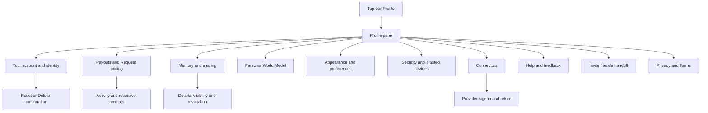

# Profile UI Contract

Status: current product and UI reference, checked against source revision
`fd22c14a9` on 20 October 2026. Owner: frontend architecture. Classification:
`canonical`, package-local. This contract inventories the signed-in person's
Profile: its menu, nested screens, editors, confirmations, and immediate
handoffs. Public person profiles retain the [Connect contract](./connect.md).
The [typography contract](./typography.md) explains which font role to use;
the [navigation contract](./navigation.md) owns shared shell controls.

## Visual Map

## Entry, navigation, and authority

Profile is normally a pane over the current route. Its URL uses
`profile_pane=1`, `profile_panel`, and `profile_detail`; these are pane states,
not independent full pages. The pane owns its nested history and scroll
restoration. Inactive stack bodies are hidden/inert during transitions.
Back first unwinds a registered feature layer, then detail, panel, and pane.
Close dismisses the pane and restores the underlying route.

On web, the proxy intercepts `/one/profile`, `/profile`, and their descendants
and redirects to the Profile pane over `/one`. It resolves recognized path
suffixes through the existing Profile route mapper. Provider `oauth/return`
addresses and the World Model `?claim` entry are exceptions. Native static
exports can reach page implementations without this proxy. A page file alone
therefore does not prove an ordinary web destination.

Sources: [web proxy](../../proxy.ts), [Profile routes](../../lib/navigation/profile-routes.ts),
[pane state](../../lib/navigation/profile-pane.ts),
[Back owner](../../lib/navigation/profile-pane-back.ts),
[pane presentation](../../components/app-ui/profile-pane.tsx), and
[stack navigator](../../components/profile/profile-stack-navigator.tsx).

| Surface | Panel/detail or entry | Current meaning |
| --- | --- | --- |
| Profile home | No panel/detail | Identity and grouped menu. |
| Your account | `account`; `phone` | Identity editor, phone verification, account lifecycle. |
| Payouts / Request pricing | `payouts`; `request-pricing` | Money, activity, Stripe handoffs; default future request price. |
| Memory | `my-data` | Live memory, saved details, sharing and received information. |
| Memory detail | `domain:<key>`, `sharing`, `connection:<id>` | Existing category, sharing list, or one connection's access. |
| Personal World Model | `world-model` | Existing personal research model and its sources/invitations. |
| Appearance & preferences | `preferences` | Appearance, accent, Gemini, Voice, writing style. |
| Finance preferences | `preferences` / `kai-preferences` | Implemented direct entry; no current Preferences menu row. |
| Gemini / Voice | `preferences` / `gemini` or `voice` | Runtime choice/key and voice preferences. |
| Security & privacy | `security` | Vault methods entry. |
| Vault methods / Account access | `security` / `vault` or `session` | Unlock methods; compatibility Sign out screen. |
| Trusted devices | `security` / `trusted-devices` | Pane-only root menu entry, not a standalone devices page. |
| Connectors | `connectors`; `connector:<catalog-id>` | Catalog and connector detail. |
| Help & feedback | `support` | One composer; historical routing/compose details resolve here. |
| Legal | `legal` / `privacy` or `terms` | In-place reader, rather than leaving Profile for public legal pages. |
| Gmail compatibility | `gmail`; `gmail-connection`, `gmail-actions` | Retained authored pane states; not a root menu group. |
| Referrals compatibility | `referrals` | Retained panel; root Invite friends instead opens `/one/referrals`. |

Root render waits for auth and requires a signed-in person. Memory, Payouts,
World Model, Request pricing, Connected Systems, Connectors, Gmail, Security,
and Finance/Gemini details require vault access in the Profile owner. Menu
selection can open vault creation/unlock and resume its pending destination
after success; Cancel clears that destination. Security has its own no-vault
recovery. Do not infer identical no-vault rendering for every panel from the
shared locked-vault guard.

Native scenes require acknowledged presentation/navigation capabilities,
feature availability, and owner/vault/privacy fences. An unsupported scene
falls back to the web body; an iOS version alone does not prove admission.
Sources: [workspace](../../components/profile/profile-workspace-page.tsx),
[native admission](../../components/profile/native-profile-menu.tsx),
[scene fence](../../lib/capacitor/native-profile-scene-fence.ts).

## Home menu and identity

The authored [menu model](../../components/profile/profile-menu-model.ts)
owns the labels and order. Rows open the panel in the table above, except:

| CTA | Effect and boundary |
| --- | --- |
| Profile photo | Existing portrait opens full-photo view; otherwise opens photo options. Busy disables entry. |
| Camera | Launches the change-photo picker directly, rather than first opening full-photo view. |
| Photo options | Explicit action inside full-photo view opens the options sheet. Ordinary dialog dismissal only closes the view. |
| View photo | Opens the existing portrait; dismissal closes that view. |
| Upload a photo | Web file picker. Native says **Take photo or choose from library**. Selecting a valid photo commits through the identity service; no separate Save step. |
| Remove photo | Commits removal immediately from photo options. |
| Invite friends | Leaves the pane for the `/one/referrals` owner. |
| Developer tools · Local | Development and allowed developer-host only. Targets the lab route, subject to the web proxy limitation below. |
| Privacy Policy / Terms of Service | Opens that document within Profile's Legal reader. |
| Sign out | Calls the existing auth sign-out owner; no confirmation. Failure is logged; this handler has no inline failure panel. |

Photo owner: [avatar editor](../../components/profile/profile-avatar-editor.tsx).

## Your account and phone verification

| CTA or state | Effect, validation, and save boundary |
| --- | --- |
| Display name · Edit / Close | Toggles the inline editor. **Cancel** closes without committing. |
| Save name | Collapses whitespace; requires 2–60 characters and rejects control characters, links, and handles. Disabled for unchanged/invalid/busy/unowned input. Confirmed server-normalized identity closes the editor. |
| Name failure | Validation/auth/unavailable errors remain inline. An accepted save with unavailable readback remains open and explains the uncertainty. |
| Mail / Sign-in provider | Read-only identity rows. |
| Phone number · Add / Change | Opens phone detail. Unresolved lookup disables entry; **Retry** retries lookup. A blocked detail offers **Try again** and **Cancel**. |
| Country chooser / search | Selects calling code before entering the number; a local selector state. |
| Send verification code | Validates the number, sends explicitly, then enters the six-digit **One-time code** step. |
| Save phone number | Confirms the code, syncs the current identity, and replaces the detail with Account. |
| Resend code / Use a different number | Explicit resend or return to number entry. Wrong/expired code, conflict, recent-login requirement and rate limit keep recovery in the flow. |
| Phone Back | Code step returns to number entry before returning to Account. Stale owner/vault/visit work cannot commit into a different session. |
| Wallet Card | Conditional feature entry; hands off to the existing wallet-card route. |
| Native portrait row | Native Account can expose its portrait scene; web Account does not duplicate the home avatar editor. |

Sources: [name editor](../../components/profile/display-name-editor.tsx),
[phone flow](../../components/auth/phone-verification-flow.tsx), and
[Account composition](../../components/profile/profile-workspace-page.tsx).

### Account lifecycle

**Reset account** and **Delete account** run existing owner/vault preflight;
a locked vault requires unlock before confirmation. Idle confirmations expire
when the account, vault session, or active Account screen changes. Busy
confirmation controls and native Back/close cannot replay the operation.

| Confirmation | Explicit commit | Confirmed result |
| --- | --- | --- |
| Reset account? | **Cancel** / **Reset account** | After bank-revocation preflight, requires backend `success && account_reset`; then clears owned local state/receipts and restarts setup while preserving identity/vault. |
| Delete account? | **Cancel** / **Delete account**; locked entry can read **Unlock to delete account** | Requires verified deletion, performs account cleanup, and signs out to the account-deleted login notice. |

Both operations revoke vault bank connections **before** the backend
reset/delete request. A failed or unknown account operation can therefore
already have disconnected banks. Local erasure and the success result require
verified backend completion. Sources:
[verified deletion](../../lib/flows/delete-account.ts) and
[reset handler](../../components/profile/profile-workspace-page.tsx).

A lost response remains an unknown outcome for reconciliation. The UI must
not report an unconfirmed reset/deletion as success or submit a fresh retry
automatically. Source: [lifecycle owner](../../components/profile/profile-workspace-page.tsx)
and [confirmation preparation](../../components/profile/account-confirmation-preparation.ts).

## Payouts, activity, and Request pricing

Payouts composes independent wallet, bank, and activity readers: failure of
one must not imply the other balances are unavailable. Protected money UI
requires its owner token. Live and test activity remain separately labelled.

| Surface / CTA | Effect and boundary |
| --- | --- |
| Hussh Coins | Opens local Activity filtered to Coins; displays holds/review context. |
| In Stripe | Opens Available/Settling/next-availability details or empty state; no transfer action. |
| Payout bank · Link bank / Finish setup / Manage | Creates an authenticated Stripe onboarding/manage destination and hands off externally. Busy reads **Checking…** / **Opening…**. Bounded return rechecks status. Bank details stay masked. |
| Retry bank check | Reconciles an unavailable bank status; separate bank and verification errors. |
| Verify details | Conditional Stripe verification handoff; an in-review status is read-only. |
| Redeem $… | Live, server-enabled only; requires ready bank, healthy unheld wallet and a fresh read. One paid request at a time. |
| Sending… / Updating balance… / Check transfer | Pending/unknown redemption reconciliation. Retry retains the existing client request identity instead of creating another transfer. |
| Test redeem / Check test redemption | Test-server-mode only; uses the separate sandbox balance/history. |
| Activity filters | **All**, **Earnings**, **Redemptions**, **Bank deposits**, **Adjustments**. Real/Test activity are distinct; Coins is also available in View all. |
| Activity row / View all | Opens a receipt, or the paginated Activity sheet. Current summary shows up to five rows. **Load more** and **Retry** retain good reads. |
| Receipt linked stage | Opens the corresponding receipt above its parent, with cycle protection. Topmost Close/Back returns one level and restores the opener. |
| Copy reference | Copies the receipt's available reference. |
| Receipt Next step | **Update bank** / **Verify details** closes receipt ancestry before invoking the existing bank flow; it does not move money. |
| Missing/incompatible receipt | “This activity isn't available.”; incompatible contract offers web **Reload** / native **Update app**. |
| Native Activity | **View all activity**, previous/next pages of 20, receipt details pages of 40, at most six receipt levels. Busy blocks navigation; owner change retires sheets. |
| Price per request | **Default price (USD)** for Google Drive, $0.50–$500; fee information and conditional **Ask each time**. |
| Save price | Valid dirty draft only; confirmed default affects future requests, never existing quotes. Safe `from` can return a route presentation after save; the pane remains inline. |
| Ask each time / Retry | Keeps the pricing editor for per-request decisions, or retries its failed read. |

Owners: [Payouts composition](../../components/consent/document-hashcoins.tsx),
[bank row](../../components/consent/payouts/payout-bank-row.tsx),
[redemption](../../components/consent/payouts/redeem-action.tsx),
[activity](../../components/consent/payouts/activity-card.tsx),
[receipts](../../components/consent/payouts/receipts/payout-receipt-sheet.tsx),
[native payouts](../../components/profile/use-native-payouts.ts), and
[pricing](../../components/consent/document-request-pricing-card.tsx).

## Memory, World Model, and Connectors

These substantial nested flows have their own maintained contract pages:

- [Memory and World Model](./profile-memory.md): every category/section CTA,
  sharing/revocation, received cards/files, Secrets, Browse all memory,
  research decisions, source preparation and invitation/claim states.
- [Connectors](./profile-connectors.md): catalog and provider details, selected
  files, packet/listing review, document trust, custom tools, OAuth returns,
  legacy Mail and gated Connected Systems.

Both inherit the entry/unlock/Back hierarchy above. Their immediate actions
must be read from these child contracts before changing a nested CTA.

## Appearance, writing, Gemini, and Voice

| Surface / CTA | Effect and save boundary |
| --- | --- |
| Appearance / Accent | Existing theme and accent choices commit immediately. |
| App haptics | Native preference only; immediate update, disabled until ready/during save; saving/saved/error feedback. |
| How One writes to you · Unlock to edit | Unlocks before editing protected writing preferences. Web fields are inline; native **Writing style** opens a scene. |
| Writing fields | **Call me** (64 max), **Tone** (No preference/Direct/Warm/Casual/Formal/Executive), **Length** (Short/Balanced/Detailed), **Language** (12 languages plus no preference), **Avoid em dashes**, **Style note** (280 max, one paragraph). |
| Writing Save | Draft until explicit Save writes encrypted `identity.communication_preferences`; disabled unless dirty/available. Save failure preserves draft; load failure asks to reopen. Native Save stays open; Cancel/Back closes the scene. |
| Gemini · Use Hussh's AI / Use my own key | Managed choice is an owner operation. Own-key entry selects **API endpoint**: Google AI Studio or Google Cloud Vertex API key, with conditional project/location and secret-key fields. |
| Validate key → Confirm and save | Checking then ready confirmation; protected owner/vault-fenced operation. Inline errors retain recovery. **Remove key** exists only for a saved key. Native blocks Back while pending. |
| Live voice | Read-only readiness: Checking/Ready/Off/Unavailable. |
| Test microphone | Three-second local check and tone with level/sample-rate/echo/worklet result; this test does not transmit a recording. |
| Speakerphone-safe mode | Immediate per-user preference. |
| Voice control | Immediate switch; sensitive-action explanation remains read-only. |
| Location voice defaults | Conditional on token/default availability: **Auto-approve requests**, **Visible in Nearby Check-In**, **Allow connection requests**, **In an emergency** → Open the screen/Send the alert. Per-field server mutation/busy state. |
| Connect · Reuse access from last time | Authenticated preference to reuse the last request's asks/offers for the same person. |
| Domain restrictions | Only **Location** and **Connections** have switches. Mail, Connected Systems, Consent Center, Identity verification, Finance and Calendar show **Coming soon** restriction controls; that label does not prove their underlying voice actions are off. |

Owners: [appearance](../../components/profile/profile-appearance-controls.tsx),
[writing fields](../../components/profile/communication-preferences-group.tsx),
[writing owner](../../components/profile/communication-preferences-section.tsx),
[Gemini](../../components/connections/gemini-runtime-settings-card.tsx),
[voice overview](../../components/profile/one-voice-preferences-section.tsx),
[voice preferences](../../components/profile/voice-preferences-panel.tsx),
[domain restriction catalog](../../lib/agent/voice-engine-domains.ts).

### Finance preferences direct entry

`preferences` / `kai-preferences` exists behind vault access but is not offered
as a Preferences row. It loads the current profile, then asks horizon
(under 3 / 3–7 / over 7 years), drawdown response (reduce/stay/buy more), and
volatility (small/moderate/large). **Next** advances; terminal **Save changes**
commits all preferences. A changed horizon can open **Update horizon anchor?**
with **Apply from now (default)** / **Keep original start date**, **Cancel**,
and **Apply**.

Web edit mode hides its own Back button; it has no equivalent wizard-step
Back layer in the inspected hook. Native Back closes the horizon decision,
then moves to the previous question, then parent. Unavailable web content
asks to reopen; native provides **Try again**. Owners:
[panel](../../components/profile/profile-kai-preferences-panel.tsx),
[wizard](../../components/kai/onboarding/KaiPreferencesWizard.tsx), and
[wizard model](../../components/kai/onboarding/use-kai-preferences-wizard.ts).

## Security, vault methods, and devices

Security & privacy currently offers **Vault methods**. Trusted devices is a
separate root menu entry. **Account access** is a compatibility detail with
Sign out, not an offered Security row.

| Surface / CTA | Effect and boundary |
| --- | --- |
| Create your vault / Unlock vault | Existing creation/unlock recovery before methods can be managed. |
| Default unlock | Selects an available wrapper as default through the existing vault owner. |
| Refresh methods | Reconciles unavailable/uncertain state before further mutation. |
| Add passkey / native biometric option | Capability-dependent enrollment; no fabricated available method. |
| Wrapper row | Opens detail with **Use as default** and permitted **Remove passkey**. Generated local biometric wrappers are not removable here. |
| Change password | New/confirmation fields, minimum eight characters; **Cancel** / **Save new password**. Requires matching valid fields; busy prevents cancellation/replay. Existing other wrappers remain. |
| Remove passkey? | **Cancel** / **Remove passkey** confirmation; warns the password stays and a password-manager copy may remain. |
| Trusted devices · Refresh | Loads/reconciles the device list, empty state, or failed status. |
| Unlink device | Active device trash button named **Unlink <name>** → **Cancel** / **Unlink device** confirmation. Warns sync stops, local vault seals and reapproval/reinitialization is needed. |
| Uncertain unlink | Lost/5xx/408 response prevents retry until fresh reconciliation. Confirmed revocation remains visible even if follow-up refresh fails. |

Owners: [methods panel](../../components/profile/vault-methods-panel.tsx),
[methods model](../../components/profile/use-profile-vault-methods-model.ts),
[trusted devices](../../components/profile/trusted-devices-page.tsx),
[device model](../../components/profile/use-trusted-devices-model.ts).

The incoming `/one/profile/security/devices/authorize` page implements
**Approve device** → backend authorization → optional passkey handoff →
returned redirect. It disables incomplete/unowned/busy requests and retains
failure recovery. That suffix is not recognized by the web pane mapper and is
normally proxy-shadowed to Profile root. This is a native/no-proxy entry
implementation, not proof of ordinary web reachability.

## Help, invitations, and Legal

| Surface / CTA | Effect and boundary |
| --- | --- |
| Help & feedback | One composer with **Problem**, **Help**, **Feedback** choices. Historical support-routing/compose states render this same composer. |
| Send report / Send request / Send feedback | Explicit submit only; trimmed message 10–8000 characters, offline rejected locally. Busy guards duplicate submission. Accepted response shows sent heading; **Done** returns to Profile root. |
| Support failure | Error/unknown delivery retains draft. A newer draft revision survives acknowledgement of an older submission; no false sent state. Copy explains no automatic receipt. |
| Invite friends | `/one/referrals` handoff. Retained Profile Referrals panel offers link **Copy**, **Share** (clipboard fallback), load **Try again**, and public handle **Save**. |
| Referral handle | Server validates 3–24 letters/numbers/hyphens and uniqueness. Share cancellation is quiet. Counts, ranks, coins, milestones and anonymized team/leaderboard come from server authority. |
| In progress | Conditional toggle opens anonymous progress when count is nonzero. Stream or foreground polling refreshes; optional gamification failure does not hide the core invitation link. |
| Privacy Policy / Terms of Service | In-place legal document reader. **On this page** scrolls sections; **See also** replaces the document so Back returns to the opener. External/mail links retain authored destinations. |
| Native legal link | Existing native reader handles HTTPS/mail links and delete-account handoff; no second legal copy. |

Owners: [support workspace](../../components/profile/profile-workspace-page.tsx),
[referrals panel](../../components/profile/referrals-panel.tsx),
[legal section](../../components/profile/profile-legal-section.tsx),
[legal reader](../../components/legal/legal-reader.tsx), and
[native legal handler](../../components/profile/profile-native-legal.ts).

## Compatibility and existing gaps

| Claim / entry | Classification and current boundary |
| --- | --- |
| Every Profile page file is a reachable web page | `wrong_direction`: proxy and route normalization decide effective entry. |
| `/preferences/device` | `already_exists` as compatibility entry to Preferences root. |
| Voice examples/changelog | `already_exists` as aliases of Voice, not separate current screens. |
| Finance Preferences in the menu | `missing`: implemented direct entry has no current root/Preferences row. |
| `/receipts`, `/integrations`, `/pkm`, `/regulatory`, `/pkm-agent-lab` under Profile | `partially_exists`: page implementations redirect/render, but the ordinary web proxy sends these unrecognized suffixes to Profile root. Native/no-proxy exports differ. |
| `/one/profile/referrals` | Recognized web Profile panel; page-file redirect can instead hand off in native/no-proxy entry. Root Invite friends uses `/one/referrals` directly. |
| Developer tools offered locally | `partially_exists`: dev/host-gated row exists, but its target is also proxy-shadowed on ordinary web. |
| Identical web/native Back inside Finance wizard | `wrong_direction`: native has explicit nested Back handling; web edit mode differs. |
| Native scenes are always active | `wrong_direction`: acknowledgment, feature availability and privacy fences are required. |

## Verification and maintenance

This is a source-backed inventory, not evidence of live provider delivery,
account deletion, payments, native biometric/picker success, or a deployed
account walkthrough. No protected account actions were performed for this
contract. Account-specific balances, counts and connector status are examples
only when explicitly labelled, never fixed product limits.

Nearest existing verification owners include
[pane state](../../__tests__/navigation/profile-pane.test.ts),
[stack behavior](../../__tests__/components/profile-stack-navigator.test.tsx),
[name editing](../../__tests__/components/display-name-editor.test.tsx),
[photo editing](../../__tests__/components/profile-avatar-editor.test.tsx),
[trusted devices model](../../components/profile/use-trusted-devices-model.ts),
and [Profile pane layout](../../e2e/profile-pane-close.layout.spec.ts).
These links identify owners; execution evidence is reported with the change.

Update this contract when a panel, CTA, commit boundary, normalization rule,
platform gate, or Back layer changes. Preserve executable authority in the
existing route/action/vault owners. Run `./bin/hushh docs verify` for prose;
UI implementation changes follow the
[UI contributor scaffold](../../../docs/reference/architecture/ui-contract-contributor-guide.md).
