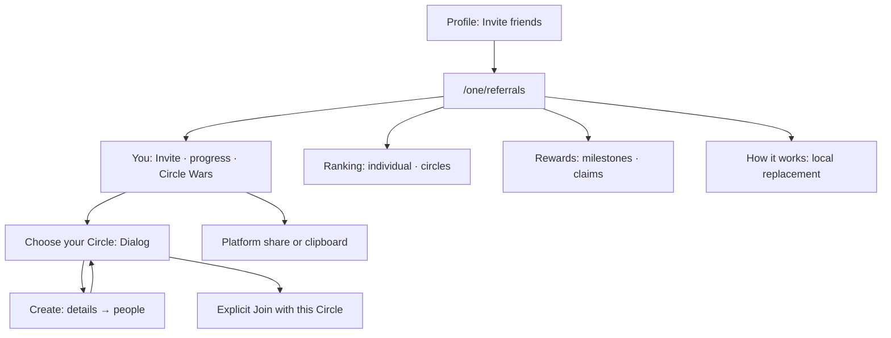

# Referrals UI Contract

Status: current source-backed product/UI contract at
`3ff2620b48567177dce5c667e77a70203e4a8c35`, checked 20 October 2026. Owner:
frontend architecture. Classification: `canonical`, package-local. Source
inspection only; no live invitation, enrollment or claim was executed.

## Visual Map

## Routes, admission and source owners

`/one/referrals` mounts
[ReferralDashboardPage](../../components/referrals/referral-dashboard-page.tsx),
not the retained Profile `ReferralsPanel`. Loading/signed-out copy is
`Opening Referrals…`; signed-out replaces route with
`/login?redirect=%2Fone%2Freferrals`. Default **You**, **Ranking** and **Rewards**
are local tabs. **How it works** replaces body/title, registers Back, resets
scroll and focuses main; it is not a modal. Root Invite friends and the old
`/one/profile/referrals` compatibility panel have different controls.

Owners: [route](../../app/one/referrals/page.tsx),
[invite](../../components/referrals/referral-invite-actions.tsx),
[share](../../lib/share/share-link.ts),
[individual rankings](../../components/referrals/individual-referral-rankings.tsx),
[ranking row](../../components/referrals/referral-ranking-row.tsx),
[rules](../../components/referrals/referral-journey.tsx),
[reward presentation](../../lib/referral/reward-presentation.ts),
[Circle model](../../components/profile/circle-wars-panel.tsx),
[Circle view](../../components/profile/circle-wars-view.tsx),
[create](../../components/one-location/redesign/circles/named-circle-flows.tsx),
[people step](../../components/one-location/redesign/circles/create-circle-people-step.tsx).

Not mounted here: Recent referrals, Weekly prizes, QR, rotate/revoke link UI,
social icon chooser, handle editor, or legacy preview-team controls. Unused
service methods/CSS do not make them current CTAs. Shell/vault/provider
ceremonies retain their linked [Navigation](./navigation.md) and [Profile](./profile.md)
owners.

## Read provenance, fields and persistence

`R=/api/one/referrals`. `F` is current Firebase bearer; `V` vault-owner bearer.
[ReferralService](../../lib/services/referral-service.ts),
[CircleWarsService](../../lib/services/circle-wars-service.ts) and
[Location service](../../lib/one-location/service.ts) use the
[One proxy](../../app/api/one/[...path]/route.ts), same backend paths; admitted
native transport can call configured backend directly. JSON/auth are forwarded,
no-store. Backend [referrals routes](../../../consent-protocol/api/routes/one/referrals.py)
compose the existing referral/activity/leaderboard/program/rewards/Circle
services; this contract is their UI projection, not a second award schema.

| Trigger | Exact request | Response → visible fields |
| --- | --- | --- |
| Summary | F GET `R/summary`, no body/query | `joined_count,total_count?,next_offset?,slug,link,link_open_count?,last_opened_at?,qualified_count,in_progress_count,under_review_count,required_active_minutes,new_users_only,referrals[]`. You mounts **link and joined_count**; does not render referrals[]. GET can mint initial slug, so it is not guaranteed zero-write. |
| Coins | F GET `R/points` | `points,coins` must be equal safe integers; en-IN formatting. Independent of published ranking. |
| Individual first page/rank | F GET `R/leaderboard?limit=10` | `snapshot_id?,next_after_rank?,snapshot_generated_at,entries[],viewer,stale`; entry `rank,handle,display_name?,photo_url?,points,is_viewer`. Permitted display_name else handle, avatar, coins and rank; viewer supplies off-page own rank. |
| Individual page/jump/retry | F GET `R/leaderboard?after_rank=N&limit=10[&snapshot_id=UUID]` | Pinned snapshot; changed snapshot resets first page. Empty continuation does not invent a further page. |
| Rules | F GET `R/policy` | `version,challenge_duration_days,points,streak_rules,weekly_schedule,weekly_prizes_enabled,flash_bonus_enabled`→earning amounts/requirements, not hardcoded catalog. |
| Rewards | F GET `R/milestones` | `joined_referral_count,progress_basis?,available_milestones[],lifetime_qualified_count,earned[],next_milestone`. Catalog `milestone_key,threshold,reward`; next adds progress; earned `milestone_key,reward,earned_at,claimed_at?,fulfillment_status?`→progress/claim/fulfillment captions. |
| Streak | F GET `R/engagement` | `streak:{current_run_days,run_length_days,longest_run_days?,last_activity_date?}`, `flash:{active,ends_at}`. Web displays current streak/flame, no flash panel. |
| Visible dashboard day | F POST `R/app-open`, `{surface:"referral_dashboard"}` | `activity_date,timezone,server_now,next_day_at`→server-midnight schedule; records view/day, reloads engagement/points/ranking. Silent failure retries through60s fallback timer and visible resume/online; pending prevents concurrent writes. Resumed events bypass the day schedule. |
| Stream | F GET `R/events`, Accept SSE | `ready:{channel:"referrals"}`, `heartbeat:{timestamp}`, `referral_changed:{reason}`. Doorbells reread resources, no balance in frames. |
| Circle state | V GET `R/circle-wars` | `{period,participation}` below. |
| Circle standings | V GET `R/circle-wars/leaderboard?limit=10&offset=N` | `period,teams,total_teams,offset,limit,has_more`→rows/page/cutoff. |
| Chooser roster | V GET `/api/one/location/circles` | `circles[].id,name,memberCount`→radio choices; initially no selection. |

`period={round_id,status,week_start,starts_at,ends_at,timezone,server_now,seconds_remaining}`;
client adds unpersisted monotonic receipt anchor. `participation=null` or
`{status:"active",opted_in_at,team:null|Team}`. Team fields:
`team_key,circle_id,name,anonymous,rank,participating_members,qualified_referrals,
is_your_circle,next_rank,referrals_to_next_rank,relative_progress`.
Unauthorized names are server aliases; client does not deanonymize them.

Each resource retains current-owner memory during refresh; one failure does
not zero another. [SSE](../../lib/referral/use-referral-stream.ts) reconnect/
change rereads six resources and Circle state; disconnected visible fallback30s,
focus/online/visibility refresh. Circle independently refreshes30s/cutoff,
reconciles round mismatch and invalid pages.
[Daily activity](../../lib/referral/use-daily-app-activity.ts) is a separate
write owner; opening this page is not purely read-only.

## Every CTA, confirmation, cancellation and failure

| CTA/branch | Wire/effect and acknowledgement |
| --- | --- |
| Invite / Invite Friends | Platform share title/text `Join me on Hushh One`, dialog `Share your invite`, URL summary.link. Native Capacitor/Web Share; unavailable Web Share copies `Join me on Hushh One\n{link}`. Cancel silent; clipboard `Invite link copied`; error `Could not share your invite. Please try again.` Provider failure does not automatically mean clipboard fallback. No recipient-send endpoint. |
| How it works / Back | Local replacement/restore previous tab; no business call. |
| Tabs / individual-circles | Local selection, owning readers as above; no route or award mutation. |
| Try again | Retry failed resource; retained-content banner retries all. |
| Your rank #N | Loads own ten-row page, floor((rank−1)/10)×10, same snapshot. |
| Latest rankings | Unpins local browse and shows the latest first page already supplied by the parent; no request on this tap. |
| Claim reward | F POST `R/rewards/claim`, `{milestone_key}`→`{milestone_key,claimed_at,status:"claimed"}`; reread milestones, busy `Claiming…`. No confirmation. Existing unclaimed entitlement required; repeat/not-earned409. Error `Unable to claim. Refresh your rewards and try again.` Claim does not ship/create another fulfillment job. |
| Join Circle Wars | Opens chooser, clears selected ID, reads Circles. No enrollment yet. |
| Join with this Circle | V POST `R/circle-wars/participation`, `{circle_id,consent:true}`→state; closes, `You joined Circle Wars`, refresh. No extra Yes/No checkbox ceremony. |
| Join failure | Already-selected `You already chose a Circle for this week.`; membership `Choose a Circle you currently belong to.` clears selection/reloads; generic `Could not join. Please try again.` Reconcile current state. |
| Same-circle replay | Resumes same current-round choice; different Circle conflicts. No mounted opt-out/change-team CTA. |
| View Rankings | Local Ranking+circles selection. |
| Create New Circle | Two-step existing Create inside chooser; creation is not Circle Wars enrollment. |
| Chooser X/outside | Close idle; blocked mutation. Escape during create unwinds nested Back. No rollback. |
| Back to Circles | Returns chooser; saved Circle remains. |
| Open Circles when locked | Connect Circles navigation, no implicit unlock/join/creation. |

### Nested Create: details and people

| Step/control | Exact contract |
| --- | --- |
| Details | Blank name, trim required/max80; default Family; Family/Friends/Other. Typing/type selection local. |
| Next / Saving… | V POST `/api/one/location/circles`, `{name,kind}`→`circle`; **persists before people step**. No caller create-idempotency key; uncertain retry not guaranteed duplicate-free. Failure service error/fallback `Could not create this Circle.` |
| Back/edit Next | Same saved ID, changed PATCH `/api/one/location/circles/<id>`, `{name,kind}`→circle; unchanged no call. |
| People search/page | V GET `/api/one/location/circles/<id>/eligible-connections?page=N&limit=50[&query=trimmed]`;200ms. `eligibleConnections,pendingInvites,remainingCapacity,page,hasMore,totalCount`; compatibility connections fallback. |
| Selection | Initially none; max min(20,floor(remainingCapacity)); selected still removable at cap. Local map, no address-book import. |
| Add N | V POST `/api/one/location/circle-member-invites`, `{circleId,inviteeUserIds}`→`{invites:[],added:[],skipped:[],skippedReasons:{}}`. Current implementation adds direct memberships. |
| Success | Refresh roster; return chooser with new Circle selected. Explicit Join still required. |
| Failure | `Could not add those people. Try again or add people later.` keeps selection. |
| Back / Add people later / Close | No rollback/delete. Add people later does not POST membership. No visible Yes/No/Cancel authored in these mounted create forms. |

## Exact mounted English content

Braces denote dynamic names/counts/prices/server catalog values. Local dates,
permitted names, reward names and safe service errors are not finite literals.

| Surface | Verbatim copy/templates |
| --- | --- |
| Root | `Referrals`; `You`; `Ranking`; `Rewards`; `How it works`; `Good things grow together`; `Invite`; `Your progress` |
| Loading/errors | `Loading your referrals…`; `Unable to load. Check your connection.`; `Loading…`; `Unable to load {retryLabel}.`; `Try again`; `Unable to refresh. Showing the last update.` Retry labels `the individual standings`, `your reward progress`, `referral rules`. |
| Metrics | `Coins`; `Rank`; `Referrals`; `…`; `Loading`; `—`; `Unable to load`; `day`; `days`; accessible `{N} day streak` |
| Ranking | `individual`; `circles`; `Individual rankings`; `Standings are unavailable.`; `No entries yet.`; `Could not load that page.`; `Your rank #{N}`; `Page {N}`; `Latest rankings`; `Previous`; `Next`; `You`; `Your circle` |
| Rewards unavailable | `Rewards policy unavailable`; `Rewards are not available yet. Your progress is saved.`; `{N} joined referrals · {M} recorded rewards` |
| Rewards progress | `Milestone reached`; `Your next reward`; `Your reward is being confirmed.`; `{progress} / {threshold} referrals`; `{N}% complete`; `All milestones reached`; `{N} joined referrals. Rewards become claimable after qualification and review.` |
| Milestones | `Milestones`; `{N} of {M} unlocked`; `Unlocked`; `Confirming`; `Unlocked at {threshold}`; `{threshold} referrals`; `{N} joined referrals. Your progress is saved.`; `Previously earned rewards`; `Claim reward`; `Claiming…` |
| Claimed | `Claimed · Awaiting review`; `Claimed · Approved for fulfillment`; `Claimed · Shipped`; `Claimed · Delivered`; `Claimed · Cancelled`; fallback `Claimed · Awaiting fulfillment review` |
| Circle locked | `Open your vault to see Circle rankings.`; `Your circle`; `Win with your circle`; `Open your vault to choose a Circle and join Circle Wars.`; `Open Circles` |
| Circle load | `Loading Circle Wars…`; `Circle Wars could not refresh. Showing the last update.`; `Circle Wars could not refresh. Please try again.` |
| Circle intro/unavailable | `Circle Wars.`; `Rise together.`; `Join Circle Wars`; `Your Circle is unavailable`; `Your weekly selection is saved. Check your Circle membership to see its details.` |
| Team | `Your circle is in`; `Rank #{N}`; `{name}`; `{N} participating members`; `qualified referrals`; `this week`; `Invite Friends`; `View Rankings` |
| Movement | `Your Circle moved up to Rank #{N}!`; `Another Circle just passed your team.`; `You're {N} referrals away from Rank #{N}!`; `Your Circle leads this week. Keep growing together.` |
| Timer | `New round starting`; `{N}s left`; `{N}m left`; `{H}h {M}m left`; `{D}d {H}h left`; accessible ` · {timezone}` |
| Circle ranking | `Circle rankings`; `No Circle rankings yet.`; `Page {N}`; `Previous`; `Next` |
| Chooser | `Choose your Circle`; `Create a Circle`; `A good team starts with your people.`; `Could not load your Circles.`; `Try loading Circles again`; `Loading your Circles…`; `You have no Circles yet. Create a Circle to compete with friends.`; `{N} members`; `Create New Circle`; `Back to Circles`; `Joining…`; `Join with this Circle` |
| Join disclosure | `By joining, you choose one Circle for this week. Only your new qualified referrals after joining count. Your friends join separately.` |
| Create | `Step 1 of 2 · Name your Circle, then add people now or later.`; `Circle name`; `Family, close friends, project team`; `Enter a Circle name.`; `{N} / 80`; `Circle type`; `Family`; `Friends`; `Other`; `Next`; `Saving…` |
| Add people | `Add people`; `Step 2 of 2 · Choose people for {circleName}, or add them later.`; `Search people`; `{N} selected`; ` · Choose up to {N} people`; ` · This Circle is full` |
| People state | `Loading contacts…`; `Could not load your contacts.`; `No contacts match that name.`; `No connections to add yet. You can add people later.`; `Load more contacts`; `Loading…`; `Try again` |
| People footer | `Add people`; `Add 1 person`; `Add {N} people`; `Back`; `Add people later`; accessible `Close` |

| How it works placement | Verbatim copy |
| --- | --- |
| Steps | `Invite a friend`; `They finish setup and use the private agent`; `Earn {qualified_referral_points} coins` |
| Circle heading | `Win with your circle` |
| Circle rules | `Choose an existing Circle or create one, then explicitly join Circle Wars for the current week. Each member joins separately and chooses one Circle per week.` |
| Qualification/deadline | `Each new referral started after you join adds one team referral when it qualifies. Individual coins and lifetime rewards keep working independently. The weekly deadline follows the program timezone shown in Circle Wars.` |
| Earning heading | `More ways to earn` |
| Streak | `Keep your streak`; `View your referral dashboard on {run_length_days} consecutive days` |
| Flash | `Flash boost`; `Replaces {qualified_referral_points} coins when active` |
| Referral | `Referral activity`; `Join: {in_progress_points} coins; qualified: {qualified_activity_total_points} total activity coins` |
| Memory/connection/agent | `Memory updates` / `Save memory once per day`; `Connection Builder` / `Each new connection`; `Agent usage` / `Each completed private-agent reply` |

Configured earning rows require positive amounts; flash also its enabled flag.
Awards `+{N} coins`, flash omits `+`.

## Spatial canvas, typography and native presentation

X is container-relative; centered shell `x=(viewport−effectiveWidth)/2`.
Y follows actual rendered preceding heights+gaps. No screenshot coordinates
or physical-native frames were measured. Responsive thresholds marked
“container” are container queries, not all viewport queries.

| Surface | Source-derived geometry/placement |
| --- | --- |
| Shell | Agent-width cap880/shared gutters; content height grows. |
| Hero |2 equal columns/gap24/p12 top,48 sides,20 bottom; art max340/ratio1124:887. Container≤44rem sides24;≤32rem1.2:1/gap8/p12/0/24;≤20rem1.4:1;≤17rem1column/art≤220. |
| Invite |88×44 target/inner pill min40. No anchored local share menu; platform owns share UI. |
| Progress |gap24/p16/0/28; card24;4 metric columns/gap20/16→2 at container≤40rem→1≤17rem. |
| Ranking |min54; columns24/flexible/64,gap12,p10,avatar30. Container≤520 columns20/flex/48,gap8,p10/8,avatar28. |
| Rewards |4columns→2 container≤44rem→1≤17rem; phone viewport≤560 two. Feature art208/140phone; tile160/136. |
| Circle card |content/150,gap20,p14/24/24; container≤520 art112/gap12/p12/20/20;≤300 onecolumn/art hidden. |
| Chooser |Shared **modal Dialog**, not Sheet; max85dvh/scroll; effective width viewport−32/cap512,p24/gap16. Create inside same Dialog. Shared scrim800/content801/close local layer. |
| Circle choice |min76,p14/16,gap12,border1,icon44/glyph25,radio18; selected accent border/tint. |
| Create |input52/radius14/font17/22; type48/radius14,3columns≥360/1below. People list max min(40dvh,360),inner scroll/footer outside. |
| Rules |3steps horizontal→vertical container≤680,markers40→36; earning36/content/value→32/content/value;≤17rem2columns. |

Sources: [dashboard CSS](../../components/referrals/referral-dashboard.css),
[ranking CSS](../../components/referrals/referral-rankings.module.css),
[Circle CSS](../../components/profile/circle-wars.module.css),
[rules CSS](../../components/referrals/referral-journey.module.css).
Final typography overrides occur after earlier duplicate declarations.
Family `var(--font-app-body)`, shared agent title/tabs, foundation footnote/
caption, major-section metric roles; use [Typography](./typography.md) for
semantic defaults rather than assigning every heading the same size.

[Native workspace](../../components/referrals/native-referral-workspace.tsx)
requires bootstrap contractVersion1, enabled, coherentShell and supported
whole-presentation referrals capability; otherwise web fallback. Native
**Individual / Circles** is title-cased;40-row windows **More / Previous**;
native Circle editor/Back. Native You has Coins/Rank and joined count under
Invite, not web streak card. Additional literals `Loading standings…`,
`Loading Circle rankings…`, `Circle rankings could not refresh.`, `Unable to
load Circle Wars.`, `Could not load that page. Try again`. Native timer is
`New round starting` or `{ceil(seconds/60)}m left`. Native geometry/OS fonts
remain host-owned; web Dialog values do not establish device frames.

## Verification and limits

Nearest existing checks:
[dashboard](../../__tests__/components/referral-dashboard-page.test.tsx),
[rankings](../../__tests__/components/individual-referral-rankings.test.tsx),
[Circle Wars](../../__tests__/components/circle-wars-panel.test.tsx),
[service](../../__tests__/services/referral-service.test.ts),
[Circle service](../../__tests__/services/circle-wars-service.test.ts),
[stream](../../__tests__/services/referral-stream.test.ts),
[route layout](../../__tests__/navigation/referrals-route-layout.test.ts).
These were inspected, not executed for this docs expansion. No live account,
provider share, claim, enrollment, member write, physical-native parity or
computed full-page geometry was tested.
