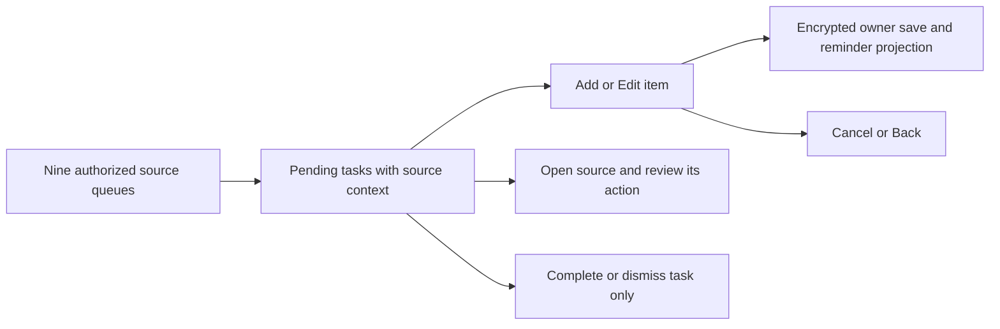

# To-do UI contract

Source-backed reference inspected on 26 October 2026 against feature base
`d57906ef2b`. Owner: frontend architecture and backend API contracts.
Scope: `/one/todos` and the One profile To-do tab. Local fixtures do not qualify
live Google accounts, Cloud Scheduler provisioning or physical-device alerts.

Messages, Finance, Wallet, Location, Advisor, Mail, Calendar, Memory and Consent
use existing owner-authorized services. Empty, disconnected, failed and partial
reads remain distinct. Nothing manufactures a task merely to populate a source.
Published queue work appears without AI permission; optional model suggestions
remain opt-in, bounded and reviewed before Add task.

Rows show title, schedule, source, verified source context and separate owner
notes. A scheduled Calendar demo appears even when no RSVP is pending; its
participant labels use a separate owner-only projection and do not widen chat.
Mail reply candidates show sender, subject and receiving account. Messages use
unread metadata, not message previews. A shared Drive setup prerequisite appears
once with its known blocked requesters. Distinct requests are never merged by
matching title. Calendar identity distinguishes account/calendar/event and
retains unambiguous legacy completion state. The current agenda covers seven
days; a truncated provider response is shown as limited coverage.

`Show tasks from` / `Task source` filters the current view, including completed
items on the full page. It does not delete, complete or disconnect anything.
Due receipts retain their independent source lifecycle. Filters reset when the
owner's page remounts; they are not a durable notification preference.

Each row has right-aligned Edit, completion and Delete controls, using the
shared action surfaces and 44-pixel targets. Add item and Edit open the same
sheet. Title is required; date, time and notes are editable. Source context and
links are not editable. Edits affect this task only. Unchanged provider fields
continue refreshing; changed fields retain the owner's explicit overrides.

Cancel, sheet close and Back discard an unsaved draft and restore trigger focus.
Saving blocks duplicate submissions and competing row mutations. Failure keeps
the draft open with a retryable inline error; stale revisions require refresh.
Account change, vault lock and session retirement invalidate late reads/saves.
The full page confirms Delete; preview dismisses through its existing row flow.
Completion/dismissal never performs the source approval, payment or send action.

Date and time together schedule a generic reminder in the displayed device time
zone. Date-only tasks do not alert. Invalid/nonexistent/ambiguous local times
fail validation. Past selections do not create new alerts. An unchanged schedule
keeps its absolute instant when the device changes time zone. The explicit
`Enable reminder notifications` CTA requests permission and reports the result;
opening or saving a task does not prompt. Reminder timing is atomically projected
with encrypted task persistence. Completing, deleting or rescheduling suppresses
old generations. Generic alerts open `/one/todos` and expire after 15 minutes.
OS permission, transport reachability and the deployed scheduler affect delivery.

Mail scans 25 threads per bounded request, automatically continuing while this
view is mounted. `Task sources` reports checked threads and complete, scanning,
more-to-scan or retry states. A failed page retries without advancing over unread
threads. Refresh begins a new scan; cursors are sealed, owner/account/grant-bound
and expire after two hours. There is no fixed 50-thread total or recent-only
cutoff. An independent bounded read adds dated recent email invitations and
meeting mentions. Invitation tasks show the organizer; inferred mentions say
Review meeting and require checking their details. Exact iCalendar UID and
occurrence matching merge a meeting already shown from Calendar. Equal titles
alone never merge tasks. Failed meeting reads retain reply results and report
their separate unavailable state; reply-scan completion does not imply exhaustive
meeting extraction. Messages coverage reports unread metadata; an aggregate
count alone does not fabricate a completable obligation for each person.

Phone and desktop use shared typography roles, wrapping context and compact
44-pixel actions. Browser fixtures exercise 320, 393 and 1280 pixel layouts,
create/edit/reopen/cancel, cleared reminders, focus and overflow. Unit/service
regressions cover owner changes, stale writes, grouped prerequisites, source
filtering, context redaction and retry pagination. Backend PostgreSQL regressions
verify transaction rollback, generation suppression, delivery timing and erasure.
