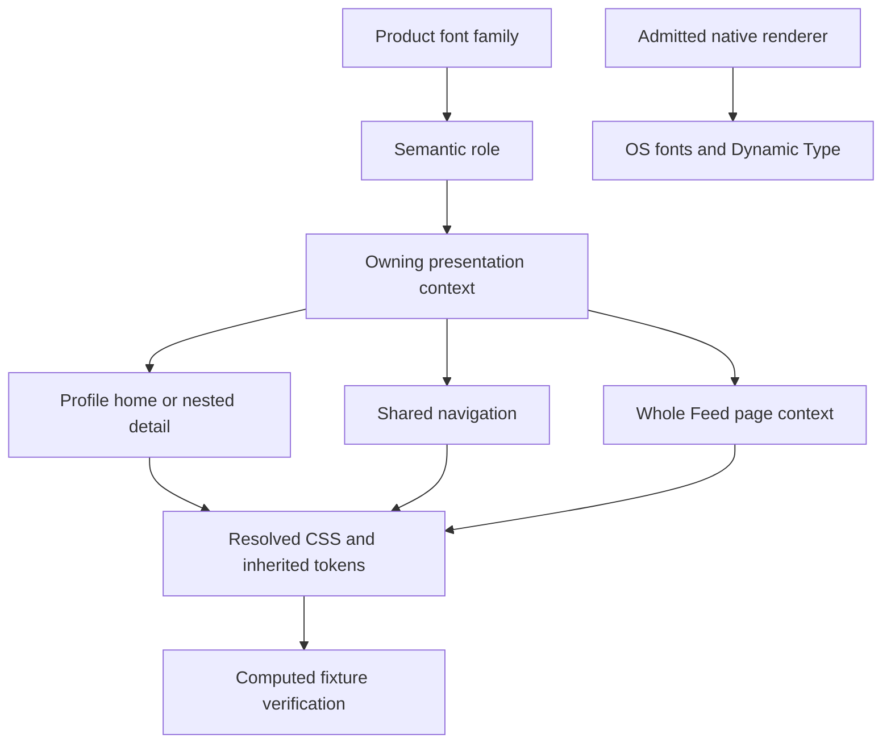

# Profile, Navigation, and Feed Typography Contract

Mail's page-specific heading overrides, dialogs, editor, phone/desktop sizing
and cascade boundaries are recorded in the [Mail contract](./mail.md#font-schema-what-to-use-where-and-actual-override-boundaries).

Status: current source-backed usage map, checked against revision
`296d7769c83176739e4db8d3ad549b0521894f52` on 20 October 2026. Owner: frontend design system. Classification:
`canonical`, package-local. This answers **when to use what** in these product
surfaces. The existing [design system](../../../docs/reference/quality/design-system.md)
and executable tokens remain authoritative; this page does not introduce a
second font schema.

## Visual Map

## Selection rule

Choose the meaning first: screen title, section, row name, explanation, action,
input, or metadata. Reuse `PageHeader`, `SettingsGroup`, `SettingsRow`, and
semantic typography components. Let the owning Profile/Feed context resolve
the compact size. Do not copy a numeric size from one context into another or
infer the result from a JSX `text-sm` class.

| Need | Use | Example |
| --- | --- | --- |
| Primary page or agent heading | PageHeader with PageTitle/AgentTitle | Body heading where the route owns it; do not duplicate the shell's Feed title. |
| Compact navigation name | NavigationTitle / shared top-bar owner | Breadcrumb; current page is not another clickable parent. |
| Group a settings list | SettingsGroup / SectionLabel | Account, security, connector groups. |
| Name one setting/person/request | SettingsRow / RowLabel | Display name, connector name, Feed decision. |
| Explain that row | RowDescription | Current setting or request summary. |
| Short inline action | TrailingAction or existing action-role hook | Edit, Retry, Details; preserve its target independent of text size. |
| Commit an ordinary/final operation | Shared Button standard/prominent | Retry/pagination versus Save/Join/final confirmation. |
| Dense toolbar/row button | Shared Button compact | Compact label in a full 44px target. |
| Form label / entered value | FormLabel / InputValue and shared control | Field name versus the person's typed value. |
| Supporting instruction | HelperText / Footnote | One line that helps the decision. |
| Uppercase metadata | EyebrowText, mono family | Metadata; never replace body paragraphs with this role. |
| Long legal or memory document | Existing article/Markdown reader | Retain readable document typography; do not flatten paragraphs to Profile's 10px group label. |

## Family and weight schema

Web and WebView product text uses self-hosted **Plus Jakarta Sans**. Display
and body aliases resolve to that same family. Shipped normal and italic faces
are 400, 600, and 700 with `font-display: swap`. Emoji/unsupported glyphs use
platform fallback. Technical/uppercase metadata uses the existing system
monospace stack. Do not bundle Apple font files.

| Placement | Requested CSS weight | Available selected face |
| --- | ---: | ---: |
| Body, ordinary row/card title, explanation | 400 | 400 |
| Header navigation / contextual tab | 550 | 600 |
| Page/section heading and form label | 600 | 600 |
| Standard/prominent/compact button label | 650 | 700 |
| Explicit bold emphasis | 700 | 700 |

Requested weight is what a computed-style result can report; it is not proof
of a separate 500/550/650 font file. Some contextual actions request 500.
Sources: [font faces, aliases and tokens](../../app/globals.css),
[root font loading](../../app/layout.tsx), and
[semantic wrappers](../../components/app-ui/typography.tsx).

## Semantic defaults

Values below are authored defaults in CSS pixels, **before** heading/slot
locks, compact density, and scoped overrides. Use the API, rather than
copying these values into feature CSS.

| Role | Size / line height | Weight |
| --- | --- | ---: |
| LargeTitle, PageTitle, AgentTitle, IdentityName | 28 / 34 | 600 |
| NavigationTitle | 17 / 22 | 550 |
| PageSubtitle, SupportingText | 15 / 20 | 400 |
| MajorSectionTitle, SectionTitle | 20 / 25 | 600 |
| CardTitle | 20 / 25 | 400 |
| Headline | 17 / 22 | 600 |
| SectionLabel, GroupLabel | 15 / 20 | 600 |
| Compact SectionLabel | 14 / 18 | 600 |
| BodyText, RowLabel | 17 / 22 | 400 |
| MediumRowLabel | 17 / 22 | 600 |
| Compact RowLabel | 16 / 21 | 400 |
| RowDescription, compact description | 13 / 18 | 400 |
| FormLabel | 15 / 20 | 600 |
| InputValue | 17 / 22 | 400 |
| HelperText, Footnote | 13 / 18 | 400 |
| StatusText | 13 / 18 | 600 |
| TrailingAction | 15 / 20 | 600 |
| TrailingValue | 15 / 20 | 400 |
| ButtonLabel | 17 / 22 | 650 |
| CompactButtonLabel | 15 / 20 | 650 |
| EyebrowText | 12 / 16, mono, .04em tracking | 400 |
| TabLabel | 11 / 13 | 550 |
| AgentTabLabel | 15 / 20 | 550 |
| CaptionText | 12 / 16 | 400 |
| LegalText | 11 / 15 | 400 |

`PageHeader` lives in [page-sections](../../components/app-ui/page-sections.tsx).
[Settings primitives](../../components/app-ui/settings-ui.tsx) publish role
and slot hooks. Their context is part of their contract. TrailingValue uses
the body family and tertiary label color. Its direct 15/20 rule is distinct
from a trailing slot's inherited Profile size.

## Profile: home versus nested details

Use home navigation treatment to choose a section. Use the quieter nested
settings treatment once inside it. The Profile pane's final scoped rules
override generic semantic defaults.

| Placement | Size / line height | Weight / tracking |
| --- | --- | --- |
| Pane header | 20 / 23 | 600; −.025em |
| Home identity name | clamp(19px, 4vw, 24px) / 1.1 | 600; −.045em |
| Home identity supporting line | 10.5 / 13.65 | Regular |
| Home grouped heading | 10 / 14 | 600; .02em |
| Home navigation row | 13 / 15.6 | 550 |
| Home row description | 9 / 10.8 | Regular |
| Nested group heading | 10 / 14 | 600; .02em |
| Nested setting/row name | 13 / 15.86 | 400 |
| Nested description | 12 / 15.6 | 400 |
| Nested trailing slot / undecorated action | Inherited 12 / 15.6 | Context/inherited |
| TrailingValue inside that slot | Direct 15 / 20 unless a matching direct override applies | 400 |
| Nested input/select/combobox | 13 / 16.9 | 400 |
| Header description | 12 / 16.8 | Regular |

Do not enlarge row titles just because their HTML element is a heading.
`SettingsRow` wraps string/number trailing props in TrailingValue; those do
not become 12px merely because the containing slot inherits 12px. Existing
plain spans and explicit Profile action hooks have their own scoped rules.
Account, Payouts, Request pricing, Memory and secondary panes reuse existing
Profile composition. Devices, Referrals, Access, Gmail and vault methods have
targeted secondary rules; legal article content retains its document scale.
Sources: [global pane rules](../../app/globals.css),
[Account CSS](../../components/profile/profile-your-account.module.css),
[secondary CSS](../../components/profile/profile-secondary-typography.module.css),
and [Profile management rules](../profile-management-design-rules.md).

## Explicit opt-in Profile scale

`data-profile-type-scale` extends the existing Profile scale to a bounded
surface. It is not a global replacement. The associated `data-profile-role`
names are meaningful only within that context.

| Role hook | Size / line height / weight |
| --- | --- |
| header | 20 / 23 / 600; −.025em |
| label, scoped agent-tab label | 13 / 15.6 / 550 |
| group-label / SettingsGroup heading | 10 / 14 / 600; .02em |
| name / SettingsRow title | 13 / 15.86 / 400 |
| description | 12 / 15.6 / 400 |
| action | 12 / 15.6 / 500 |
| Opted-in AlertDialog title | 15 / 18 / 600 |
| Dialog description | 11 / 13.75 |
| Dialog footer label | 12 / inherited line / 600 |

The value `"page"` additionally restyles the shared top-bar title/breadcrumb
to20/23/600 while mounted. The whole Feed page and To-do use it.
Connect has its own `data-connect-type-scale="page"`, described below. Agents roster and the
remove-connection dialog also opt in locally. Chat uses `"chat"` for its
authored welcome context and preserves its separate 16px composer rule.
Source: [context definitions](../../app/globals.css).

## Current Connect and Feed context schema

At the checked revision **Connect owns `data-connect-type-scale="page"`** and
workspace tokens. **The whole Feed AppPageShell has
`data-profile-type-scale="page"`**. Older CSS comments naming Connect and only
Feed Needs you lag these executable callers. Follow imports and winning CSS,
not those comments or an isolated fixture's absent context.

| Surface/role | Current source-derived resolution and use |
| --- | --- |
| Connect row |14/21/550; Settings title slot consumes workspace tokens. Not Profile's13px rule. |
| Connect description |12/18/400. |
| Connect section |14/22/600; source-group headings explicitly12/18/600. |
| Connect form label |15/22/550. |
| Connect input |14/22/400; workspace token16px at≤620. |
| Connect action |Explicit action role12/18/550; utility controls13/21/550→12≤620. |
| Connect person layout |Settings slots; identity and actions siblings;36avatar/min72 desktop/70≤620; one column. |
| Connect remove Dialog |Portalled explicit empty Profile type scope; its own dialog scale, not inherited workspace tokens. |
| Feed top-bar title |Page context20/23/600. |
| Feed name/history/actionable/Live |13/15.86/400 through explicit name role. Live emergency emphasis changes pulse/color, not a larger noncompact font. |
| Feed description/time |12/15.6/400. Timestamp remains visible on phones; current component has no old below521 hide class. |
| Feed action |12/15.6/500, shared compact target44. |
| Feed group heading |10/14/600,.02em. |
| Feed error/empty |Explicit name/description roles13/15.86 and12/15.6, not old17px generic heading. |
| Feed unread |Generic slot requests600, but more-specific page Profile name rule requests400 and wins. Marker and accessible `Unread:` still distinguish unread. No claim of600 computed emphasis from isolated row fixture. |
| Ordinary Feed row track |Single inline name/description track with truncation; trailing time/action. SMS incidents are the explicit exception: wrapped sender/status/original sent time, no separate trailing timestamp. Sender groups use inline details/summary with counts and latest sent time. |
| Feed removal Dialog |Portalled explicit `data-profile-type-scale="feed"` activates its own dialog roles. |

Sources: [Connect root](../../app/connect/page-client.tsx),
[workspace tokens](../../components/connect/connect-workspace.module.css),
[person row](../../components/connect/connect-person-row.tsx),
[Feed root](../../components/feed/feed-page.tsx),
[metadata](../../components/feed/feed-row-metadata.tsx),
[history](../../components/feed/feed-row.tsx),
[actionable](../../components/feed/feed-actionable-row.tsx),
[Profile selectors](../../app/globals.css).

## Rendering pipeline and every local branch

Typography has **no business API or mutation**. Component props→emitted tag/
class/data-ui-role→global role tokens→density/context→winning CSS. Same-origin
WOFF2 GETs are asset downloads, not a font-choice API. Appearance/accent/writing
preferences are real [Profile](./profile.md) operations with separate persistence.
No Save/Yes/No/Cancel transaction exists for choosing a semantic text component.

`SemanticText` publishes role hooks; SettingsRow also publishes title,
description and trailing slots. String/number trailing values are wrapped in
explicit TrailingValue; inherited12px slot does not erase its direct15px rule.
ReactNode trailing props retain their own component. Compact semantics require
the owning density context. Portals need explicit matching type scope; global
html tokens alone do not make every portal a Profile Dialog.

The six same-origin font faces are normal/italic400/600/700. Google font
preconnect hints in root layout are not an active external stylesheet/font API.
Requested550/650 are CSS weights, not separate shipped files. MediumRowLabel
uses strong body; SupportingText aliases subtitle; Footnote aliases helper;
StatusText is13/18/600; IdentityName emits h1 and does not automatically style
every person's name. Native adapters use OS typography; exported maxFontScale
metadata alone does not prove caps are enforced.

## Navigation and button schema

| Placement | Current source schema | Use |
| --- | --- | --- |
| Breadcrumb | 17/22/550 container; current final child requests 600 | Shared compact trail; Profile page opt-in can override container to 20/23/600. |
| Non-breadcrumb shell pill | Shared responsive 14px/600 recipe, larger `sm` text utility | Use ShellActionSurface; do not substitute arbitrary page-title classes. |
| One wordmark | 20px / 1 / 600; −.035em | Brand only. |
| Profile initials | 15 / 20 / 600 | Avatar fallback only. |
| Contextual tab | 15 / 20 / 550 | Existing AgentTabLabel. |
| More than three contextual tabs | Source size 11px; 12 at ≥360; 14 at ≥400; 15 at ≥640 | Existing responsive tab recipe, subject to scoped Profile label override. |
| DOM bottom label | 10 / 13 / 550 | Chat, One, Connect, Feed; not generic TabLabel's 11px default. |
| Standard button | 44px target; 17/22/650 label | Ordinary action, retry, pagination. |
| Prominent button | 50px target; 17/22/650 label | Final commitment in a flow. |
| Compact button | 44px target; 15/20/650 label | Dense toolbar/row action. |
| Icon-only action | 44px target | Accessible name required; no text role needed. |

Legacy size variants remain compatibility API; new composition uses the
preferred three text sizes and icon-touch. Labels do not wrap; widen/stack
the action group instead. Sources:
[top app bar](../../components/app-ui/top-app-bar.tsx),
[tabs](../../components/app-ui/top-shell-tabs.tsx),
[bottom nav](../../components/navbar.tsx),
[shell controls](../../components/app-ui/shell-action-surface.tsx), and
[button variants](../../lib/ui/button-variants.ts).

## Cascade, native, and verification limits

Resolve family → semantic role → compact context → inherited custom
properties → scoped rule and winning CSS declaration. `@layer base`
important rules outrank unlayered important rules; later source position alone
does not determine the result. The Profile-specific important base rules can
also outrank the general mobile input floor. Do not assume browser zoom/OS
text enlargement or iOS input behavior from a utility class alone.

Jakarta applies to WebView content. Admitted UIKit/SwiftUI adapters use system
fonts: native Profile rows use scaled body 16, group subheadline 14, identity
title3 19, supporting footnote 10.5, and a title2-bold header. These are authored
starting values, not fixed final Dynamic Type metrics. Standard UIKit bottom
tabs use OS label typography; the small attention badge font is not their title
font. Native composer scales system 16 through UIFontMetrics. The exported
Foundation maxFontScale constants have no inspected native consumers and do
not prove enforced caps. Sources:
[native drawer](../../ios/App/App/Plugins/NativeDrawerPresentationController.swift),
[native bottom bar](../../ios/App/App/Plugins/HushhNativeNavigationPlugin.swift),
[native dock](../../ios/App/App/Plugins/HushhNativeDockPlugin.swift),
[Foundation type metadata](../../lib/foundation/hussh.type.ts).

Existing production-component fixtures provide bounded computed-style proof:
[Profile scale](../../e2e/profile-scale-surfaces.layout.spec.ts),
[Feed rows](../../e2e/feed-needs-you-row.layout.spec.ts),
[nested Profile](../../e2e/profile-pane-close.layout.spec.ts), and
[Connectors](../../e2e/profile-legal-connectors.layout.spec.ts).
Profile-scale is not currently in the WebKit admission list; this change ran
it in Chromium. The other listed fixtures have existing WebKit admission.
Earlier contract work recorded19 Profile-scale checks in Chromium,26
Feed-row checks across Chromium/WebKit and four focused nested-Profile/Connector
checks. Those historical results are not fresh full-context proof for the
current3ff Feed/Connect overrides. These do not certify every route, native Dynamic Type,
VoiceOver, OS font fallback, or real account state.

Known source debt: explanatory comments in `tokens/surfaces.ts` cite older
type values. Preserve this distinction instead of documenting those comments
as executable truth.
